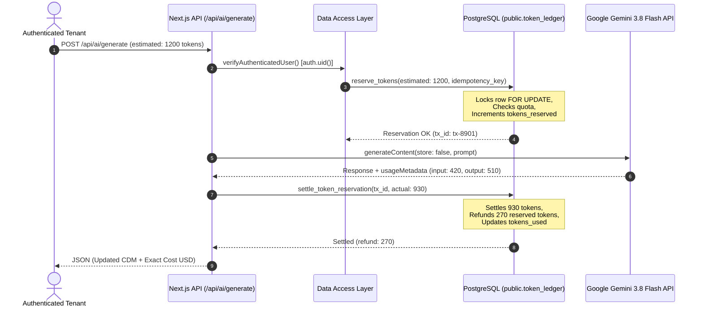

# DOCORA — Target Production System Architecture
**Document Code:** DOC-ARCH-2026-001  
**Version:** 2.0.0 (Production Target Baseline)  
**Classification:** Core System Architecture Specification  
**Status:** Approved for Implementation

---

## 1. System Topology & Architectural Philosophy

DOCORA is engineered as a high-assurance, bilingual (Arabic RTL / English LTR), AI-native document studio. Unlike conversational chatbots or unstructured block note tools, DOCORA models documents as strongly typed, schema-validated Abstract Syntax Trees via the **Canonical Document Model (CDM v1.2)**.

```
┌──────────────────────────────────────────────────────────────────────────────────────────────────┐
│                                       CLIENT TIER (BROWSER)                                      │
│   Next.js 16.4.5 • React 19.2 • Tailwind CSS v4 • Tiptap v3 • Framer Motion • Zustand           │
│   ┌───────────────────────────────┐  ┌────────────────────────────────┐  ┌─────────────────────┐ │
│   │   Unified Bilingual Shell     │  │  Virtual Paged A4 Canvas       │  │ 9-Agent Review Pane │ │
│   │   (Dir / Locale Independence) │  │  (Keep-with-next Engine)       │  │ (Inline Diffs / QA) │ │
│   └──────────────┬────────────────┘  └───────────────┬────────────────┘  └──────────┬──────────┘ │
└──────────────────┼───────────────────────────────────┼──────────────────────────────┼────────────┘
                   │                                   │                              │
                   ▼                                   ▼                              ▼
┌──────────────────────────────────────────────────────────────────────────────────────────────────┐
│                              EDGE PROXY & DEFENSE-IN-DEPTH LAYER                                 │
│   `src/proxy.ts` (SSR Session Verification & Security Headers) • Independent DAL Route Guards    │
└──────────────────────────────────────────────┬───────────────────────────────────────────────────┘
                                               │
                                               ▼
┌──────────────────────────────────────────────────────────────────────────────────────────────────┐
│                             APPLICATION & DATA ACCESS LAYER (DAL)                                │
│   ┌─────────────────────────┐  ┌─────────────────────────┐  ┌────────────────────────────────┐  │
│   │  /api/documents (CRUD)  │  │  /api/ai/generate (SDK) │  │  /api/documents/[id]/export   │  │
│   │  Optimistic Concurrency │  │  Two-Phase Token Ledger │  │  DOCX & Vector PDF Pipeline │  │
│   └────────────┬────────────┘  └────────────┬────────────┘  └───────────────┬────────────────┘  │
└────────────────┼────────────────────────────┼───────────────────────────────┼────────────────────┘
                 │                            │                               │
                 ▼                            ▼                               ▼
┌──────────────────────────────────────────────────────────────────────────────────────────────────┐
│                             PERSISTENCE & ISOLATION TIER (SUPABASE)                              │
│   PostgreSQL 15+ with Forced Row-Level Security (RLS) • Cryptographic Tenant Boundaries         │
│   ┌─────────────────────────┐  ┌─────────────────────────┐  ┌────────────────────────────────┐  │
│   │   public.documents      │  │  user_entitlements &    │  │   public.export_jobs (PGMQ)   │  │
│   │   document_cdm_versions │  │  token_ledger (Atomic)  │  │   Visibility Leases / Fencing   │  │
│   └─────────────────────────┘  └─────────────────────────┘  └───────────────┬────────────────┘  │
│                                                                             │                    │
│   Private Supabase Storage Buckets: `document-exports` • `user-uploads`     │                    │
└─────────────────────────────────────────────────────────────────────────────┼────────────────────┘
                                                                              │
                                                                              ▼
┌──────────────────────────────────────────────────────────────────────────────────────────────────┐
│                              BACKGROUND WORKER TIER (`docora-worker`)                            │
│   Isolated Node.js long-running worker polling `claim_next_export_job()` RPC                     │
│   - OOXML Compilation (`docx@9.15.2` with `<w:bidiVisual/>`)                                    │
│   - ISO 32000-1 Vector PDF Compilation (Pure binary stream / Chromium @page A4)                 │
│   - Fencing token check (`complete_export_job`) & DLQ retry management                          │
└──────────────────────────────────────────────────────────────────────────────────────────────────┘
```

---

## 2. Canonical Document Model (CDM v1.2) Specification

The Canonical Document Model is the single authoritative data structure representing documents across the entire platform. Every editor change, AI generation, and export compilation operates strictly on this AST.

### 2.1 Core Invariants
1. **Schema Versioning:** Strict `cdmVersion: "1.2.0"` discriminator.
2. **Block Types:** Strictly discriminated union of 5 core block types:
   - `HeadingBlock`: Levels 1, 2, 3 with mandatory `keepWithNext: boolean` constraint.
   - `ParagraphBlock`: Text runs with inline marks (`bold`, `italic`, `underline`, `highlight`, `code`), alignment, and directional isolation.
   - `TableBlock`: Structured 2D grid with mandatory `bidiVisual: true` on RTL tables, explicit column headers, and repeatable header rows for multi-page splits.
   - `CalloutBlock`: Distinct tones (`info`, `warning`, `legal`, `verified`) with localized titles.
   - `SignatureBlock`: Formal legal closing block with first-party and second-party labels, names, and date fields.
3. **Physical Page Setup:** Explicit paper size (`A4`), margin boundaries ($20\text{mm}$ top/bottom, $22\text{mm}$ sides), and pagination tracking.

---

## 3. Two-Phase Token Ledger & Quota Governance

To eliminate financial risk and guarantee enterprise transparency, AI operations follow strict two-phase atomic ledger semantics matching `0002_entitlements_and_token_ledger.sql`:



---

## 4. Multi-Tenant Security & Defense-in-Depth

Security follows a zero-trust model where authorization is never delegated to a single tier:
1. **Tier 1 (Proxy):** `src/proxy.ts` verifies session cookies (`docora_session` or Supabase JWT), redirecting unauthenticated requests to `/sign-in`.
2. **Tier 2 (DAL):** Every Route Handler and Server Action independently calls `verifyAuthenticatedUser()`, retrieving user identity strictly from validated session context. Caller-controlled headers (`x-docora-test-user`) are rejected.
3. **Tier 3 (Database RLS):** All tables have Row-Level Security enabled and forced (`ALTER TABLE ... FORCE ROW LEVEL SECURITY`). Policies restrict operations via `(SELECT auth.uid()) = owner_id`.

---

## 5. Export Pipeline & Fidelity Guarantee

Export operations are decoupled from short-lived HTTP handlers:
1. **DOCX Generation:** Compiles via `docx@9.15.2`. For Arabic documents, applies `visuallyRightToLeft: true` on tables and `bidirectional: true` on paragraphs, guaranteeing correct RTL rendering in Microsoft Word.
2. **Vector PDF Generation:** Compiles ISO 32000-1 binary vector streams with physical A4 dimensions ($595.28 \times 841.89\text{ pt}$), running headers/footers, and page-break dividers.
3. **Storage Delivery:** Completed files are stored in private storage and downloaded via authenticated endpoints.
