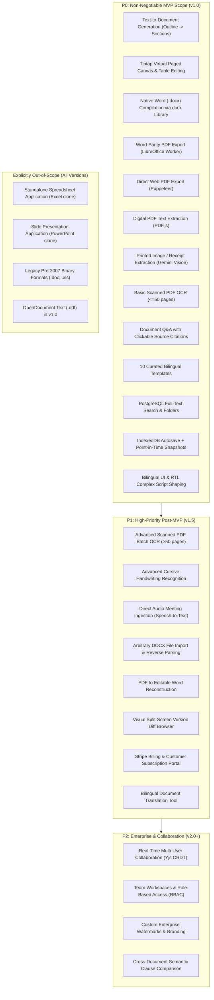

# 02 — Updated MVP Scope & Feature Prioritization
## Project: DOCORA — AI Document Studio
**Phase:** 00.1 — Master Architecture Validation & Blueprint Remediation  
**Status:** Reconciled & Scope-Locked Specification  

---

## 1. Scope Reconciliation & Boundary Rules

The initial Phase 00 blueprint contained several conflicting classifications between the PRD, feature prioritization, and roadmap. This document formally locks the feature boundaries for **MVP (v1.0)**, **Post-MVP (v1.5)**, and **Future Enterprise (v2.0+)**.

### Guiding Principles for MVP Scoping:
1. **No Phantom Capabilities**: If a feature is marked P0, it must have a concrete implementation phase, an assigned architectural subsystem, and automated test criteria.
2. **Text-First Meeting Notes**: The platform generates meeting minutes from typed text notes, bullet points, or pasted audio transcripts. Direct audio file ingestion (Whisper / Audio API) is deferred to P1.
3. **Unidirectional Word Authoring**: MVP focuses on high-fidelity **Text/Prompt/Template -> Editable Canvas -> DOCX Export**. Reverse-engineering arbitrary third-party `.docx` files back into editable web state is a complex AST reconstruction task deferred to P1.
4. **Focused Template Catalog**: MVP launches with **10 curated, production-grade bilingual templates**, rather than an unverified promise of 20+ templates.

---

## 2. Reconciled Feature Prioritization Matrix

---

## 3. Detailed P0 Feature Implementation Specifications

Every P0 feature is mapped to its engineering phase, technical owner, dependencies, and measurable acceptance criteria:

### 3.1 Core Generation & Authoring (P0)
- **Feature**: Natural Language Prompt to Document via Staged Pipeline.
- **Phase**: Phase 05 (AI Generation Pipeline).
- **Subsystem**: `AI Orchestrator / Prompt Engine`.
- **Dependencies**: CDM Schema (Phase 03), Gemini Adapter (Phase 05).
- **Acceptance Criteria**: 
  - Decomposes prompt into Outline Schema within 2,500ms.
  - Streams completed sections to client via Server-Sent Events (SSE).
  - Produces valid CDM JSON validated by Zod with 0 schema violations.

### 3.2 Professional Virtual Paged Canvas (P0)
- **Feature**: Rich-text editing with virtual A4 sheet containers, table manipulation, and image insertion.
- **Phase**: Phase 04 (Virtual Canvas & Editor).
- **Subsystem**: `Editor Client (Tiptap / ProseMirror)`.
- **Dependencies**: Next.js Shell (Phase 01), CDM Bridge (Phase 04).
- **Acceptance Criteria**:
  - Typing input latency (INP) remains under 50ms for documents up to 50 pages.
  - Users can insert, delete, and resize table columns without layout snapping.
  - Paragraph direction toggles smoothly between RTL and LTR based on script detection.

### 3.3 Native Word (`.docx`) Export (P0)
- **Feature**: Exporting document to valid Microsoft Office Open XML (`.docx`).
- **Phase**: Phase 03 (Document Engine).
- **Subsystem**: `DOCX Compiler (docx npm library)`.
- **Dependencies**: CDM Schema v1.1.0 (Phase 03).
- **Acceptance Criteria**:
  - Generated `.docx` passes `xmllint` schema validation.
  - Opens in Microsoft Word 2016+ with zero recovery/repair warnings.
  - Arabic paragraphs carry `<w:bidi/>` and complex script font declarations (`Amiri`).

### 3.4 Dual-Track PDF Export (P0)
- **Feature**: Instant web PDF export + Word-parity PDF conversion.
- **Phase**: Phase 03 (Document Engine) & Phase 10 (Worker Infrastructure).
- **Subsystem**: `Conversion Worker (Chromium + LibreOffice)`.
- **Dependencies**: Docker Worker, Supabase PGMQ (Phase 03/10).
- **Acceptance Criteria**:
  - Web PDF generates within 2,000ms for a 10-page document.
  - LibreOffice PDF matches DOCX page count and heading positions with >=95% visual similarity.

### 3.5 Digital PDF & Basic Printed Image Extraction (P0)
- **Feature**: Ingestion of digital PDFs and smartphone photos of printed documents/receipts.
- **Phase**: Phase 06 (File Intelligence).
- **Subsystem**: `Extraction Pipeline (PDF.js + Gemini Vision)`.
- **Dependencies**: Supabase Storage (`raw-uploads` bucket), Gemini Adapter.
- **Acceptance Criteria**:
  - Native digital PDFs extract text and geometry in <1,500ms with zero LLM cost.
  - Printed invoices extract tabular rows into editable CDM tables with >95% character accuracy.

### 3.6 Grounded Document Q&A with Citations (P0)
- **Feature**: Asking questions over uploaded PDFs with interactive citation badges.
- **Phase**: Phase 06 (File Intelligence).
- **Subsystem**: `Citation Engine & PDF.js Viewer`.
- **Dependencies**: `document_sources`, `document_source_snippets` tables.
- **Acceptance Criteria**:
  - 100% of factual assertions cite a valid `source_id` and `page_number`.
  - Clicking a citation badge scrolls the PDF viewer to the referenced page and renders an amber bounding box over the source passage.

### 3.7 Curated Bilingual Template Engine (P0)
- **Feature**: 10 curated bilingual templates with variable placeholder hydration.
- **Phase**: Phase 07 (Templates & Library).
- **Subsystem**: `Template Engine`.
- **Dependencies**: CDM Schema v1.1.0, Studio Editor.
- **The 10 MVP Templates**:
  1. *Executive Business Proposal (Bilingual Ar/En)*
  2. *Standard Employment Agreement (Saudi / UAE Labor Law Compliant)*
  3. *Non-Disclosure Agreement (Mutual NDA - Bilingual)*
  4. *Board Meeting Minutes & Action Items Table*
  5. *Academic Literature Review & Research Abstract*
  6. *Technical Architecture Specification (SAD)*
  7. *Official Administrative Memorandum*
  8. *Consulting Advisory Report*
  9. *Standard Operating Procedure (SOP) Manual*
  10. *Commercial Services Invoice & Deliverables Summary*
- **Acceptance Criteria**: Variable substitution (`{{client_name}}`, `{{effective_date}}`) hydratable via guided modal in <15 seconds.

### 3.8 Searchable Document Library & File Management (P0)
- **Feature**: Grid/list view, folder hierarchy, PostgreSQL full-text search, favorites, and trash.
- **Phase**: Phase 07 (Templates & Library).
- **Subsystem**: `Library Manager & Supabase DB`.
- **Dependencies**: Supabase Database Schemas (Phase 02).
- **Acceptance Criteria**: Full-text search returns matching documents across 1,000 records in <150ms.

### 3.9 Autosave & Point-in-Time Version Checkpoints (P0)
- **Feature**: Local keystroke buffer in IndexedDB + debounced cloud persistence every 2000ms.
- **Phase**: Phase 04 (Virtual Canvas & Editor).
- **Subsystem**: `State Synchronization Engine`.
- **Dependencies**: Supabase Database, IndexedDB.
- **Acceptance Criteria**: Zero data loss on sudden browser crash or network disconnection; restoring connection synchronizes state within 1,000ms.
