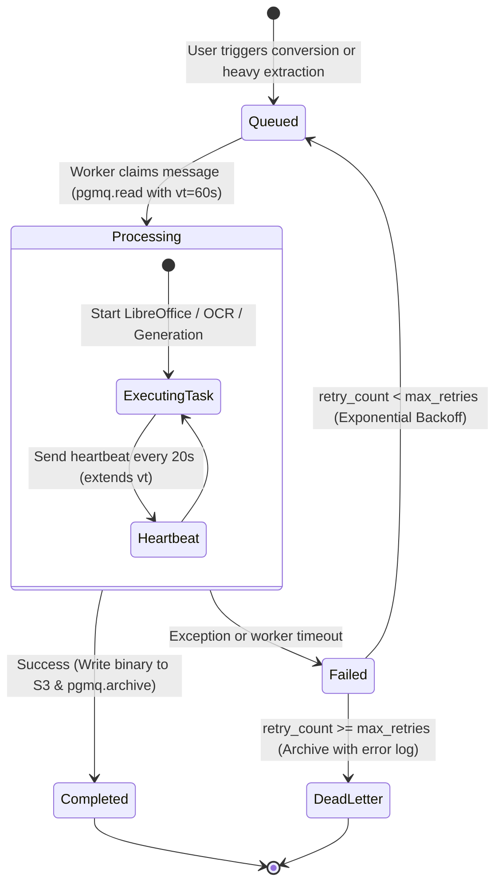
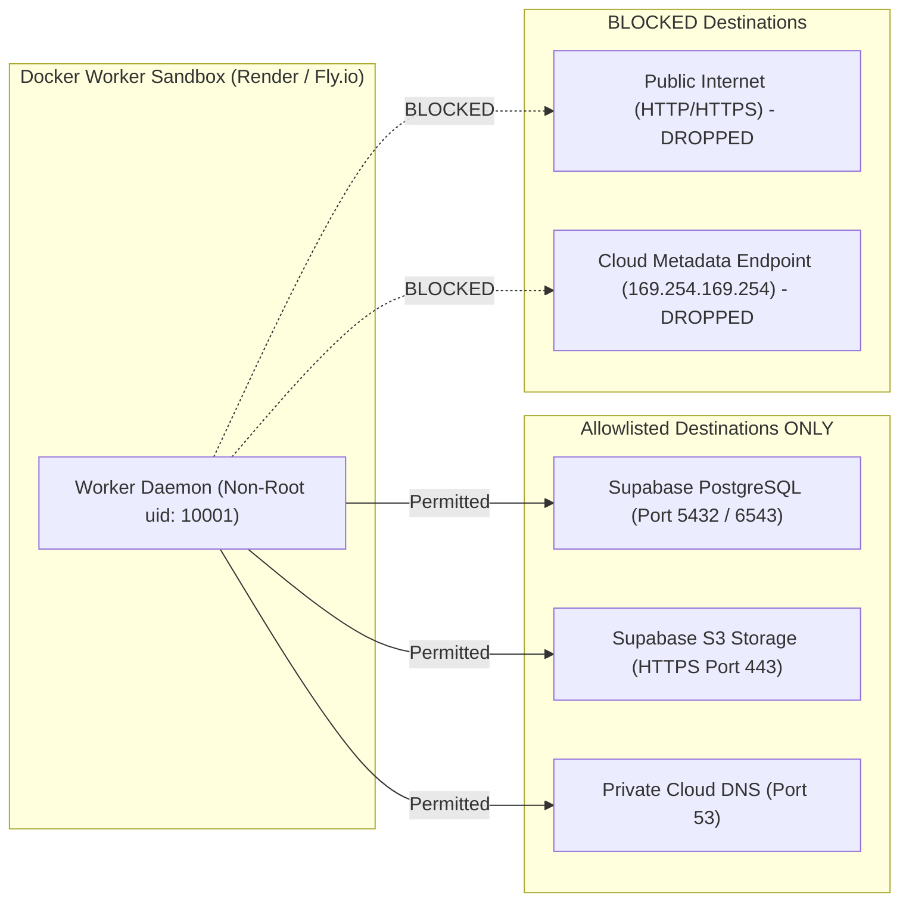

# 03 — Updated System Architecture & Asynchronous Topology
## Project: DOCORA — AI Document Studio
**Phase:** 00.1 — Master Architecture Validation & Blueprint Remediation  
**Status:** Remediated System Topology & Queue Specification  

---

## 1. Multi-Plane System Topology

The architecture separates user-interactive operations from compute-intensive document conversions across five decoupled planes:

```mermaid
flowchart TB
    subgraph ClientPlane ["1. Client Presentation Plane (Browser)"]
        UI["Studio Web Shell (Next.js 15+ / Tailwind v4)"]
        Canvas["Virtual Paged Canvas (Tiptap v2 Core)"]
        PDFViewer["Mozilla PDF.js Citation Viewer"]
        State["State Manager (Zustand + TanStack Query)"]
        IDB["Offline Storage (IndexedDB idb-keyval)"]
        
        UI <--> Canvas
        UI <--> PDFViewer
        Canvas <--> State
        State <--> IDB
    end

    subgraph EdgePlane ["2. Edge & Serverless API Plane (Vercel)"]
        Middleware["Security & RTL Direction Middleware"]
        ServerActions["Next.js Server Actions (RPC Mutations)"]
        SSEStream["Streaming Route Handlers (Server-Sent Events)"]
        ZodGuard["Zod Runtime Schema Guard"]
        
        Middleware --> ServerActions
        Middleware --> SSEStream
        ServerActions --> ZodGuard
        SSEStream --> ZodGuard
    end

    subgraph DataPlane ["3. Data, Storage & Queue Plane (Supabase)"]
        Auth["Supabase Auth (JWT, OAuth2, Magic Links)"]
        PostgresDB[("PostgreSQL 16 DB (RLS, JSONB AST, Full-Text GIN)")]
        PGMQ["Supabase Queues (pgmq Extension)"]
        S3Storage[("Private S3 Buckets (raw-uploads, document-assets, generated-exports)")]
        Realtime["Supabase Realtime (WebSocket Notification Hub)"]
        
        Auth --> PostgresDB
        PostgresDB <--> PGMQ
        PostgresDB <--> S3Storage
    end

    subgraph AIPlane ["4. AI Orchestration Plane"]
        AIGateway["AI Gateway & Capability Router"]
        ModelRegistry["Capability-Based Model Registry"]
        GeminiPrimary["Google Gemini (2.5 Pro / Flash / 3.8 Flash)"]
        SecondaryAI["Anthropic Claude / OpenAI (Adapter Fallback)"]
        
        AIGateway --> ModelRegistry
        ModelRegistry --> GeminiPrimary
        ModelRegistry -.-> SecondaryAI
    end

    subgraph WorkerPlane ["5. Asynchronous Worker Plane (Docker / Render)"]
        WorkerDaemon["Worker Process Pool (Node.js 24)"]
        LibreOffice["LibreOffice 24 Headless Daemon"]
        ChromiumEngine["Headless Chromium (Puppeteer)"]
        DocxEngine["Native docx OOXML Engine"]
        
        WorkerDaemon --> LibreOffice
        WorkerDaemon --> ChromiumEngine
        WorkerDaemon --> DocxEngine
    end

    ClientPlane <==> |HTTPS / TLS 1.3| EdgePlane
    ClientPlane <==> |Secure WebSockets| Realtime
    EdgePlane <==> |Server-Side Supabase Client (Service Role)| PostgresDB
    EdgePlane ==> |Enqueue Tasks via SQL| PGMQ
    EdgePlane <==> |gRPC / HTTPS| AIPlane
    
    WorkerDaemon <==> |Poll & Ack Messages| PGMQ
    WorkerDaemon <==> |Fetch Uploads & Write Exports| S3Storage
    WorkerDaemon ==> |Broadcast Job Progress via Realtime| PostgresDB
```

---

## 2. Asynchronous Queue Architecture: Supabase PGMQ

### 2.1 Why Supabase PGMQ Was Selected over Redis BullMQ
1. **Zero Additional Infrastructure**: Runs natively inside the existing PostgreSQL 16 database via the `pgmq` extension. Eliminates the need to provision, secure, and monitor a separate Redis cluster.
2. **Transactional Enqueueing**: Jobs can be enqueued inside the same database transaction that updates document metadata, guaranteeing that a job is never orphaned if a transaction rolls back.
3. **Auditability & Replayability**: `pgmq` supports built-in archiving (`pgmq.archive()`), allowing historical analysis of failed or completed jobs directly with SQL queries.

### 2.2 Complete Job Lifecycle State Machine



### 2.3 Job Execution Protocols
- **Message Claim & Lease**:
  A worker claims jobs using a 60-second visibility timeout (`vt`):
  ```sql
  SELECT * FROM pgmq.read('docora_jobs', 60, 1);
  ```
- **Worker Heartbeats**:
  For long-running tasks (e.g., converting a 50-page document), the worker daemon sends a heartbeat every 20 seconds using `pgmq.set_vt()` to extend visibility by another 60 seconds, preventing duplicate consumer processing.
- **Idempotency Safeguards**:
  Every job payload includes an `idempotency_key` (SHA-256 hash of `user_id + document_id + version_number + job_type`). The worker verifies this key against `generation_jobs` before executing.
- **Crash Recovery & Dead-Letter Handling**:
  If a worker container crashes (OOM or node eviction), its visibility timeout expires after 60 seconds. Another worker picks up the message. If the message fails 3 times (`retry_count >= 3`), it is moved to the dead-letter archive table (`pgmq.a_docora_jobs`), and a failure alert is sent to the user via Supabase Realtime.

---

## 3. Network Egress Security & Worker Boundaries

### Resolution of Previous Contradiction
The Phase 00 blueprint claimed that the worker container had "completely disabled network egress," while simultaneously stating that it fetched files from S3 and sent progress events to the database. This was an unworkable contradiction.

### Remediated Allowlisted Network Egress Policy:
The Docker worker executes in a hardened private network environment governed by strict firewall rules:



1. **Explicit Allowlist**: Outbound traffic is restricted strictly to the verified Supabase project domain (`*.supabase.co`) and S3 storage endpoints over TLS 1.3.
2. **Blocked Destinations**: All arbitrary outbound internet connections (HTTP/HTTPS to third-party IPs) and cloud instance metadata services (`169.254.169.254`) are dropped by iptables/network security policies. This neutralizes Server-Side Request Forgery (SSRF) and data exfiltration attacks if a malicious document compromises LibreOffice.
3. **Filesystem Isolation**: The container root filesystem is mounted as read-only (`read_only: true`). Temporary conversion files are written to an ephemeral `tmpfs` RAM disk mounted at `/tmp` (limited to 512MB), which is wiped clean upon job termination.
