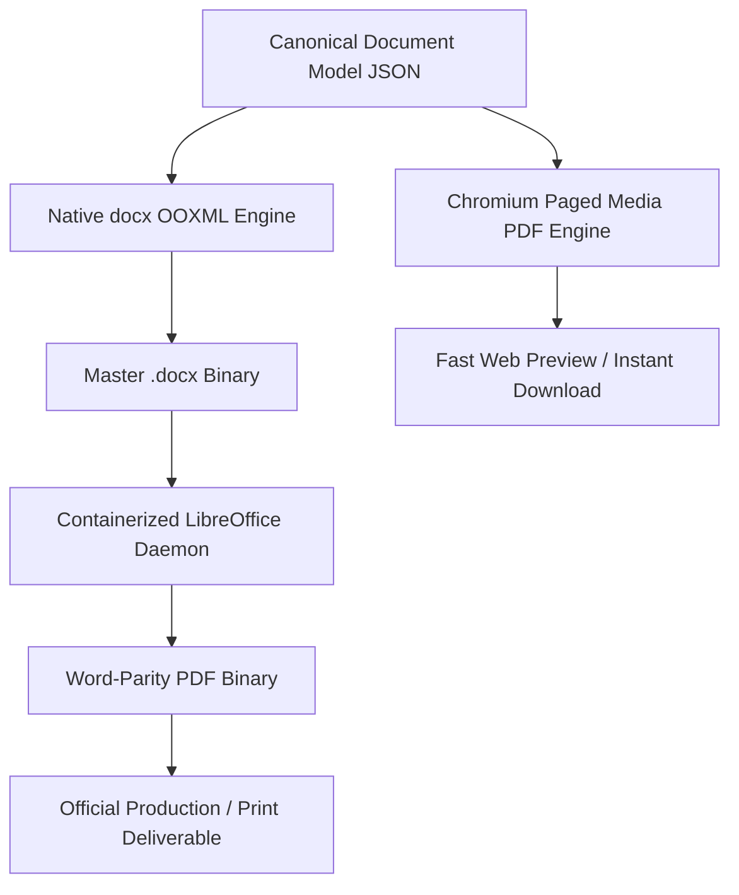

# 04 — Updated Document Engine & Canonical Data Model
## Project: DOCORA — AI Document Studio
**Phase:** 00.1 — Master Architecture Validation & Blueprint Remediation  
**Status:** Remediated Schema & Document Engine Specification  

---

## 1. Single Source of Truth & Synchronization Architecture

The central architectural dilemma of web document studios is the boundary between the web rich-text editor and the persisted document state.

```mermaid
graph TD
    UserKeystroke[User Keystroke / Edit] --> TiptapDOM[Tiptap ProseMirror State (Ephemeral Presentation)]
    TiptapDOM -->|Debounced 2000ms Compiler| CDMState[Canonical Document Model JSON v1.1.0 (AUTHORITATIVE STATE)]
    
    CDMState -->|Validated by Zod| PostgresJSONB[PostgreSQL JSONB Storage]
    
    AIEngine[AI Generation / Scoped Edit] -->|Structured Output| CDMValidator[Zod CDM Schema Validator]
    CDMValidator --> CDMState
    
    CDMState -->|OOXML AST Compiler| DocxEngine[Native docx Compiler -> .docx]
    CDMState -->|Paged HTML Compiler| ChromiumPDF[Chromium PDF Engine -> .pdf]
    DocxEngine --> LibreOfficeWorker[LibreOffice Conversion Worker -> .pdf]
    
    CDMState -->|Hydrate Canvas| TiptapDOM
```

### Architectural Axioms:
1. **The Canonical Document Model (CDM) is the sole authoritative document representation**. It is versioned, strictly typed, and persisted in PostgreSQL JSONB.
2. **Tiptap ProseMirror state is an ephemeral client projection**. It exists solely during an active browser session to handle user typing, selection carets, and DOM event dispatching.
3. **Deterministic Synchronization**:
   - `cdmToProseMirror(cdmDoc: CanonicalDocument): ProseMirrorJSON`: Hydrates the editor canvas when opening a document.
   - `proseMirrorToCdm(pmDoc: ProseMirrorJSON, baseCdm: CanonicalDocument): CanonicalDocument`: Serializes the editor state back into CDM, preserving immutable node UUIDs and top-level document metadata.
4. **Export Independence**: Export engines (`docx` compiler and Chromium/LibreOffice PDF workers) compile strictly from the CDM, never from raw browser HTML strings.

---

## 2. Canonical Document Model (CDM v1.1.0) Specification

The CDM schema eliminates loose, untyped `attributes` maps in favor of **explicit discriminated unions** in TypeScript and Zod.

### 2.1 Multi-Section Architecture (Mixed Portrait & Landscape)
Documents can contain multiple sections. Each section defines its own orientation, margins, headers, and footers:

```typescript
export interface PageSection {
  id: string; // Section UUID
  paper_size: 'A4' | 'LETTER' | 'LEGAL';
  orientation: 'portrait' | 'landscape';
  margins: {
    top_mm: number;    // Default: 25.4
    bottom_mm: number; // Default: 25.4
    left_mm: number;   // Default: 25.4
    right_mm: number;  // Default: 25.4
  };
  header?: {
    enabled: boolean;
    first_page_different?: boolean;
    blocks: BlockNode[];
  };
  footer?: {
    enabled: boolean;
    show_page_numbers: boolean;
    number_format: 'PAGE_X' | 'PAGE_X_OF_Y';
    alignment: 'left' | 'center' | 'right';
  };
  content: BlockNode[];
}
```

---

### 2.2 Discriminated Union of Block Nodes

```typescript
export type BlockNode =
  | ParagraphBlock
  | HeadingBlock
  | TableBlock
  | BulletListBlock
  | OrderedListBlock
  | ImageBlock
  | CalloutBlock
  | PageBreakBlock
  | DividerBlock;

// 1. Paragraph Block
export interface ParagraphBlock {
  type: 'paragraph';
  id: string; // Deterministic UUID for scoped AI mutations
  direction?: 'rtl' | 'ltr' | 'auto';
  align?: 'left' | 'center' | 'right' | 'justify';
  line_spacing?: number; // e.g. 1.15, 1.35, 1.5
  space_after_pt?: number;
  runs: TextRun[];
}

// 2. Heading Block
export interface HeadingBlock {
  type: 'heading';
  id: string;
  level: 1 | 2 | 3 | 4 | 5 | 6;
  direction?: 'rtl' | 'ltr' | 'auto';
  align?: 'left' | 'center' | 'right';
  runs: TextRun[];
}

// 3. Table Block (with explicit cell merging & column widths)
export interface TableBlock {
  type: 'table';
  id: string;
  columns: { width_percent: number }[];
  has_header_row: boolean;
  rows: TableRow[];
}

export interface TableRow {
  id: string;
  is_header?: boolean;
  cells: TableCell[];
}

export interface TableCell {
  id: string;
  col_span?: number; // Translates to gridSpan in OOXML
  row_span?: number; // Translates to vMerge in OOXML
  background_color?: string; // Hex color (e.g. #F8FAFC)
  content: BlockNode[]; // Supports rich blocks inside cells
}

// 4. List Blocks
export interface BulletListBlock {
  type: 'bullet_list';
  id: string;
  items: ListItemBlock[];
}

export interface OrderedListBlock {
  type: 'ordered_list';
  id: string;
  start_index?: number;
  number_style?: 'decimal' | 'arabic_indic' | 'lower_alpha' | 'roman';
  items: ListItemBlock[];
}

export interface ListItemBlock {
  id: string;
  content: BlockNode[];
}

// 5. Image Block
export interface ImageBlock {
  type: 'image';
  id: string;
  url: string; // Storage URL or asset key
  caption?: string;
  alt_text?: string;
  width_percent: number; // 25 to 100%
  alignment: 'left' | 'center' | 'right';
  original_dimensions?: { width_px: number; height_px: number };
}

// 6. Callout Block
export interface CalloutBlock {
  type: 'callout';
  id: string;
  variant: 'info' | 'warning' | 'tip' | 'success';
  direction?: 'rtl' | 'ltr' | 'auto';
  content: BlockNode[];
}

// 7. Structural Breaks
export interface PageBreakBlock {
  type: 'page_break';
  id: string;
}

export interface DividerBlock {
  type: 'divider';
  id: string;
}
```

---

### 2.3 Text Runs, Formatting Marks & Footnotes

```typescript
export interface TextRun {
  text: string;
  bold?: boolean;
  italic?: boolean;
  underline?: boolean;
  strike?: boolean;
  color?: string; // Hex color
  highlight?: string;
  link_url?: string;
  direction?: 'rtl' | 'ltr' | 'auto';
  footnote_id?: string; // References Footnote entry
  source_citation_id?: string; // References SourceReference entry
}

export interface Footnote {
  id: string;
  number: number;
  content: TextRun[];
}

export interface SourceReference {
  id: string;
  source_id: string; // Foreign key to document_sources
  page_number: number;
  bounding_box?: [number, number, number, number]; // [top, left, width, height]
  excerpt: string;
}
```

---

## 3. Realistic Document Fidelity Architecture

### 3.1 Removal of Absolute "100% Parity" Claims
The previous blueprint claimed "100% bit-for-bit Word parity" between DOCX and PDF. In professional document engineering, **no such guarantee exists across independent layout engines**:
- Microsoft Word, Chromium (Blink), and LibreOffice use distinct font rasterizers (DirectWrite vs. FreeType), different hyphenation dictionaries, and subtle line-breaking heuristics.
- Tables with dynamic cell wrapping will occasionally wrap words on slightly different characters between Word and Web PDF.

### 3.2 The Realistic Fidelity Framework



#### Defined Fidelity Benchmarks:
1. **Structural Completeness**: **100%**. Every heading, paragraph, table row, list item, and footnote present in CDM must exist in both DOCX and PDF outputs.
2. **Hierarchical Consistency**: **100%**. Heading levels (H1–H6), table cell spans (`col_span`, `row_span`), and list indentation depth are strictly preserved.
3. **Visual Layout Similarity Target**: **>= 95%**. Verified using Playwright automated visual diffing against rendered baseline PDFs with metric-compatible fonts installed.

---

## 4. Virtual Pagination & Canvas Layout Reality

### Why Fixed-Height JavaScript Page Boundaries Fail:
A naive approach divides DOM scroll height by `1123px` (A4 height at 96 DPI) to inject artificial page breaks. This fails catastrophically because:
1. **Table Rows**: A table row crossing a fixed boundary will be sliced in half visually.
2. **Headings (Orphans)**: An H2 heading placed at the bottom 40px of a page is stranded without trailing body text.
3. **Dynamic Font Scaling**: User zoom or font-size adjustments cause content to reflow unpredictably.

### The Remediated Virtual Canvas Architecture:
The Virtual Canvas implements a **CSS Paged Container with Layout Boundary Rules**:
1. **Visual Sheet Units**: Content is rendered inside a centered sheet container (`794px × 1123px` for A4 portrait) with margin guide overlays (`25.4mm`).
2. **CSS Break Rules**:
   - `break-inside: avoid;` applied to all table rows, images, and callouts.
   - `break-after: avoid;` applied to all heading levels (H1–H4), ensuring headings never separate from their first paragraph.
   - `orphans: 2; widows: 2;` enforced on standard body paragraphs.
3. **Dynamic Page Break Gutter**: An asynchronous `ResizeObserver` monitors block node client boundaries. When a block node exceeds the printable area height, the editor injects an interactive, non-destructive page-break gutter without breaking the underlying text tree.
4. **Authoritative Pagination Deferred to Export**: The final physical page boundaries (exact page numbering `Page X of Y`, balance margins, and footnote placement) are computed authoritatively by the `docx` engine during Word compilation and by LibreOffice during PDF conversion.
