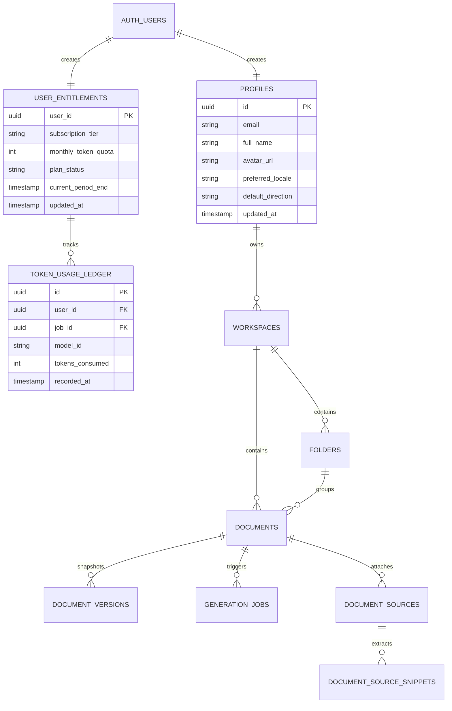

# 05 — Updated Database Architecture & Security Remediation
## Project: DOCORA — AI Document Studio
**Phase:** 00.1 — Master Architecture Validation & Blueprint Remediation  
**Status:** Hardened Relational Schema & Security Specification  

---

## 1. Critical Security Remediation: Privilege Escalation Fix

### 1.1 The Vulnerability in Phase 00 Schema
In the Phase 00 blueprint, `profiles` contained both user information and billing entitlements:
```sql
-- FLAWED PHASE 00 SCHEMA: Critical Privilege Escalation Vulnerability
CREATE TABLE profiles (
  id UUID PRIMARY KEY REFERENCES auth.users(id),
  full_name TEXT,
  subscription_tier TEXT DEFAULT 'free', -- CRITICAL FLAW
  monthly_token_quota INTEGER DEFAULT 250000, -- CRITICAL FLAW
  tokens_used_this_cycle INTEGER DEFAULT 0
);

-- Flawed RLS policy permitted users to UPDATE the entire row:
CREATE POLICY "Users can update own profile" ON profiles
FOR UPDATE USING (auth.uid() = id) WITH CHECK (auth.uid() = id);
```
**Exploit Path**: Any logged-in user could issue an authenticated REST request updating their own row: `PATCH /rest/v1/profiles { "subscription_tier": "enterprise", "monthly_token_quota": 999999999 }`. Because `auth.uid() = id` evaluates to true, PostgreSQL granted the update, elevating the free user to an unlimited enterprise quota without payment.

---

### 1.2 Remediated Architecture: Separation of Profiles & Entitlements

The schema decomposes user state into **two isolated entities** with distinct security contexts:



1. **`profiles` (User-Editable)**: Contains only benign, presentation-layer fields (`full_name`, `avatar_url`, `preferred_locale`, `default_direction`). Users can update these freely.
2. **`user_entitlements` (Server-Managed Only)**: Contains subscription tier, monthly token quotas, and active billing status. **Users can only SELECT their own entitlements; all INSERT, UPDATE, and DELETE operations are strictly prohibited to users and restricted exclusively to `service_role` (webhooks and server actions)**.
3. **`token_usage_ledger` (Append-Only Accounting)**: Every AI generation event logs an immutable ledger record, guaranteeing auditability and preventing race-condition quota tampering.

---

## 2. Hardened Relational Schema Specifications

### 2.1 Table: `profiles`
```sql
CREATE TABLE public.profiles (
  id UUID PRIMARY KEY REFERENCES auth.users(id) ON DELETE CASCADE,
  email TEXT NOT NULL UNIQUE,
  full_name TEXT,
  avatar_url TEXT,
  preferred_locale TEXT NOT NULL DEFAULT 'en' CHECK (preferred_locale IN ('en', 'ar')),
  default_direction TEXT NOT NULL DEFAULT 'ltr' CHECK (default_direction IN ('ltr', 'rtl')),
  created_at TIMESTAMPTZ NOT NULL DEFAULT NOW(),
  updated_at TIMESTAMPTZ NOT NULL DEFAULT NOW()
);

ALTER TABLE public.profiles ENABLE ROW LEVEL SECURITY;

CREATE POLICY "Users can view own profile" 
ON public.profiles FOR SELECT USING (auth.uid() = id);

CREATE POLICY "Users can update own profile" 
ON public.profiles FOR UPDATE USING (auth.uid() = id) WITH CHECK (auth.uid() = id);
```

### 2.2 Table: `user_entitlements` (Privilege Secured)
```sql
CREATE TABLE public.user_entitlements (
  user_id UUID PRIMARY KEY REFERENCES auth.users(id) ON DELETE CASCADE,
  subscription_tier TEXT NOT NULL DEFAULT 'free' CHECK (subscription_tier IN ('free', 'pro', 'enterprise')),
  monthly_token_quota INTEGER NOT NULL DEFAULT 250000,
  plan_status TEXT NOT NULL DEFAULT 'active' CHECK (plan_status IN ('active', 'past_due', 'canceled', 'trialing')),
  current_period_end TIMESTAMPTZ NOT NULL DEFAULT (NOW() + INTERVAL '30 days'),
  created_at TIMESTAMPTZ NOT NULL DEFAULT NOW(),
  updated_at TIMESTAMPTZ NOT NULL DEFAULT NOW()
);

ALTER TABLE public.user_entitlements ENABLE ROW LEVEL SECURITY;

-- Users can read their own quota and plan status:
CREATE POLICY "Users can view own entitlements" 
ON public.user_entitlements FOR SELECT USING (auth.uid() = user_id);

-- ZERO user write policies. Only service_role can modify quotas.
```

### 2.3 Table: `token_usage_ledger` (Atomic Quota Accounting)
```sql
CREATE TABLE public.token_usage_ledger (
  id UUID PRIMARY KEY DEFAULT gen_random_uuid(),
  user_id UUID NOT NULL REFERENCES auth.users(id) ON DELETE CASCADE,
  job_id UUID REFERENCES public.generation_jobs(id) ON DELETE SET NULL,
  model_id TEXT NOT NULL,
  tokens_consumed INTEGER NOT NULL CHECK (tokens_consumed >= 0),
  recorded_at TIMESTAMPTZ NOT NULL DEFAULT NOW()
);

ALTER TABLE public.token_usage_ledger ENABLE ROW LEVEL SECURITY;

CREATE POLICY "Users can view own usage ledger" 
ON public.token_usage_ledger FOR SELECT USING (auth.uid() = user_id);

-- Atomic stored procedure for deducting tokens and verifying quota
CREATE OR REPLACE FUNCTION public.check_and_deduct_tokens(
  p_user_id UUID,
  p_tokens_requested INTEGER,
  p_job_id UUID,
  p_model_id TEXT
) RETURNS BOOLEAN AS $$
DECLARE
  v_quota INTEGER;
  v_used INTEGER;
BEGIN
  -- Lock the entitlement row for update to prevent concurrent race conditions
  SELECT monthly_token_quota INTO v_quota
  FROM public.user_entitlements
  WHERE user_id = p_user_id FOR UPDATE;

  -- Calculate tokens used in current billing cycle
  SELECT COALESCE(SUM(tokens_consumed), 0) INTO v_used
  FROM public.token_usage_ledger
  WHERE user_id = p_user_id AND recorded_at >= (NOW() - INTERVAL '30 days');

  IF (v_used + p_tokens_requested) > v_quota THEN
    RETURN FALSE; -- Quota exceeded
  END IF;

  -- Record usage
  INSERT INTO public.token_usage_ledger(user_id, job_id, model_id, tokens_consumed)
  VALUES (p_user_id, p_job_id, p_model_id, p_tokens_requested);

  RETURN TRUE;
END;
$$ LANGUAGE plpgsql SECURITY DEFINER;
```

---

### 2.4 Hierarchical Consistency: Workspace & Folder Integrity

To prevent a user from injecting a `folder_id` that belongs to another workspace or user, the schema enforces **composite foreign keys and check constraints**:

```sql
CREATE TABLE public.workspaces (
  id UUID PRIMARY KEY DEFAULT gen_random_uuid(),
  owner_id UUID NOT NULL REFERENCES public.profiles(id) ON DELETE CASCADE,
  name TEXT NOT NULL,
  is_personal BOOLEAN NOT NULL DEFAULT TRUE,
  created_at TIMESTAMPTZ NOT NULL DEFAULT NOW()
);

ALTER TABLE public.workspaces ENABLE ROW LEVEL SECURITY;
CREATE POLICY "Users can manage own workspaces" 
ON public.workspaces FOR ALL USING (auth.uid() = owner_id);

CREATE TABLE public.folders (
  id UUID PRIMARY KEY DEFAULT gen_random_uuid(),
  workspace_id UUID NOT NULL REFERENCES public.workspaces(id) ON DELETE CASCADE,
  parent_folder_id UUID REFERENCES public.folders(id) ON DELETE CASCADE,
  name TEXT NOT NULL,
  color_hex TEXT DEFAULT '#4F46E5',
  created_at TIMESTAMPTZ NOT NULL DEFAULT NOW(),
  CONSTRAINT uq_folder_workspace UNIQUE (id, workspace_id)
);

ALTER TABLE public.folders ENABLE ROW LEVEL SECURITY;
CREATE POLICY "Users can manage folders in own workspace" 
ON public.folders FOR ALL 
USING (workspace_id IN (SELECT id FROM public.workspaces WHERE owner_id = auth.uid()));

CREATE TABLE public.documents (
  id UUID PRIMARY KEY DEFAULT gen_random_uuid(),
  workspace_id UUID NOT NULL REFERENCES public.workspaces(id) ON DELETE CASCADE,
  folder_id UUID,
  user_id UUID NOT NULL REFERENCES public.profiles(id) ON DELETE CASCADE,
  title TEXT NOT NULL DEFAULT 'Untitled Document',
  content_cdm JSONB NOT NULL DEFAULT '{"cdm_version":"1.1.0","sections":[]}'::jsonb,
  is_favorite BOOLEAN NOT NULL DEFAULT FALSE,
  is_trashed BOOLEAN NOT NULL DEFAULT FALSE,
  trashed_at TIMESTAMPTZ,
  created_at TIMESTAMPTZ NOT NULL DEFAULT NOW(),
  updated_at TIMESTAMPTZ NOT NULL DEFAULT NOW(),
  -- Guarantees folder belongs to the identical workspace
  CONSTRAINT fk_document_folder FOREIGN KEY (folder_id, workspace_id) 
    REFERENCES public.folders(id, workspace_id) ON DELETE SET NULL
);

ALTER TABLE public.documents ENABLE ROW LEVEL SECURITY;
CREATE POLICY "Users can manage own documents" 
ON public.documents FOR ALL USING (auth.uid() = user_id);
```

---

## 3. Storage Security & Native Signed URLs

### 3.1 Clarification on Custom HMAC vs. Supabase Storage
The Phase 00 blueprint mentioned implementing a "custom HMAC authorization layer" for S3 files. This was redundant: **Supabase Storage provides built-in private buckets and HMAC-SHA256 signed URL generation (`storage.from().createSignedUrl()`)**.

### 3.2 Private Bucket Architecture & Storage RLS
Three strictly private buckets are provisioned:
1. `raw-uploads`: User-uploaded PDFs, scans, and images awaiting extraction.
2. `document-assets`: Embedded images inside active documents.
3. `generated-exports`: Output `.docx` and `.pdf` files.

#### Object Path Convention & Storage Policy:
All objects are stored with the path prefix `{user_id}/{document_id}/{filename}`:

```sql
-- Storage RLS: Users can only upload and download objects inside their own folder
CREATE POLICY "Users can access own raw-uploads"
ON storage.objects FOR ALL
USING (bucket_id = 'raw-uploads' AND (storage.foldername(name))[1] = auth.uid()::text)
WITH CHECK (bucket_id = 'raw-uploads' AND (storage.foldername(name))[1] = auth.uid()::text);
```

#### Signed URL Expiration Rules:
- **Temporary Upload URL**: TTL = **15 minutes**. Generated prior to file upload.
- **Preview Asset URL**: TTL = **30 minutes**. Embedded in the virtual editor canvas for image blocks.
- **Export Download URL**: TTL = **15 minutes**. Generated upon job completion. Files in `generated-exports` are auto-purged by a database cron after 7 days.
