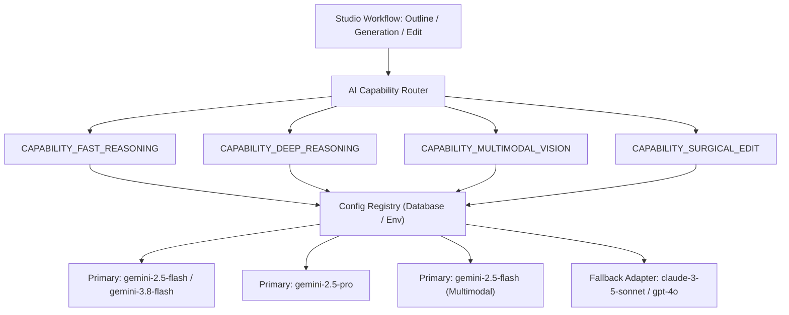
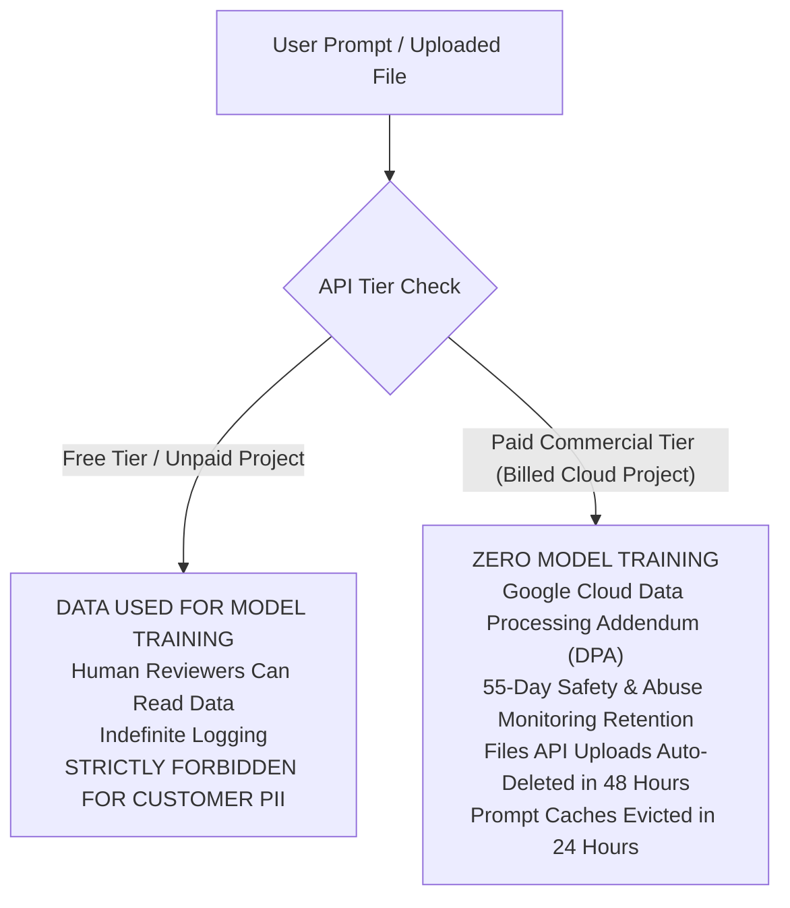

# 06 — Updated AI Architecture, Model Registry & Data Privacy
## Project: DOCORA — AI Document Studio
**Phase:** 00.1 — Master Architecture Validation & Blueprint Remediation  
**Status:** Remediated AI Systems & Privacy Specification  

---

## 1. Capability-Based Model Registry

Rather than hardcoding a static model identifier throughout the codebase, DOCORA establishes a **Capability-Based Model Registry**. Application workflows request models by **capability archetype**, allowing seamless model upgrades (e.g., from Gemini 2.5 to Gemini 3.x) via configuration without code refactoring.



### 1.1 Model Capability Mapping Matrix

| Capability Key | Primary Model ID | Fallback Model ID | Key Requirements | Target Workflow |
|---|---|---|---|---|
| `DOC_OUTLINE` | `gemini-2.5-flash` / `gemini-3.8-flash` | `gpt-4o-mini` | Low latency (<1.5s), strict JSON Schema adherence | Prompt -> Document Outline |
| `SECTION_GEN` | `gemini-2.5-pro` | `claude-3-5-sonnet` | High reasoning depth, rich vocabulary, complex tables | Deep Chapter & Section Synthesis |
| `MULTIMODAL_EXTRACT` | `gemini-2.5-flash` | `claude-3-5-sonnet` | Native image/PDF vision, table coordinate detection | Invoices, Scans, Receipts -> CDM |
| `SCOPED_EDIT` | `gemini-2.5-flash` / `gemini-3.8-flash` | `gpt-4o-mini` | Sub-second latency, precise node replacement | Inline Selection Rewrite / Tone Shift |
| `DOC_SUMMARIZE` | `gemini-2.5-flash` | `gpt-4o-mini` | 1M+ token context ingestion, rapid compression | 50-page PDF Executive Summary |
| `GROUNDED_QA` | `gemini-2.5-pro` | `claude-3-5-sonnet` | Verbatim quote retrieval, 0 hallucination tolerance | Source Document Question & Answer |
| `ARABIC_POLISH` | `gemini-2.5-pro` | `claude-3-5-sonnet` | Classical Fusha grammar, case endings, punctuation | Bilingual Editorial Refinement |

---

## 2. Google Gemini Data Privacy, Retention & Compliance

### 2.1 Critical Distinction: Free Tier vs. Paid Commercial Tier
The previous blueprint made the dangerous claim that "customer data is never retained or used for training across all Gemini APIs." This is factually incorrect for the Free Tier and legally hazardous.



### 2.2 Verified Official Policy Summary

| Policy Dimension | Gemini API Free Tier (AI Studio) | Gemini API Paid Tier (Billed Google Cloud) | Vertex AI (Enterprise Cloud) |
|---|---|---|---|
| **Used for Google Model Training?** | **YES** (Prompts and outputs train Google models) | **NO** (Zero training on customer content) | **NO** (Zero training on customer content) |
| **Human Review by Google Contractors?** | **YES** (Human annotators can review data) | **NO** (Strictly isolated from human review) | **NO** (Zero human review) |
| **Safety / Abuse Log Retention Window** | Indefinite / Standard operational lifecycle | **55 Days** (Strictly for safety/abuse monitoring, then purged) | **Configurable / Zero Retention** with approved BAA |
| **File API Upload Retention (PDFs/Images)** | Stored for 48 hours, then deleted | Stored for **48 hours**, then deleted | Governed by customer Cloud Storage bucket |
| **In-Memory Prompt Caching Retention** | Max 24 hours | Max **24 hours** | Max 24 hours (Customer isolated) |
| **Production Suitability for DOCORA** | **PROHIBITED** (Violates user confidentiality) | **APPROVED FOR PRODUCTION MVP** | **APPROVED FOR ENTERPRISE TIER** |

### 2.3 Production Privacy Mandate for DOCORA
- **Zero Free-Tier Usage**: Production and staging environments must exclusively connect via Google Cloud projects with active commercial billing.
- **Data Protection Transparency**: DOCORA’s Privacy Policy must accurately disclose that prompt inputs are retained by Google for 55 days strictly for abuse and safety compliance before deletion.
- **Enterprise Zero-Retention Track**: Enterprise customers requiring absolute zero data retention must be routed to Google Cloud Vertex AI with a signed Business Associate Agreement (BAA).

---

## 3. Defense-in-Depth Prompt Injection Architecture

### 3.1 The Limitation of XML Delimiters
The Phase 00 blueprint treated XML delimiters (`<user_sources>...</user_sources>`) as an impenetrable security boundary. **This is false.** Advanced prompt injection attacks (such as delimiter spoofing, fake closing tags `</user_sources>`, or multi-lingual override instructions) can bypass simple XML framing.

### 3.2 Remediated Multi-Layer Defense Architecture

```mermaid
flowchart TD
    RawInput[Untrusted Uploaded Document / Prompt] --> L1[Layer 1: Sanitizer & Delimiter Neutralizer]
    L1 --> L2[Layer 2: Tool Isolation Guard - No System Tool Access]
    L2 --> L3[Layer 3: Separate Instruction & Context Enclaves]
    L3 --> L4[Layer 4: Server-Side Schema Enforcer (Zod)]
    L4 --> L5[Layer 5: AST Boundary Isolation - Single-Node Lock]
    L5 --> Render[Safe Rendering to Canvas]
```

1. **Layer 1: Delimiter Neutralization & Control Character Stripping**:
   - Before document text is formatted into prompt context, any existing XML/HTML closing tags matching system boundaries (`</user_untrusted_sources>`, `</system_rules>`) are escaped or stripped.
2. **Layer 2: Tool Isolation Guard (Zero Tool Permissions)**:
   - When the AI engine processes untrusted user documents, **function calling and tool execution are completely disabled**. The model cannot execute database queries, invoke web searches, or call internal APIs based on text found inside a user's uploaded PDF.
3. **Layer 3: Secret Isolation**:
   - Database credentials, Supabase service keys, and system tokens are never injected into prompt templates or system contexts under any circumstances.
4. **Layer 4: Strict Output Schema Enforcement**:
   - The AI Gateway uses Gemini's native `responseSchema` (or Zod runtime parsing). If a prompt injection tricks the model into returning a conversational message or script payload, the parser rejects it with a schema error.
5. **Layer 5: AST Node-Level Boundary Lock (Scoped Edits)**:
   - When a user requests a scoped edit on Paragraph #4, the server validates that the returned AST contains an edit **exclusively for the targeted node UUID**. The AI engine is physically prevented from modifying, deleting, or injecting nodes anywhere else in the document.
