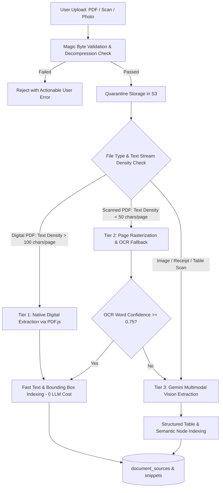
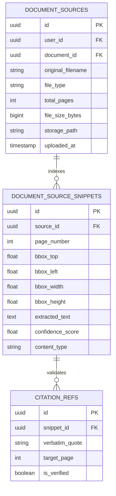

# 07 — Updated File Intelligence & Multimodal Extraction Pipeline
## Project: DOCORA — AI Document Studio
**Phase:** 00.1 — Master Architecture Validation & Blueprint Remediation  
**Status:** Remediated Ingestion & Extraction Specification  

---

## 1. Adaptive 3-Tier Processing Pipeline

To optimize latency, user experience, and token unit economics, uploaded documents (PDFs, scans, photographs) are processed through an **Adaptive 3-Tier Extraction Funnel**:



---

## 2. Realistic Scope Boundaries for MVP

The Phase 00 blueprint over-promised simultaneous handwriting recognition, complex flowchart extraction, and 100-page batch scanned OCR for MVP. The remediated scope establishes clear technical boundaries:

| Capability | MVP (v1.0 - P0) Scope | Post-MVP (v1.5 - P1) Scope | Technical Reason for Boundary |
|---|---|---|---|
| **Digital Text PDFs** | Full Support (Up to 100 pages) | Full Support | Fast, zero-LLM-cost extraction via PDF.js; high reliability. |
| **Scanned Bitmap PDFs** | Supported up to **50 pages** | Batch processing (100+ pages) | Rasterizing 50+ pages to 300 DPI images creates heavy memory load on worker. |
| **Printed Invoices & Receipts** | Full Support (PNG / JPG / WEBP) | Full Support | Gemini Vision excels at structured key-value pairs and tabular layouts. |
| **Handwritten Notes** | Basic legible print handwriting | Cursive, doctor notes, historical scripts | Unconstrained cursive handwriting recognition requires dedicated fine-tuned OCR. |
| **Flowcharts & Diagrams** | Descriptive text summary | Export to editable Mermaid diagrams | Diagram-to-vector reconstruction requires complex visual graph parsing. |
| **PDF-to-Word Conversion** | Basic text & table extraction to DOCX | Advanced layout stream reconstruction | PDF lacks semantic paragraph concepts; rebuilding exact columns requires P1 heuristics. |

---

## 3. Grounded Citation & Source Provenance Architecture

A foundational guarantee of DOCORA is that **AI co-pilots never cite facts without verifiable source lineage**.



### 3.1 Grounding Enforcement Protocol
1. **Extraction & Chunking**: When a PDF is ingested, every paragraph or table cell is assigned a unique `snippet_id`, recording its physical `page_number` and normalized bounding box coordinates (`[top, left, width, height]`).
2. **Citation Injection**: When the AI co-pilot answers a user query (e.g., *"Operating expenses increased by 8.4% in 2023"*), the prompt schema mandates returning:
   ```json
   {
     "answer": "Operating expenses increased by 8.4% in 2023.",
     "citation": {
       "snippet_id": "7f9a2b1c-...",
       "source_page": 14,
       "verbatim_quote": "Total operating expenses rose by 8.4% to $12.3M in FY2023."
     }
   }
   ```
3. **Server-Side Quote Verification**: The server verifies that `verbatim_quote` actually appears in the extracted text stream of `source_page`. If the quote cannot be verified, the citation is flagged as `unverified` and rendered with an amber warning badge.
4. **Interactive Studio Inspection**: Clicking the citation badge in the AI panel immediately navigates the embedded PDF.js viewer to Page 14, smoothly centering and highlighting the exact source passage in translucent amber.

---

## 4. Ingestion Security & Quota Controls

| Validation Step | Enforced Rule | Failure Action |
|---|---|---|
| **Magic Byte Inspection** | First 16 bytes must match `%PDF-`, `PK\x03\x04`, `\x89PNG`, or `\xFF\xD8\xFF` | Immediate HTTP 400 rejection; file discarded from memory. |
| **ZIP Bomb Ratio Check** | DOCX uncompressed-to-compressed ratio capped at **100:1**; max uncompressed size **100 MB** | Abort decompression stream immediately; log security event. |
| **PDF Page Limit** | Maximum **100 pages** for digital PDFs; maximum **50 pages** for scanned PDFs in MVP | Alert user with option to split document before processing. |
| **File Size Limit** | Maximum **50 MB** (PDF), **30 MB** (DOCX), **20 MB** (Images) | Rejected at client dropzone and checked by S3 signed URL policy. |
| **Storage Lifecycle** | Raw files stored in private `raw-uploads` bucket; auto-purged after **30 days** of inactivity | Automated database maintenance cron removes expired files. |
