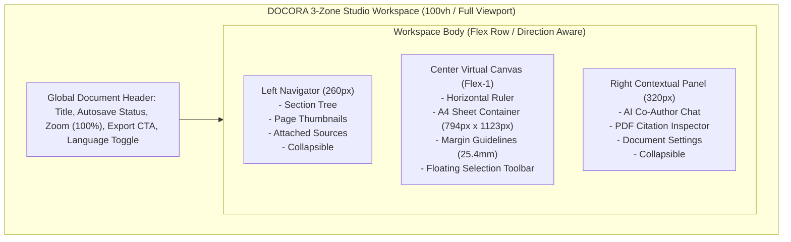

# 08 — Updated UI/UX Design System & Studio Workspace
## Project: DOCORA — AI Document Studio
**Phase:** 00.1 — Master Architecture Validation & Blueprint Remediation  
**Status:** Remediated Visual Design System & Screen Specifications  

---

## 1. Visual Direction & Aesthetic Stance

DOCORA adopts the design discipline of **Mode B: High-Craft Enterprise SaaS** (Linear, Apple, Vercel, Stripe Press). The interface avoids generic AI clichés (no oversaturated purple gradient blobs, no floating neon particles, and no illegible low-contrast text).

### Visual Directives:
1. **The Canvas is the Hero**: Toolbars and navigation panels recede into muted slate tones (`#0F172A` / `#1E293B`), allowing the crisp document sheet (`#FFFFFF`) and typography to command primary attention.
2. **Tactile Virtual Page Simulation**: The center canvas simulates standard A4 and US Letter sheets with subtle elevation drop-shadows and configurable margin guidelines (`25.4mm`).
3. **Bilingual Typographic Harmony**: Latin typefaces (`Inter`, `Source Serif 4`) and Arabic typefaces (`Noto Sans Arabic`, `Amiri`) are calibrated to share identical optical weights and baseline alignments, eliminating layout jumping when switching languages.
4. **Zero-Lag Typing Rule**: The active editable canvas enforces **0ms animation on text input and cursor movements**, ensuring zero perceived keystroke latency.

---

## 2. Design Tokens & CSS Custom Properties

Tailwind CSS v4 native CSS `@theme` tokens support seamless switching between Dark Mode (Default Studio View) and Light Mode (Editorial View):

```css
@theme {
  /* Surface Elevations (Dark Mode Default) */
  --color-canvas-backdrop: #090d16; /* Deep obsidian background */
  --color-surface-sidebar: #0f172a; /* Slate 900 */
  --color-surface-card: #1e293b;    /* Slate 800 */
  --color-surface-sheet: #ffffff;   /* Pure white printable sheet */
  
  /* Borders & Dividers */
  --color-border-subtle: rgba(255, 255, 255, 0.08);
  --color-border-strong: rgba(255, 255, 255, 0.16);
  --color-margin-guideline: rgba(79, 70, 229, 0.25);
  
  /* Text & Typography */
  --color-text-primary: #f8fafc;
  --color-text-secondary: #94a3b8;
  --color-text-muted: #64748b;
  --color-text-sheet: #0f172a; /* Dark text on white sheet */
  
  /* Brand Accent */
  --color-brand-indigo: #4f46e5;
  --color-brand-hover: #6366f1;
  --color-brand-subdued: rgba(79, 70, 229, 0.12);
  
  /* Semantic Feedback */
  --color-status-success: #10b981;
  --color-status-warning: #f59e0b; /* Unverified citations */
  --color-status-error: #ef4444;
}
```

---

## 3. The 3-Zone Studio Workspace Layout



### Layout Specifications:
- **Left Navigator (260px)**: Collapsible via `Cmd+\` or toggle icon. Renders interactive section headings with drag-and-drop reordering, page jump thumbnails, and uploaded reference files.
- **Center Canvas**: Scrollable workspace with centered A4 sheet container (`794px × 1123px` at 100% zoom). Dynamic zoom slider supports 50% to 200% scaling via CSS `transform: scale(zoom)`.
- **Right Contextual Panel (320px)**: Collapsible panel hosting the AI document co-pilot, grounded citation viewer, and typography configuration drawers.

---

## 4. Reconciled Specifications for 15 Essential Screens

1. **Screen 01 — Landing Page**: Modern SaaS marketing showcase highlighting DOCX/PDF export fidelity, bilingual RTL mastery, and interactive prompt-to-document animation.
2. **Screen 02 — Authentication Views**: Sign In, Sign Up, Magic Link, and OAuth2 buttons (Google, Microsoft) with language toggle flipping between LTR and RTL.
3. **Screen 03 — Main Dashboard**: Quick-create shelf, recent documents carousel with page thumbnails, remaining monthly token meter, and global search (`Cmd+K`).
4. **Screen 04 — New Document Wizard**: Modal selector for "Blank Document", "AI Prompt Co-Pilot", "Upload Reference Scan", or "Curated Template".
5. **Screen 05 — Staged AI Document Generator**: 2-stage creation interface (Prompt input -> Outline review tree -> Section streaming modal).
6. **Screen 06 — Professional Virtual Canvas Editor**: The primary 3-zone workspace with rich-text toolbar, table editor, and page break guidelines.
7. **Screen 07 — Print & Export Preview Modal**: Full-screen modal simulating physical print output, format switcher (`.docx` vs `.pdf`), and layout pre-flight checks.
8. **Screen 08 — Upload & Analysis Dropzone**: Drag-and-drop file ingestion zone with real-time magic byte validation and OCR extraction status.
9. **Screen 09 — Embedded PDF Viewer & Citation Inspector**: Side-by-side reference viewer using Mozilla PDF.js with amber bounding box citation highlights.
10. **Screen 10 — Template Gallery**: Categorized showcase of the **10 curated MVP bilingual templates** with variable placeholder forms.
11. **Screen 11 — Searchable Document Library**: Folder hierarchy tree, grid/list view switcher, and PostgreSQL full-text search.
12. **Screen 12 — Document History & Version Checkpoints**: Chronological timeline of autosave snapshots and named milestones with one-click restore.
13. **Screen 13 — Contextual AI Assistant Panel**: Right-rail chat scoped strictly to active document context; floating selection bar for in-place text rewrites.
14. **Screen 14 — User & Workspace Settings**: Profile settings, default direction (LTR/RTL), default paper size (A4 vs Letter), and theme toggle.
15. **Screen 15 — Entitlements & Token Quota Meter**: Transparent visibility into token usage per model and monthly subscription tier status (Read-only for MVP; Stripe portal deferred to P1).

---

## 5. Interaction & Motion Standards
- **Micro-Interactions**: Button clicks, dropdown menus, and tooltip reveals use snappy 150ms transitions (`cubic-bezier(0.16, 1, 0.3, 1)`).
- **Sheet Drawers & Modals**: Smooth 250ms spring transitions powered by Motion (Framer Motion).
- **Accessibility / Reduced Motion**: Enforces `@media (prefers-reduced-motion: reduce)`: instantly cuts all spring animations to instantaneous opacity fades.
