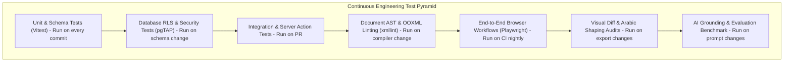
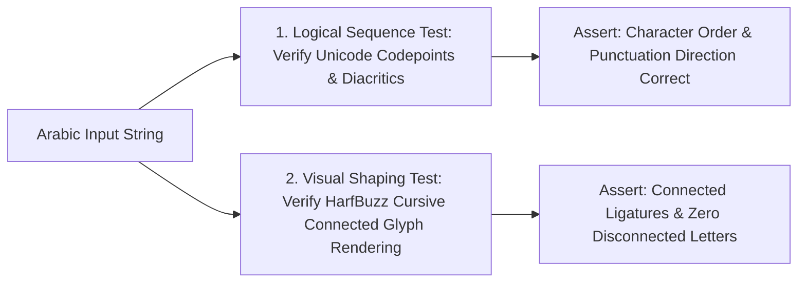

# 09 — Updated Testing Strategy & Quality Verification
## Project: DOCORA — AI Document Studio
**Phase:** 00.1 — Master Architecture Validation & Blueprint Remediation  
**Status:** Remediated Multi-Tier QA Specification  

---

## 1. Testing Philosophy: Incremental Verification

A critical flaw in the previous blueprint was deferring comprehensive quality assurance to Phase 09. In DOCORA, **testing is an incremental, continuous engineering activity**. Every phase establishes automated unit, integration, and contract tests that execute in continuous integration (CI) before merging.



---

## 2. Independent Arabic & Bilingual Verification Methodology

### The Critical Distinction: Logical Character Stream vs. Visual Glyph Shaping
In Arabic document engineering, standard text extraction assertions are insufficient. A test may extract the correct Arabic Unicode sequence while the rendered PDF displays unshaped, disconnected glyphs or reversed words.



1. **Logical Character Order Test**:
   - Extracts the raw text stream using `pdf-parse` or OOXML XML parser.
   - Asserts that Arabic characters are stored in standard logical reading order (`\u0627\u0644...`), diacritics are attached to host characters, and bidirectional control tags (`<w:bidi/>`) are present.
2. **Visual Glyph Shaping & Rendering Test**:
   - Renders the generated PDF page to a PNG canvas at 300 DPI via Mozilla PDF.js.
   - Uses Playwright to compare against a verified gold-standard baseline image.
   - Inspects connected ligatures to guarantee that characters (e.g., initial *ba* `بـ`, medial `ـبـ`, final `ـب`) connect seamlessly without letter detachment or box glyph substitution (``).

---

## 3. Automated DOCX & PDF Validation Harness

### 3.1 DOCX Structural Linter
Before any generated `.docx` file is approved for user download:
1. **Archive Integrity Check**: Verifies valid ZIP container with required OOXML parts (`[Content_Types].xml`, `_rels/.rels`, `word/document.xml`, `word/styles.xml`).
2. **XML Schema Compliance**: Executes `xmllint --noout --schema wml.xsd word/document.xml` to ensure strict compliance with ISO/IEC 29500.
3. **LibreOffice Headless Smoke Test**: Converts the file in the worker container:
   `libreoffice --headless --convert-to pdf --outdir /tmp test-output.docx`
   A non-zero exit code or segfault immediately fails the build.

### 3.2 PDF Visual Comparison & Font Embedding
- **Font Embedding Verification**: Audits the PDF dictionary using `pdf-lib` to assert that required fonts (`Amiri`, `Noto Sans Arabic`, `Inter`) are embedded as subsets, preventing recipient system fallbacks.
- **Visual Regression Target**: Target similarity score of **>= 95%** against baseline PDF renders under Playwright's pixel comparison engine.

---

## 4. Security, RLS & Injection Automated Test Suites

### 4.1 Automated Privilege Escalation Test (RLS Guard)
Every CI run executes automated database tests asserting that:
```typescript
test('Non-service-role user cannot modify user_entitlements', async () => {
  const userClient = createSupabaseClient(userJwt);
  const { error } = await userClient
    .from('user_entitlements')
    .update({ monthly_token_quota: 999999999 })
    .eq('user_id', userId);
  
  // Must return HTTP 403 or reject the update
  expect(error).not.toBeNull();
});
```

### 4.2 Indirect Prompt Injection Test Suite
A regression test corpus of 20 hostile documents (PDFs, DOCX files, and images containing adversarial prompt injection payloads) is evaluated against the AI extraction pipeline:
- Asserts that system prompts remain uncompromised.
- Asserts that function calling and external network access remain disabled.
- Asserts that the AI outputs strictly validated CDM JSON conforming to Zod schemas.

---

## 5. Phase-by-Phase Testing Execution Map

| Phase | Test Activities & Automation Implemented | Exit Criteria |
|---|---|---|
| **Phase 01** | Unit tests for UI utilities, Tailwind logical properties, and theme toggling. | 0 lint/TS errors; 100% theme switch pass. |
| **Phase 02** | pgTAP tests for Supabase RLS, tenant isolation, and privilege escalation guards. | 100% RLS security test pass rate. |
| **Phase 03** | OOXML schema validation (`xmllint`), LibreOffice conversion smoke test, and CDM Zod tests. | Valid `.docx` generation across fixtures FIX-01 to FIX-10. |
| **Phase 04** | Tiptap keystroke latency benchmarks (INP < 50ms), autosave IndexedDB recovery tests. | Zero data loss on simulated crash. |
| **Phase 05** | AI schema validation repair tests, SSE streaming tests, and token quota deduction tests. | 100% JSON Schema compliance. |
| **Phase 06** | Adaptive extraction benchmarks, OCR confidence tests, and citation verification tests. | Bounding box accuracy >= 95%. |
| **Phase 07** | Template variable hydration tests, full-text search latency tests (<150ms). | All 10 templates instantiate cleanly. |
| **Phase 08** | Scoped edit non-interference tests (only target node mutated; surrounding AST unchanged). | AST diff verification passes. |
| **Phase 09** | Full Playwright E2E suites across Chromium/Firefox/WebKit; WCAG 2.2 AA audits (`axe-core`). | 0 critical bugs; 0 a11y violations. |
| **Phase 10** | Production smoke tests, worker auto-recovery tests, and backup restoration drills. | Production health check verified. |
