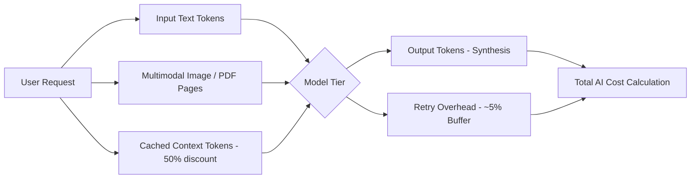

# 10 — Updated Deployment Architecture & Financial Cost Models
## Project: DOCORA — AI Document Studio
**Phase:** 00.1 — Master Architecture Validation & Blueprint Remediation  
**Status:** Remediated Infrastructure & Financial Model  

---

## 1. Verified Infrastructure Pricing Baselines

All cost models are calculated from current verified, published vendor pricing:

| Provider | Service Component | Published Commercial Tier | Cost Basis |
|---|---|---|---|
| **Vercel** | Frontend & Serverless Actions | Pro Plan | **$20 / team member / month** + bandwidth ($0.15/GB) |
| **Supabase** | PostgreSQL 16, Auth & Queues (`pgmq`) | Pro Plan | **$25 / month** (Includes 8GB DB, 100GB storage, 250GB egress) |
| **Render** | Docker Conversion Worker (LibreOffice + Node) | Standard Worker | **$25 / instance / month** (2 GB RAM, 1 vCPU) |
| **Google Cloud** | Gemini 2.5 Flash / 3.8 Flash API | Paid Commercial Tier | **$0.075 / 1M input tokens**, **$0.30 / 1M output tokens** |
| **Google Cloud** | Gemini 2.5 Pro API | Paid Commercial Tier | **$1.25 / 1M input tokens**, **$5.00 / 1M output tokens** |
| **Google Cloud** | Multimodal PDF / Image Ingestion | Paid Commercial Tier | **$0.00025 per standard page / image** |
| **Sentry / Axiom** | Error Tracking & Log Aggregation | Developer / Team Plan | **$15 to $26 / month** |

---

## 2. Multi-Dimensional AI Cost Breakdown

AI token expenses are disaggregated across specific operational dimensions to prevent underestimating costs:

### Assumptions per Active User:
- Free Tier User: ~3 documents/month; 150k Flash tokens + 30k Pro tokens; 10 PDF pages. Monthly AI cost: **~$0.18 / free user**.
- Pro Tier User ($19/mo): ~15 documents/month; 1.5M Flash tokens + 400k Pro tokens; 60 PDF pages. Monthly AI cost: **~$2.52 / pro user**.

---

## 3. Three Detailed Production Financial Scenarios

### Scenario A: Development, Staging & Pre-Launch Testing
- **Workload**: 5 internal engineers and QA testers; ~500 documents generated; automated CI regression runs.
- **Infrastructure Breakdown**:
  - Vercel Pro (1 seat): **$20.00**
  - Supabase Pro: **$25.00**
  - Render Worker (Starter 512MB RAM): **$7.00**
  - Google Gemini API (Flash/Pro blended test usage): **$18.00**
  - Domain & DNS (Amortized): **$1.50**
- **Total Infrastructure Cost**: **$71.50 / month**
- **Gross Revenue**: **$0.00** (Pre-launch development)

---

### Scenario B: Early Commercial Production (1,000 Monthly Active Users - MAU)
- **Workload Assumptions**:
  - Total MAU: **1,000 users**.
  - Paid Conversion Rate: **15%** (150 paying Pro subscribers at $19/month).
  - Free Active Users: **850 users**.
  - Monthly Document Generations: ~6,000 documents.
  - File Conversions (Word to PDF): ~1,800 jobs.
- **Monthly Revenue**:
  - Gross Subscription Revenue (150 × $19): **$2,850.00 / month**
- **Cost of Goods Sold (COGS / Infrastructure)**:
  - Vercel Pro (2 developer seats + edge bandwidth): **$55.00**
  - Supabase Pro Plan (Database, Auth, PGMQ, 100GB Storage): **$25.00**
  - Supabase Storage Overages (~120GB stored): **$10.00**
  - Render Dedicated Worker (1 Standard Instance: 2GB RAM): **$25.00**
  - Google Gemini API Expenses:
    - 850 Free Users (850 × $0.18): $153.00
    - 150 Pro Users (150 × $2.52): $378.00
    - Retry & schema repair buffer (5%): $26.50
    - *Subtotal AI Expenses*: **$557.50**
  - Observability & Error Monitoring (Sentry Team): **$26.00**
  - Domain & SSL: **$1.50**
- **Total Infrastructure & AI COGS**: **$700.00 / month**
- **Financial Performance (Excluding Taxes & Payment Fees)**:
  - **Gross Profit**: **$2,150.00 / month**
  - **Gross Margin**: **75.4%**
  - **Blended Infrastructure Cost per Active User**: **$0.70 / user / month**

---

### Scenario C: Scaling Commercial Workload (10,000 MAU)
- **Workload Assumptions**:
  - Total MAU: **10,000 users**.
  - Paid Conversion Rate: **18%** (1,800 paying Pro subscribers at $19/month).
  - Free Active Users: **8,200 users**.
  - Monthly Document Generations: ~75,000 documents.
  - File Conversions & Extractions: ~28,000 jobs.
- **Monthly Revenue**:
  - Gross Subscription Revenue (1,800 × $19): **$34,200.00 / month**
- **Cost of Goods Sold (COGS / Infrastructure)**:
  - Vercel Enterprise / Team Tier (Seats + bandwidth + compute): **$340.00**
  - Supabase Pro + Compute Add-on (4 CPU / 16GB RAM) + 1TB Storage: **$390.00**
  - Render Worker Auto-Scaling Cluster (3 to 6 Standard Instances): **$125.00**
  - Google Gemini API Expenses:
    - 8,200 Free Users (8,200 × $0.18): $1,476.00
    - 1,800 Pro Users (1,800 × $2.52): $4,536.00
    - Context Caching Discounts (Estimated 15% savings): -$900.00
    - Retry & schema repair buffer: $255.00
    - *Subtotal AI Expenses*: **$5,367.00**
  - Observability, WAF & Logging (Datadog / Sentry): **$180.00**
- **Total Infrastructure & AI COGS**: **$6,402.00 / month**
- **Financial Performance (Excluding Taxes, Payment Fees & Salaries)**:
  - **Gross Profit**: **$27,798.00 / month**
  - **Gross Margin**: **81.3%**
  - **Blended Infrastructure Cost per Active User**: **$0.64 / user / month**

---

## 4. Quota Controls to Prevent Unbounded Financial Losses

To guarantee that free or compromised accounts cannot generate unexpected AI cloud bills:
1. **Hard Account Quotas**: Free accounts are hard-capped at 250,000 tokens per 30-day rolling window.
2. **Velocity Rate Limiting**: Max 5 document generations per hour per IP on Free tier; max 25 per hour on Pro tier.
3. **Daily Cloud Budget Alerts**: Google Cloud and Supabase billing thresholds trigger automated Slack/Email alerts at 50%, 80%, and 100% of budgeted monthly spend.
