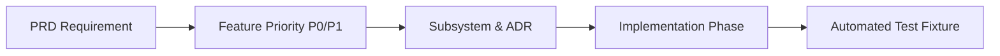

# 15 — Requirements & Architecture Traceability Matrix
## Project: DOCORA — AI Document Studio
**Phase:** 00.1 — Master Architecture Validation & Blueprint Remediation  
**Status:** Complete End-to-End Engineering Traceability  

---

## 1. Traceability Architecture

This matrix guarantees bidirectional traceability from initial **Product Requirements (PRD)** to **Feature Prioritization**, **Subsystem Architecture**, **Assigned Implementation Phase**, and **Automated Verification Test**.

---

## 2. Master Traceability Matrix

| Requirement ID | Feature Description | Priority | Architectural Subsystem & ADR | Blueprint Document | Phase | Automated Test & Verification Criteria |
|---|---|---|---|---|---|---|
| **FR-GEN-001** | Staged Outline-to-Document Generation | **P0** | AI Orchestrator / Capability Registry (ADR-005) | `06-UPDATED-AI-AND-PRIVACY.md` | Phase 05 | Schema adherence test; outlines generate in <2,500ms. |
| **FR-GEN-002** | Real-Time Section Streaming via SSE | **P0** | Edge API Route Handlers / SSE Stream | `03-UPDATED-SYSTEM-ARCHITECTURE.md` | Phase 05 | SSE chunk arrival test; client renders incremental text. |
| **FR-GEN-003** | Multi-Section Support (Portrait/Landscape) | **P0** | CDM v1.1.0 Multi-Section Schema (ADR-004) | `04-UPDATED-DOCUMENT-ENGINE.md` | Phase 03 | FIX-09 fixture test; section orientation compiles to OOXML. |
| **FR-EDT-001** | Rich-Text Editing Core (Tiptap / ProseMirror) | **P0** | Studio Editor Client (ADR-003) | `04-UPDATED-DOCUMENT-ENGINE.md` | Phase 04 | Typing latency test (INP < 50ms) across 50 pages. |
| **FR-EDT-002** | Virtual Paged Canvas & Margin Guides | **P0** | CSS Paged Media Virtual Canvas | `08-UPDATED-UI-UX-ARCHITECTURE.md` | Phase 04 | Visual regression test; A4 sheet margins render at 25.4mm. |
| **FR-EDT-003** | Advanced Table Manipulation & Cell Spans | **P0** | Tiptap Table Extension & CDM AST | `04-UPDATED-DOCUMENT-ENGINE.md` | Phase 04 | FIX-05 fixture test; col_span and row_span compile to OOXML. |
| **FR-EDT-004** | Image Insertion, Resizing & Captions | **P0** | Studio Image Node & Storage Bridge | `04-UPDATED-DOCUMENT-ENGINE.md` | Phase 04 | FIX-08 fixture test; images persist and export cleanly. |
| **FR-EDT-005** | Dynamic Headers, Footers & Page Numbers | **P0** | CDM Section Header/Footer Compiler | `04-UPDATED-DOCUMENT-ENGINE.md` | Phase 03 | Word test; `<w:fldSimple w:instr="PAGE"/>` renders correctly. |
| **FR-EDT-006** | Local Autosave & Crash Recovery | **P0** | IndexedDB Buffer + 2s Cloud Sync | `05-UPDATED-DATABASE-AND-SECURITY.md` | Phase 04 | Simulated browser kill test; zero keystroke loss on reload. |
| **FR-INT-001** | Digital PDF Text Extraction (0 LLM Cost) | **P0** | Mozilla PDF.js Tier 1 Extractor (ADR-009) | `07-UPDATED-FILE-INTELLIGENCE.md` | Phase 06 | FIX-11 fixture test; extracts 20 pages in <1,500ms. |
| **FR-INT-002** | Printed Scan & Receipt Extraction | **P0** | Gemini Multimodal Vision Tier 3 | `07-UPDATED-FILE-INTELLIGENCE.md` | Phase 06 | FIX-12 fixture test; extracts line-item table with >95% accuracy. |
| **FR-INT-003** | Basic Scanned PDF OCR (<=50 pages) | **P0** | Containerized OCR / Gemini Vision | `07-UPDATED-FILE-INTELLIGENCE.md` | Phase 06 | FIX-13 fixture test; OCR confidence badge triggers if <0.70. |
| **FR-INT-004** | Grounded Q&A with Clickable Citations | **P0** | Citation Engine & PDF.js Viewer | `07-UPDATED-FILE-INTELLIGENCE.md` | Phase 06 | Server quote verification test; badge navigates to source page. |
| **FR-RTL-001** | Bilingual RTL/LTR Interface Layout | **P0** | Tailwind CSS v4 Logical Properties (ADR-012) | `08-UPDATED-UI-UX-ARCHITECTURE.md` | Phase 01 | Automated RTL mirror test; zero flipped layout bugs. |
| **FR-RTL-002** | Arabic Complex Script Shaping & Font Stack | **P0** | HarfBuzz / FreeType Engine & Amiri Font | `09-UPDATED-TESTING-STRATEGY.md` | Phase 03 | FIX-03 fixture test; visual ligatures connect seamlessly. |
| **FR-RTL-003** | Mixed-Direction Punctuation Isolation | **P0** | Unicode Bidi Isolation (`unicode-bidi: isolate`) | `04-UPDATED-DOCUMENT-ENGINE.md` | Phase 04 | FIX-04 fixture test; periods and parentheses remain aligned. |
| **FR-EXP-001** | Native Word (.docx) Compilation | **P0** | `docx` OOXML Compiler (ADR-006) | `04-UPDATED-DOCUMENT-ENGINE.md` | Phase 03 | `xmllint` schema test; opens in Word 2016+ with 0 warnings. |
| **FR-EXP-002** | Word-Parity PDF Conversion Worker | **P0** | LibreOffice Headless Daemon (ADR-007) | `04-UPDATED-DOCUMENT-ENGINE.md` | Phase 03 | Visual comparison test; target >=95% similarity to Word. |
| **FR-TMP-001** | 10 Curated Bilingual MVP Templates | **P0** | Template Engine & Variable Hydrator | `02-UPDATED-MVP-SCOPE.md` | Phase 07 | Variable substitution test; instantiates in <15 seconds. |
| **FR-LIB-001** | Searchable Library & Folder Hierarchy | **P0** | PostgreSQL Full-Text Search (GIN) | `05-UPDATED-DATABASE-AND-SECURITY.md` | Phase 07 | Full-text query test (<150ms across 1,000 records). |
| **FR-EDT-007** | Scoped In-Place Text & Tone Rewrite | **P0** | Scoped AI Node Transformer | `06-UPDATED-AI-AND-PRIVACY.md` | Phase 08 | AST non-interference test; only target node UUID mutated. |
| **NFR-SEC-001** | Cryptographic Tenant Isolation (RLS) | **P0** | PostgreSQL Row-Level Security (ADR-002) | `05-UPDATED-DATABASE-AND-SECURITY.md` | Phase 02 | Automated pgTAP test; cross-tenant SELECT returns empty set. |
| **NFR-SEC-002** | Entitlement Privilege Escalation Guard | **P0** | Split `profiles` & `user_entitlements` (ADR-014) | `05-UPDATED-DATABASE-AND-SECURITY.md` | Phase 02 | Automated exploit test; user UPDATE on entitlements rejected. |
| **NFR-SEC-003** | Private S3 Storage & Signed Access | **P0** | Supabase Storage RLS & HMAC URLs (ADR-011) | `05-UPDATED-DATABASE-AND-SECURITY.md` | Phase 02 | Signed URL expiration test (rejected after 15m TTL). |
| **NFR-SEC-004** | Prompt Injection Defense-in-Depth | **P0** | Multi-Layer Delimiter & Tool Guard | `06-UPDATED-AI-AND-PRIVACY.md` | Phase 05 | Regression test with 20 adversarial injection documents. |
| **NFR-PERF-001** | Editor Input Latency (INP < 50ms) | **P0** | Tiptap Open-Source Virtual Canvas | `01-UPDATED-TECH-STACK.md` | Phase 04 | Playwright performance benchmark; INP verified under load. |
| **NFR-PERF-002** | Serverless Edge Timeout Offloading | **P0** | Supabase Queues (`pgmq`) + Worker (ADR-010) | `03-UPDATED-SYSTEM-ARCHITECTURE.md` | Phase 03 | Long task test (>15s); successfully offloaded to worker queue. |
| **NFR-ACC-001** | WCAG 2.2 Level AA Accessibility | **P0** | Radix UI Headless Primitives (ADR-013) | `08-UPDATED-UI-UX-ARCHITECTURE.md` | Phase 09 | Automated `axe-core` audit; 0 critical or serious violations. |
