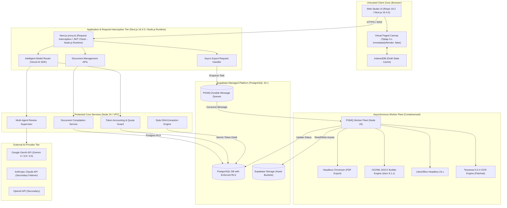
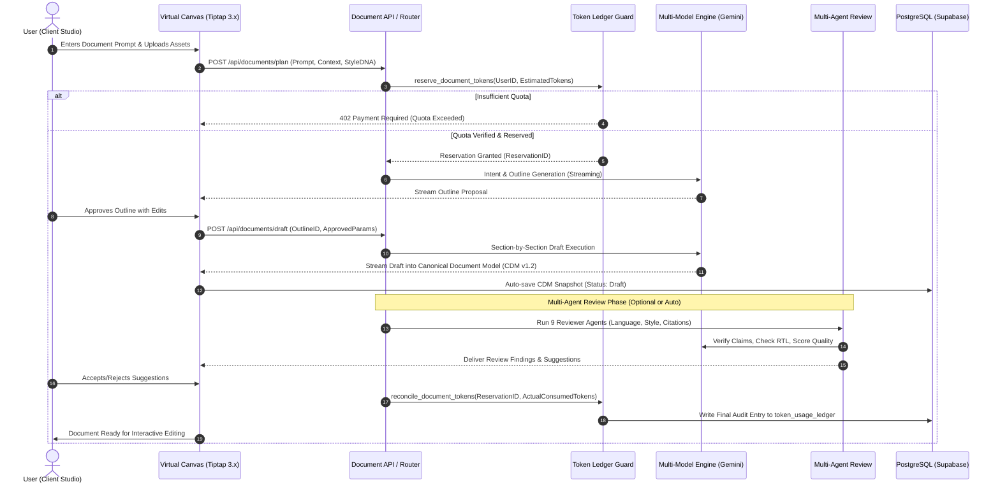

# DOCORA — Consolidated System Architecture & Topology (Phase 00.2 Remediation v1.2.2)

**Document Reference:** `DOCORA-03-ARCH-v1.2.2`  
**Status:** CONSOLIDATED ARCHITECTURE BASELINE (POST-REVIEW REMEDIATED)  
**Audit Predecessors:** Phase 00 (`04-SYSTEM-ARCHITECTURE.md`), Phase 00.1 (`03-UPDATED-SYSTEM-ARCHITECTURE.md`), Phase 00.2 Baseline  

---

## 1. System Context & Component Architecture

DOCORA operates as a modular, distributed web platform split into four primary execution tiers:
1. **Client Tier (Presentation & Virtual Canvas):** Next.js 16.4.5 App Router client components, React 19.2.0, ProseMirror/Tiptap 3.x state (`immediatelyRender: false`), Zustand local state, and Web Worker pagination observers.
2. **Application Tier (API Gateway & Interception):** Next.js 16.4.5 Route Handlers, `proxy.ts` request interception boundary (executing on the **Node.js runtime**; Edge runtime is unsupported for this convention), request rate limiting, and Vercel AI SDK streaming endpoints.
3. **Background Execution Tier (Worker Fleet):** Scalable containerized workers (Node.js 24) consuming durable messages from Supabase PGMQ, executing Puppeteer PDF rendering, LibreOffice conversions, and Tesseract 5.5.4 OCR jobs.
4. **Data & Storage Tier (Supabase Platform):** PostgreSQL 15+ with strict Row-Level Security (RLS), GoTrue Auth, Realtime listeners, PGMQ queues, and S3-compatible object storage.

---

## 2. Architecture Diagrams

### Diagram 1: DOCORA System Context & Trust Boundaries



---

### Diagram 2: Document Creation & Generation Lifecycle



---

## 3. Trust Boundaries & Network Isolation

```
[ BROWSER CLIENT ] 
      |  (TLS 1.3 / Authenticated via GoTrue JWT)
======+========================================================================
[ TRUST BOUNDARY 1: APPLICATION GATEWAY (Next.js 16.4.5 proxy.ts - Node.js Runtime) ]
- Enforces CORS, Rate Limits, and JWT Validation.
- Blocks unauthenticated access; strips dangerous request headers.
- Next.js 16 proxy.ts executes on Node.js runtime (Edge runtime is unsupported).
======+========================================================================
[ TRUST BOUNDARY 2: DATABASE & QUEUE TIER ]
- PostgreSQL RLS enforces user/tenant isolation on EVERY table.
- Direct database access restricted; client connections use anon or authenticated JWT roles.
- Administrative functions strictly isolated inside `SECURITY DEFINER` functions with `search_path = ''`.
======+========================================================================
[ TRUST BOUNDARY 3: ASYNCHRONOUS WORKER ENVIRONMENT ]
- Containerized workers execute within private VPC subnets.
- Worker processes have no public listening ports; outbound access strictly limited to:
  1. Supabase PostgreSQL & Storage API.
  2. Authorized AI Provider endpoints.
- LibreOffice and Puppeteer run in locked-down, unprivileged user accounts with non-executable `/tmp`.
======+========================================================================
[ TRUST BOUNDARY 4: EXTERNAL AI PROVIDER INTERFACE ]
- Zero credentials stored in database or client code; managed via server-side environment secrets.
- Data sent to AI providers is scrubbed of system tokens and classified according to data privacy policies.
```

---

## 4. Subsystem Decomposition & Service Responsibilities

### 4.1 Document Management Subsystem
- **Canonical Model Parser:** Converts between ProseMirror JSON AST and DOCORA CDM v1.2.
- **Auto-Save Coordinator:** Implements debounced delta persistence (every 30s or 50 keystrokes) to prevent data loss.
- **Version History Controller:** Manages immutable document snapshots in `document_versions` with differential storage.

### 4.2 Intelligent Router & Model Gateway
- **Task Classifier:** Inspects prompt and context tokens to evaluate complexity score ($C \in [1, 10]$).
- **Capability Matcher:** Matches task requirements (Arabic support, multimodal vision, long context) against the Model Registry.
- **Circuit Breaker:** Tracks provider error rates and latency, automatically degrading or escalating model calls.

### 4.3 Multi-Agent Review Coordinator
- **Review Dispatcher:** Manages parallel execution of independent review tasks (e.g., Grammar vs. Citation checking).
- **Conflict Arbitrator:** Merges non-overlapping suggestions and flags contradictory recommendations for human review.
- **Budget Enforcer:** Terminates review cycles if token limits or execution rounds ($N_{max} = 2$) are breached.

### 4.4 Asynchronous Worker Subsystem
- **PGMQ Consumer:** Polls queue topics (`export_jobs`, `ocr_jobs`, `ingestion_jobs`) with dynamic visibility timeout extension.
- **Puppeteer Headless Farm:** Manages a pool of warm Chromium browser instances with pre-cached Arabic web fonts.
- **LibreOffice Sanitizer:** Executes headless conversions in isolated temp directories, automatically cleaning up scratch files on completion.

---
*Verified against official Next.js 16 documentation and Phase 00.2 acceptance review findings.*
