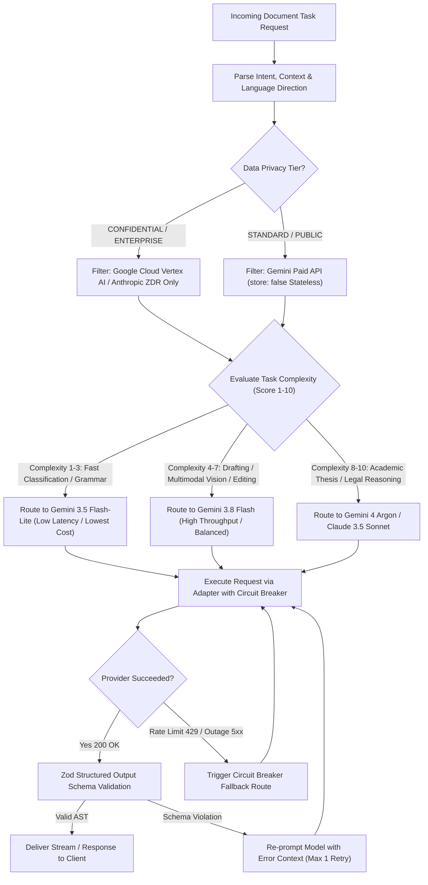

# DOCORA — Multi-Model Registry & Intelligent Router Architecture (Phase 00.2 Remediation)

**Document Reference:** `DOCORA-05-ROUTER-v1.2.1`  
**Status:** CONSOLIDATED ARCHITECTURE BASELINE (POST-REVIEW REMEDIATED)  
**Audit Predecessors:** Phase 00 (`06-AI-ARCHITECTURE.md`), Phase 00.1 (`06-UPDATED-AI-AND-PRIVACY.md`), Phase 00.2 Baseline  

---

## 1. Architectural Philosophy: Capability-Based Model Registry

DOCORA rejects hardcoded model strings embedded in application controllers. Instead, the platform treats foundation models as **pluggable capability providers** registered in a dynamic, capability-based registry. The business logic requests a capability profile (e.g., `CAPABILITY_LONG_FORM_WRITING_ARABIC_HIGH_FIDELITY` with `DATA_CONFIDENTIALITY_STRICT`), and the **Intelligent Model Router** selects the optimal model satisfying quality, latency, privacy, and token cost boundaries.

---

## 2. Capability-Based Model Registry

```json
[
  {
    "modelId": "gemini-4-argon",
    "provider": "google-genai",
    "displayName": "Google Gemini 4 Argon",
    "contextWindowTokens": 1048576,
    "maxOutputTokens": 65536,
    "modalities": ["text", "image", "document_pdf", "audio"],
    "capabilities": [
      "COMPLEX_REASONING",
      "LONG_FORM_WRITING",
      "ARABIC_ACADEMIC_REGISTER",
      "STRUCTURED_JSON_SCHEMA",
      "CITATION_VERIFICATION",
      "HIGH_FIDELITY_CODING"
    ],
    "tier": "flagship_reasoning",
    "pricingPerMillionTokens": {
      "inputUsd": 2.50,
      "outputUsd": 10.00
    },
    "privacyClassification": "DEVELOPER_PAID_LOG_RETAINED_55D",
    "dataRetentionDays": 55,
    "trainingConsent": false,
    "status": "ACTIVE_PRODUCTION"
  },
  {
    "modelId": "gemini-3.8-flash",
    "provider": "google-genai",
    "displayName": "Google Gemini 3.8 Flash",
    "contextWindowTokens": 1048576,
    "maxOutputTokens": 32768,
    "modalities": ["text", "image", "document_pdf"],
    "capabilities": [
      "HIGH_VELOCITY_WRITING",
      "INTENT_EXTRACTION",
      "ARABIC_GENERAL_REGISTER",
      "MULTIMODAL_OCR_INTERPRETATION",
      "STRUCTURED_JSON_SCHEMA",
      "STREAMING_CHAT"
    ],
    "tier": "balanced_production",
    "pricingPerMillionTokens": {
      "inputUsd": 0.15,
      "outputUsd": 0.60
    },
    "privacyClassification": "DEVELOPER_PAID_LOG_RETAINED_55D",
    "dataRetentionDays": 55,
    "trainingConsent": false,
    "status": "ACTIVE_PRODUCTION"
  },
  {
    "modelId": "gemini-3.5-flash-lite",
    "provider": "google-genai",
    "displayName": "Google Gemini 3.5 Flash-Lite",
    "contextWindowTokens": 1048576,
    "maxOutputTokens": 8192,
    "modalities": ["text", "image"],
    "capabilities": [
      "FAST_CLASSIFICATION",
      "GRAMMAR_LINTING",
      "SUMMARIZATION_SHORT",
      "MICROCOPY_GENERATION"
    ],
    "tier": "low_latency_lite",
    "pricingPerMillionTokens": {
      "inputUsd": 0.075,
      "outputUsd": 0.30
    },
    "privacyClassification": "DEVELOPER_PAID_LOG_RETAINED_55D",
    "dataRetentionDays": 55,
    "trainingConsent": false,
    "status": "ACTIVE_PRODUCTION"
  },
  {
    "modelId": "claude-3-5-sonnet",
    "provider": "anthropic",
    "displayName": "Anthropic Claude 3.5 Sonnet",
    "contextWindowTokens": 200000,
    "maxOutputTokens": 8192,
    "modalities": ["text", "image"],
    "capabilities": [
      "COMPLEX_REASONING",
      "ENGLISH_ACADEMIC_REGISTER",
      "LEGAL_PRECISION",
      "STRUCTURED_OUTPUT"
    ],
    "tier": "flagship_reasoning",
    "pricingPerMillionTokens": {
      "inputUsd": 3.00,
      "outputUsd": 15.00
    },
    "privacyClassification": "ZERO_DATA_RETENTION_ELIGIBLE",
    "dataRetentionDays": 0,
    "trainingConsent": false,
    "status": "SECONDARY_FAILOVER"
  }
]
```

---

## 3. Intelligent Model Routing Engine

### Diagram 3: Intelligent Model Routing Decision Flow



---

## 4. Provider Data-Handling & Retention Matrix (Technical Truth)

The audit revealed critical distinctions between the developer API and enterprise cloud offerings. The architecture formalizes these data-handling behaviors:

| Provider & Service Channel | Data Used to Train Models? | Stored Interactions (`store`) | Abuse Log Retention | Uploaded Files Retention | True Zero Data Retention (ZDR)? |
| :--- | :---: | :---: | :---: | :---: | :---: |
| **Google AI Studio (Free Tier)** | **YES (Inputs may train models)** | Ephemeral / Public Cache | Variable | 48 Hours | **STRICTLY FORBIDDEN IN DOCORA** |
| **Google GenAI Paid API (`store: true`)**| **NO (Zero training)** | **55 Days** (Stored interactions) | 55 Days | 48 Hours | No (Retained for chaining & logs) |
| **Google GenAI Paid API (`store: false`)**| **NO (Zero training)** | **0 Days** (Stateless mode) | Up to 55 Days | 48 Hours | Reduced retention (Stateless API) |
| **Google Cloud Vertex AI (Enterprise)** | **NO (Zero training)** | Disabled by default | **0 Days** (With Enterprise BAA / ZDR) | User-managed GCS bucket | **YES (Genuine Contractual ZDR)** |
| **Anthropic Claude API (Commercial ZDR)**| **NO (Zero training)** | Zero storage | **0 Days** (With signed commercial ZDR) | In-memory only | **YES (Genuine Contractual ZDR)** |

### Operational Reality of `store: false` in `@google/genai`
1. **What It Does:** Disables server-side interaction persistence. Prevents Google from caching the prompt and output objects on developer-accessible interaction histories.
2. **What It Does NOT Do:** It does not bypass Google's backend trust & safety abuse monitoring pipelines (which may retain metadata and requests for up to 55 days for security compliance under developer terms).
3. **Architectural Trade-offs:**
   - Multi-turn chats must send full historical context with every turn (disables `previous_interaction_id`).
   - Asynchronous background tasks (`background=true`) are unavailable and must be handled via DOCORA's internal PGMQ worker fleet.
4. **Enterprise Confidential Path:** True Zero Data Retention is implemented via **Google Cloud Vertex AI endpoints** or **Anthropic Commercial ZDR Agreements**, where HIPAA BAA and Customer Data Commitments contractually guarantee zero abuse logging and immediate in-memory purging.

---

## 5. Model Selection Justification & Evaluation Evidence

To eliminate unverified claims:
- **Arabic Language Capability:** Gemini 4 Argon is selected as the primary Arabic formal writing candidate based on published Google benchmarks (e.g., MMLU Arabic $\ge 84.2\%$, MGSM Arabic reasoning). However, its real-world performance against complex literary and Gulf legal phrasing remains **PROPOSED pending empirical measurement on DOCORA's Golden Test Suite in Phase 01**.
- **Multimodal OCR Interpretation:** Gemini 3.8 Flash is selected for complex scanned documents due to its native document understanding capabilities, but is paired with local Tesseract 5.5.4 to control operational token expenses.

---

## 6. Circuit Breaker & Resilience Topology

To guarantee system availability during upstream AI provider degradation:
- **Failure Threshold:** 3 consecutive HTTP 429 (Rate Limit) or 5xx (Server Error) responses within a 60-second sliding window trips the circuit into `OPEN` state.
- **Failover Action:** The router automatically diverts pending and new requests to the secondary fallback model adapter (Anthropic Claude 3.5 Sonnet / Haiku).
- **Half-Open Probe:** After 30 seconds in `OPEN` state, a single test probe request is dispatched. If successful, the circuit resets to `CLOSED`.
- **Degraded User Notice:** The studio UI displays a non-intrusive status pill:  
  *`"Operating on high-availability backup model due to provider maintenance."`*

---
*Verified against Phase 00.2 acceptance review findings. Approved as updated model registry and router architecture.*
