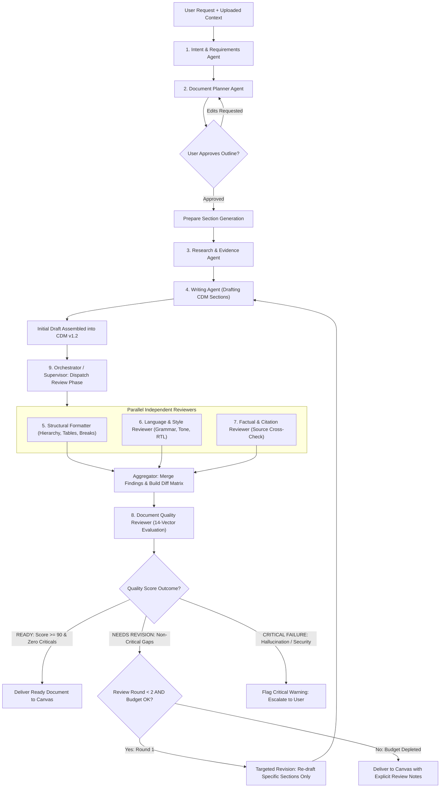

# DOCORA — Multi-Agent Orchestration & Review Architecture (Phase 00.2)

**Document Reference:** `DOCORA-06-AGENTS-v1.2`  
**Status:** CONSOLIDATED ARCHITECTURE BASELINE  
**Audit Predecessors:** Phase 00 (`06-AI-ARCHITECTURE.md`), Phase 00.1 (`06-UPDATED-AI-AND-PRIVACY.md`)  

---

## 1. Architectural Philosophy: Bounded, Role-Specific Agents

DOCORA strictly avoids chaotic, unbounded multi-agent swarms. Excessive agent counts create unpredictable latency, compounding token costs, circular revision loops, and untraceable errors. 

In DOCORA, **multi-agent orchestration represents a set of 9 clearly defined logical roles** governed by an **Orchestrator / Supervisor**. These roles do not require 9 distinct microservice deployments; rather, they are structured, isolated prompts and tool loops executed sequentially where dependent and in parallel where independent.

---

## 2. The 9 Logical Agent Roles & Bounded Responsibilities

| Agent Role | Responsibility | Input Schema | Output Schema | Permitted Tools |
| :--- | :--- | :--- | :--- | :--- |
| **1. Intent & Requirements** | Dissects user prompt into explicit document constraints and audience goals. | `UserPromptContext` | `DocumentIntentSpec` | None (Zero tool access) |
| **2. Document Planner** | Structures the document outline, section headings, and word budgets. | `DocumentIntentSpec` | `DocumentOutlineSpec` | `fetch_style_dna_template` |
| **3. Research & Evidence** | Retrieves facts, extracts quotes, and organizes reference citations. | `OutlineTopicQueries` | `EvidenceCollection` | `search_user_files`, `extract_provenance` |
| **4. Writing Agent** | Drafts section content in CDM AST adhering to approved style and language direction. | `SectionSpec`, `Evidence` | `CDMSectionNode` | None (Direct generation) |
| **5. Structural Formatter** | Enforces heading hierarchies, table layouts, page breaks, and margin rules. | `CDMDocument` | `StructuralDiffReport` | `validate_cdm_ast` |
| **6. Language & Style Reviewer** | Audits grammar, formality, terminology consistency, and Arabic/English tone. | `CDMSectionNode` | `StyleCorrectionList` | `dictionary_lookup` |
| **7. Factual & Citation Reviewer** | Cross-references generated claims against original uploaded source documents. | `ClaimList`, `Citations` | `CitationAuditReport` | `verify_provenance_id` |
| **8. Quality Reviewer** | Evaluates document across 14 multidimensional quality vectors. | Full `CDMDocument` | `QualityScoreCard` | `eval_completeness_rules` |
| **9. Orchestrator / Supervisor** | Controls execution graph, resolves conflicts, and finalizes delivery. | Workflow State | Final Action Directive | Workflow control primitives |

---

## 3. Orchestration Workflow & Execution Graph

### Diagram 4: Multi-Agent Review Workflow

---

## 4. Execution Discipline & Guardrail Budgets

To prevent run-away AI loops and protect system operational margins:
1. **Maximum Execution Depth ($D_{max} = 3$):** An individual sub-task can branch no deeper than 3 recursive calls.
2. **Maximum Review Iterations ($N_{max} = 2$):** Multi-agent review is capped at a strict maximum of **two iterations**. If a document still has minor issues after Round 2, it is delivered to the user canvas with highlighted warnings rather than wasting tokens in endless refinement loops.
3. **Hard Token Budget ($B_{token}$):**
   - Standard Document (1-5 pages): 35,000 token ceiling.
   - Long-form Document (6-25 pages): 120,000 token ceiling.
   - If 90% of the token budget is reached, review phases are automatically halted, and the current best draft is materialized.
4. **Per-Role Timeout ($T_{role} = 15\text{s}$):** Any reviewer agent that does not respond within 15 seconds is timed out and excluded from the aggregation matrix without blocking the supervisor.

---

## 5. Agent Trust Boundaries & Privilege Defense

Agents in DOCORA operate under the **Principle of Least Privilege**:
- **Zero RLS Bypass:** Agents execute purely under the security context of the authenticated user. They possess zero database credentials and cannot query data outside the user's tenant.
- **Read-Only Document Access:** Reviewer agents cannot mutate the document directly; they emit typed `Suggestion` objects containing `nodeId`, `replacementText`, `explanation`, and `severity`.
- **Zero Tool Escalation:** A writing or intent agent cannot dynamically invoke an export, billing, or account deletion tool. Tools are explicitly whitelisted and bound per role.
- **Untrusted Output Quarantine:** All text produced by agents is treated as untrusted user input and sanitized against XSS, prompt injection, and CSS injection prior to insertion into the CDM AST.

---

## 6. Supervisor Conflict Resolution & Decision Rules

When parallel reviewers submit overlapping or contradictory recommendations:
1. **Factual Integrity Trumps Stylistic Preference:** If the Factual Reviewer flags a sentence as unsupported, its removal or citation requirement supersedes the Style Reviewer's desire for a smoother sentence flow.
2. **Non-Overlapping Diffs Auto-Merge:** Suggestions targeting distinct node IDs or independent text spans are merged cleanly into a single revision payload.
3. **Overlapping Diffs Flagged for Human Review:** If two reviewers propose conflicting rewrites for the exact same sentence, the Orchestrator presents both options as an interactive diff card in the studio sidebar:  
   *`"Option A (Factual Clarity) vs. Option B (Stylistic Tone) — Click to choose."`*

---
*Verified against Phase 00.1 remediation directives. Approved as baseline multi-agent orchestration architecture for Phase 00.2 consolidation.*
