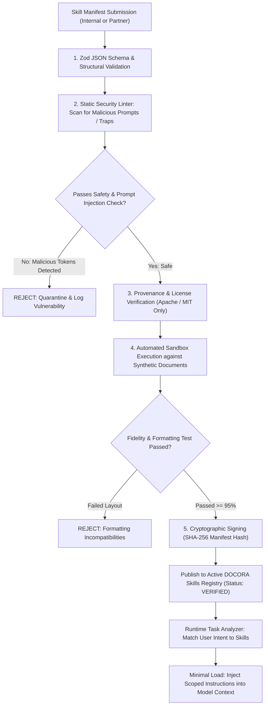

# DOCORA — Skills Registry & Capability Governance Architecture (Phase 00.2)

**Document Reference:** `DOCORA-07-SKILLS-v1.2`  
**Status:** CONSOLIDATED ARCHITECTURE BASELINE  
**Audit Predecessors:** Phase 00 (`16-TOOLS-AND-SKILLS-INVENTORY.md`)  

---

## 1. Architectural Role of the Skills Registry

In DOCORA, a **Skill** is a governed, modular, versioned capability package that equips the system with specialized document engineering domain knowledge (e.g., formatting an academic IEEE thesis, structuring a Gulf region bilingual employment agreement, or reconstructing complex financial balance sheets). 

Skills are not unvetted third-party plugins executing arbitrary code on user machines. They are **declarative, schema-validated operational recipes** composed of prompt instructions, structural constraints, layout templates, and validation heuristics.

---

## 2. Governed Skill Schema Definition

```json
{
  "$schema": "https://docora.ai/schemas/skill-manifest-v1.json",
  "skillId": "skill-academic-ieee-bilingual",
  "name": "Bilingual IEEE Research Paper Specialist",
  "version": "1.2.0",
  "category": "academic_research",
  "author": "DOCORA Core Engineering",
  "license": "Apache-2.0",
  "provenance": {
    "source": "official_internal_registry",
    "verifiedSha256": "e3b0c44298fc1c149afbf4c8996fb92427ae41e4649b934ca495991b7852b855",
    "lastSecurityAuditDate": "2026-11-01"
  },
  "supportedLanguages": ["ar", "en"],
  "supportedTasks": [
    "RESEARCH_PAPER_PLANNING",
    "SECTION_DRAFTING",
    "CITATION_FORMATTING_IEEE",
    "TWO_COLUMN_LAYOUT_VERIFICATION"
  ],
  "requiredCapabilities": [
    "ARABIC_ACADEMIC_REGISTER",
    "STRUCTURED_JSON_SCHEMA",
    "CITATION_VERIFICATION"
  ],
  "permissionRequirements": {
    "fileReadAccess": "scoped_user_attachments",
    "networkEgress": "none",
    "tokenQuotaExempt": false
  },
  "layoutConstraints": {
    "pageSize": "A4",
    "columns": 2,
    "marginsMm": { "top": 19.0, "bottom": 25.4, "left": 15.8, "right": 15.8 },
    "citationStyle": "IEEE_NUMERICAL",
    "abstractRequired": true,
    "keywordsRequired": true
  },
  "trustStatus": "VERIFIED_OFFICIAL",
  "securityReviewStatus": "PASSED_ZERO_INJECTION_RISK"
}
```

---

## 3. Skill Lifecycle & Security Governance

### Diagram 5: Skills Discovery, Verification & Activation Lifecycle



---

## 4. Built-in Core Skills Inventory

| Skill Identifier | Category | Target Output | Key Enforcements |
| :--- | :--- | :--- | :--- |
| `skill-academic-ieee` | Academic | IEEE Research Paper | 2-column layout, abstract block, numerical citations `[1]`. |
| `skill-business-proposal` | Corporate | RFP / Business Proposal | Executive summary, deliverables table, pricing schedule, milestones. |
| `skill-legal-employment-draft` | Legal | Employment Agreement Draft | Bilingual side-by-side columns, mandatory legal disclaimer banners. |
| `skill-academic-cv-bilingual` | Career | Academic / Executive CV | Standard reverse-chronological sections, publications list, RTL/LTR styling. |
| `skill-technical-whitepaper` | Engineering | Architecture Whitepaper | Code blocks, callout warning boxes, system architecture diagrams. |
| `skill-financial-statement` | Finance | Quarterly / Annual Report | Strict tabular alignment, accounting underlines, footnote annotations. |
| `skill-arabic-callout-rtl` | Typography | Styled Document Elements | Proper Quranic / classical Arabic quote borders, margin indents. |

---

## 5. Defense Against Poisoned Skills & Untrusted Ingestion

External skills represent a potential vector for **prompt injection, unauthorized exfiltration, and formatting corruption**. DOCORA enforces rigorous safeguards:
1. **Zero Execution of Arbitrary Code:** Skills never execute binary code, JavaScript eval, shell scripts, or container commands. A skill is strictly a **declarative data asset**.
2. **Untrusted Text Isolation:** All instructions within a skill manifest are isolated inside delimited XML prompt boundaries (`<governed_skill_rule id="...">`) with strict system priority instructions that forbid the skill from overriding core platform guardrails.
3. **Dynamic Scope Minimization:** The system loads at most **one primary skill and one auxiliary formatting skill per task**. It is architecturally prohibited to dump the entire skills catalog into an LLM context window.

---
*Verified against Phase 00.1 remediation directives. Approved as baseline skills registry and governance architecture for Phase 00.2 consolidation.*
