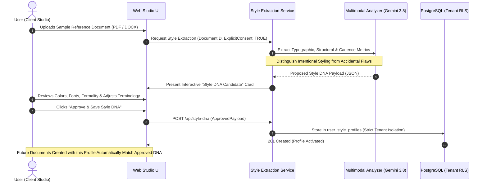

# DOCORA — Style DNA & Personal Document Learning Architecture (Phase 00.2)

**Document Reference:** `DOCORA-08-STYLE-v1.2`  
**Status:** CONSOLIDATED ARCHITECTURE BASELINE  
**Audit Predecessors:** Phase 00 (`01-PRODUCT-REQUIREMENTS.md`), Phase 00.1 (`06-UPDATED-AI-AND-PRIVACY.md`)  

---

## 1. Architectural Philosophy: Privacy-Preserving Stylistic Adaptation

A primary differentiator of DOCORA is its ability to understand and mirror a user's unique writing cadence, corporate typography, and layout preferences. 

However, **DOCORA strictly rejects model weight fine-tuning or shared parameter updates on user documents**. Foundation model fine-tuning introduces severe privacy hazards: corporate secrets or private personal data can easily leak into subsequent generations across tenants.

Instead, DOCORA implements **Style DNA: A declarative, tenant-isolated structural profile** extracted from user-approved sample documents, stored exclusively in the user's PostgreSQL database row, and injected dynamically as bounded structured parameters during generation.

---

## 2. Style DNA Profile Schema

```json
{
  "$schema": "https://docora.ai/schemas/style-dna-v1.json",
  "profileId": "dna-91a02b1c-74f0-466a-b22f-d890e0c8b991",
  "userId": "usr-4819a-381c",
  "profileName": "King Fahd University Academic Style",
  "documentCategory": "academic_research",
  "createdTimestamp": 1772884800000,
  "lastUpdatedTimestamp": 1772886000000,
  "consentStatus": "USER_EXPLICIT_APPROVED",
  "writingPreferences": {
    "formalityLevel": "rigorous_academic",
    "tone": "objective_analytical",
    "sentenceComplexity": "compound_detailed",
    "averageParagraphWordCount": 110,
    "arabicRegister": "fusha_classical_academic",
    "englishStyle": "oxford_academic",
    "preferredTerminology": {
      "artificial intelligence": "الذكاء الاصطناعي",
      "canonical document model": "نموذج الوثيقة المعياري",
      "framework": "إطار عمل"
    },
    "citationStyle": "APA_7TH"
  },
  "formattingPreferences": {
    "primaryFontArabic": "Amiri",
    "primaryFontEnglish": "Times New Roman",
    "headingFont": "Cairo",
    "bodyFontSizeHalfPt": 24,
    "heading1SizeHalfPt": 36,
    "lineSpacingMultiplier": 1.5,
    "paragraphSpacingAfterPt": 6,
    "pageMarginsMm": {
      "top": 25.4,
      "bottom": 25.4,
      "left": 25.4,
      "right": 25.4
    },
    "tableHeaderBackgroundHex": "#1E293B",
    "tableHeaderTextColorHex": "#FFFFFF",
    "coverPageStyle": "classic_centered_bordered"
  }
}
```

---

## 3. Personal Document Learning Workflow

### Diagram 6: Style DNA Learning, Review & Approval Lifecycle



---

## 4. Discerning Intentional Style vs. Accidental Artifacts

A naive extractor copies bad formatting (e.g., accidental double spaces, misaligned bullet tabs, or random font changes). DOCORA's **Style Extraction Service** applies heuristic normalization filters:
1. **Statistical Thresholding:** A font family or margin size is only recognized as a stylistic rule if it accounts for $> 70\%$ of body paragraph occurrences.
2. **Grammar & Spacing Cleanse:** Multiple spaces, irregular carriage returns, and broken hyphens are stripped prior to stylistic cadence evaluation.
3. **Contrast & Accessibility Gate:** If the user's sample document uses illegible low-contrast colors (e.g., light gray text on white background), the extractor automatically flags the violation and recommends an accessible WCAG AA alternative.

---

## 5. Privacy, Isolation & Lifecycle Controls

- **Absolute Tenant Isolation:** Style DNA profiles are stored in `user_style_profiles` protected by PostgreSQL RLS (`auth.uid() = user_id`). No user or enterprise tenant can ever query, inspect, or inherit another tenant's Style DNA.
- **Zero Training Guarantee:** Style DNA rules are serialized into dynamic system prompts at runtime. They are never transmitted to model training clusters or retained beyond ephemeral session evaluation.
- **Export & Right to Erasure:** Users can export their complete Style DNA profiles as portable JSON files or click "Delete Profile", triggering cryptographic database deletion and cache eviction in compliance with GDPR and Saudi PDPL.

---
*Verified against Phase 00.1 remediation directives. Approved as baseline Style DNA and personal learning architecture for Phase 00.2 consolidation.*
