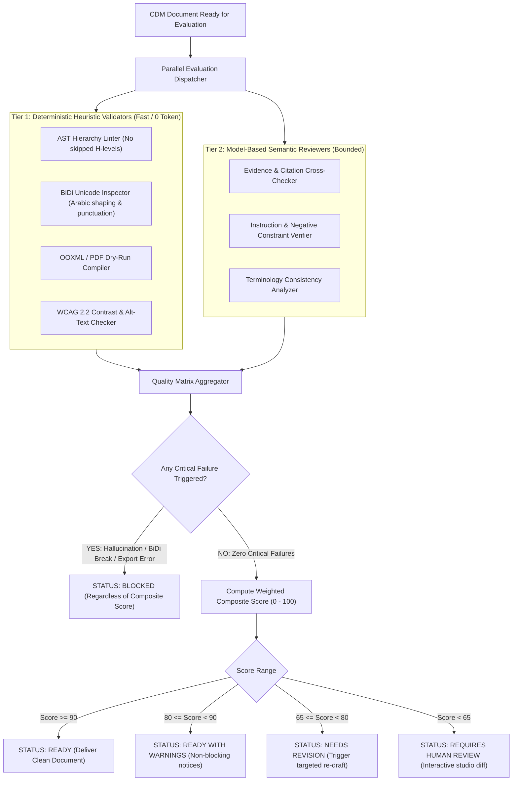

# DOCORA — Document Quality Scoring Engine (Phase 00.2)

**Document Reference:** `DOCORA-09-QUALITY-v1.2`  
**Status:** CONSOLIDATED ARCHITECTURE BASELINE  
**Audit Predecessors:** Phase 00 (`01-PRODUCT-REQUIREMENTS.md`), Phase 00.1 (`09-UPDATED-TESTING-STRATEGY.md`)  

---

## 1. Architectural Philosophy: Transparent, Multidimensional Quality

DOCORA categorically rejects the concept of a "black-box single AI score" (e.g., *"This document is 94% good"*). Unexplained aggregate scores erode professional trust and conceal fatal flaws such as hallucinated citations, broken table borders, or flipped Arabic parentheses.

The **DOCORA Quality Scoring Engine** evaluates documents across **14 distinct, explainable dimensions** combining **deterministic algorithmic validators** (structural parsers, regex linters, accessibility analyzers) and **bounded model-based reviewers**.

---

## 2. The 14 Quality Evaluation Dimensions

| # | Dimension | Evaluation Method | Weight | Critical Failure Condition | Remediation Action |
| :- | :--- | :--- | :---: | :--- | :--- |
| **1** | **Content Completeness** | Deterministic AST + Checklist | 10% | Missing mandatory section specified in outline | Flag missing section; auto-draft section |
| **2** | **Instruction Compliance** | Semantic Embedding Check | 10% | Direct contradiction of explicit user negative constraint | Targeted section rewrite |
| **3** | **Structural Quality** | AST Hierarchy Analyzer | 8% | Skipped heading level (e.g., H1 directly to H3) | Normalize heading tags |
| **4** | **Language & Grammar** | Algorithmic Linter + Lite LLM | 8% | Severe grammatical or spelling errors ($> 5$ / page) | Inline suggestion chip with auto-fix |
| **5** | **Terminology Consistency**| Lexical Analysis Table | 5% | Conflicting translations of core technical terms | Flag variant; suggest canonical term |
| **6** | **Factual Reliability** | Source Cross-Referencing | 12% | **Critical factual claim contradicted by source doc** | **BLOCK: Immediate escalation to user** |
| **7** | **Citation Validity** | URL / DOI Regex + Schema | 6% | Malformed citation syntax or dead DOI reference | Flag malformed citation |
| **8** | **Claim-to-Citation Support**| Bounded Model Evidence Match | 10% | **Citation attached to claim it does not support** | **BLOCK: Highlight hallucinated reference** |
| **9** | **Formatting Consistency** | CSS & Mark Uniformity Check | 5% | Mixed arbitrary font sizes or inconsistent colors | Re-apply Style DNA token defaults |
| **10**| **Layout & Pagination** | Virtual Canvas Height Engine | 6% | Table overflowing page width; lone orphan heading | Insert forced page break or wrap table |
| **11**| **Arabic & RTL Correctness** | HarfBuzz & BiDi Linter | 8% | **Flipped punctuation; broken Arabic character shaping** | **BLOCK: Inject Unicode BiDi isolates** |
| **12**| **Accessibility (a11y)** | WCAG 2.2 Algorithmic Rules | 4% | Image lacking alt text; contrast ratio $< 4.5:1$ | Auto-generate alt text; bump contrast |
| **13**| **Export Integrity** | Dry-Run OOXML / PDF Compile | 5% | **OOXML schema failure or Puppeteer crash** | **BLOCK: Repair corrupted AST node** |
| **14**| **Document Usability** | Readability Index (Flesch/ARI)| 3% | Excessively dense sentence length ($> 45$ words) | Suggest sentence split |

---

## 3. Evaluation Flow & Hard Gate Overrides

### Diagram 7: Document Quality Evaluation & Hard Gate Flow

---

## 4. Operational Status Definitions

1. **`READY` (Composite $\ge 90$, 0 Criticals):**  
   The document satisfies all structural, factual, typographic, and export benchmarks. Ready for immediate one-click export.
2. **`READY WITH WARNINGS` ($80 \le \text{Composite} < 90$, 0 Criticals):**  
   Document is fully exportable, but contains minor non-blocking suggestions (e.g., a sentence could be simplified, or an optional citation could be added).
3. **`NEEDS REVISION` ($65 \le \text{Composite} < 80$, 0 Criticals):**  
   Document contains structural deficiencies or missing sections. Automatically triggers targeted re-drafting of the offending blocks without re-generating the entire file.
4. **`REQUIRES HUMAN REVIEW` ($\text{Composite} < 65$ or Ambiguous Evidence):**  
   Significant stylistic, terminological, or structural discrepancies. Displays a split-view interactive diff in the studio sidebar for user adjudication.
5. **`BLOCKED` (Any Critical Failure Triggered):**  
   Triggered unconditionally if an unverified claim, broken export schema, or garbled Arabic text is detected. Export buttons are disabled with clear, actionable remediation guidance.

---
*Verified against Phase 00.1 remediation directives. Approved as baseline document quality scoring engine architecture for Phase 00.2 consolidation.*
