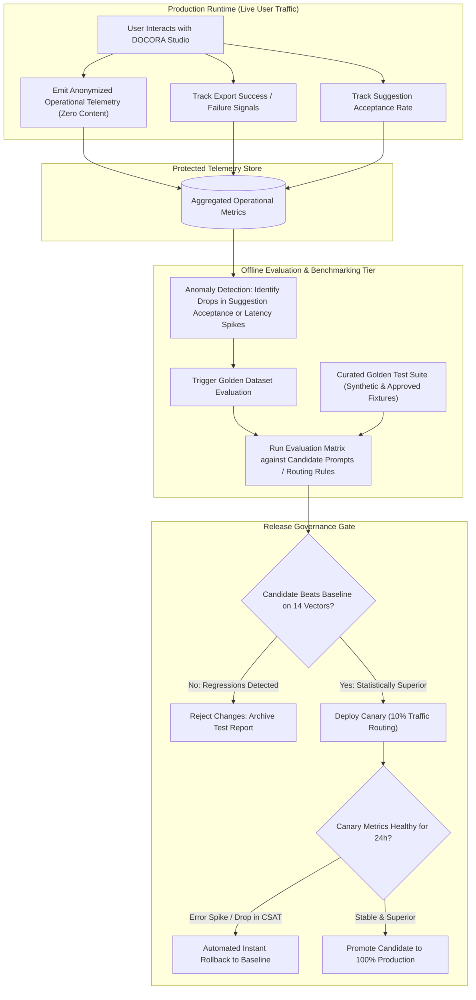

# DOCORA — Continuous Improvement & Evaluation Loop Architecture (Phase 00.2)

**Document Reference:** `DOCORA-10-IMPROVE-v1.2`  
**Status:** CONSOLIDATED ARCHITECTURE BASELINE  
**Audit Predecessors:** Phase 00 (`11-TESTING-STRATEGY.md`), Phase 00.1 (`09-UPDATED-TESTING-STRATEGY.md`)  

---

## 1. Architectural Philosophy: Privacy-First Continuous Improvement

DOCORA improves system performance, routing accuracy, and document fidelity through **empirical, telemetry-driven observation** rather than indiscriminate data scraping.

> **Privacy Invariant:**  
> *DOCORA never logs, stores, or analyzes raw user document text for global model training or product improvement by default. All system optimization relies on anonymized, non-content operational telemetry, synthetic regression benchmarks, and explicit user-opted bug reports.*

---

## 2. Telemetry Signals & Boundary Separation

```
+----------------------------------------------------------------------------------------------------+
|                                    TELEMETRY DATA SEPARATION                                       |
+----------------------------------------------------------------------------------------------------+
|  ALLOWED OPERATIONAL TELEMETRY (Logged by Default)                                                 |
|  - Latency: TTFT, total generation time, export compile duration                                   |
|  - Token Economics: Prompt tokens, completion tokens, cached tokens, provider cost                |
|  - Quality Telemetry: 14-vector dimension scores, status outcome (READY / BLOCKED)                  |
|  - Acceptance Rates: % of multi-agent review suggestions accepted vs dismissed                     |
|  - Error Codes: HTTP 429, 5xx, OOXML schema validation errors, Puppeteer crash signals             |
|  - Language & Task Tag: e.g., task='academic_research', lang='ar', direction='rtl'                |
|                                                                                                    |
|  FORBIDDEN CONTENT TELEMETRY (Stripped at the Gateway)                                             |
|  - Raw paragraph, heading, or table cell text                                                      |
|  - Document titles, author names, or file attachment contents                                      |
|  - Extracted OCR raw text snippets or user uploaded images                                         |
|  - Style DNA specific terminology mappings or proprietary entity names                             |
+----------------------------------------------------------------------------------------------------+
```

---

## 3. Continuous Evaluation & Rollout Pipeline

### Diagram 11: Continuous Improvement & Controlled Rollout Loop



---

## 4. The Golden Evaluation Dataset

To evaluate new model routing strategies, prompt revisions, or export compiler updates without accessing private user documents, DOCORA maintains an internal **Golden Evaluation Suite**:
- **Bilingual Composition:** 100 standardized test documents (50 Modern Standard Arabic, 40 English, 10 Complex Mixed-Direction BiDi).
- **Domain Coverage:** Academic theses, legal employment drafts, financial balance sheets, marketing proposals, and executive CVs.
- **Stress Fixtures:**
  - 10-column tables with merged Arabic header cells.
  - 30-page documents with alternating landscape/portrait orientations.
  - Citations mixing English APA references with Arabic text runs.
  - Low-contrast scanned PDF receipts for OCR stress-testing.

---

## 5. Automated Rollback & Versioned Governance

1. **Versioned Registry:** Every routing heuristic, system prompt template, and skill definition is stored in Git with a semver tag (e.g., `router-v1.4.2`).
2. **Canary Guardrails:** During canary deployment (10% of user sessions), automated health checks monitor two primary kill-switches:
   - **Export Failure Rate $> 0.5\%$:** Immediate rollback.
   - **P95 Latency $> 6.0\text{s}$:** Immediate rollback.
3. **Audit Trail:** Every promotion or rollback is recorded in `architecture_decision_logs` with attached benchmark performance artifacts.

---
*Verified against Phase 00.1 remediation directives. Approved as baseline continuous improvement architecture for Phase 00.2 consolidation.*
