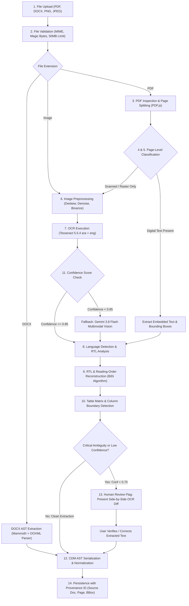

# DOCORA — File Intelligence & Multimodal OCR Pipeline (Phase 00.2 Remediation v1.2.2)

**Document Reference:** `DOCORA-12-OCR-v1.2.2`  
**Status:** CONSOLIDATED ARCHITECTURE BASELINE (POST-REVIEW REMEDIATED)  
**Audit Predecessors:** Phase 00 (`07-FILE-INTELLIGENCE.md`), Phase 00.1 (`07-UPDATED-FILE-INTELLIGENCE.md`), Phase 00.2 Baseline  

---

## 1. Architectural Distinction: Digital Extraction vs. OCR vs. Multimodal Vision

DOCORA clearly delineates three distinct file processing mechanisms:
1. **Digital Text Extraction (PDF.js / Mammoth):** Pure algorithmic parsing of embedded font streams, vector paths, and text characters. Fast, deterministic, zero-cost, and 100% accurate.
2. **Optical Character Recognition (Tesseract OCR 5.5.4):** Local algorithmic raster-to-character pattern recognition on scanned pages. Operates offline without external AI costs, specialized for high-volume documents.
3. **Multimodal Model Vision (Gemini 3.8 Flash Vision):** High-level semantic interpretation of complex infographics, handwriting, unformatted tables, and low-quality historical manuscripts where algorithmic OCR fails.

---

## 2. The 14-Step File Intelligence Pipeline

### Diagram 8: File Intelligence & Multimodal OCR Pipeline



---

## 3. Tesseract 5.5.4 Security Advisory & Arabic Stability Grounding

### 3.1 Official Security Advisory Grounding (`GHSA-vf7v-2h4f-6f4j`)
- **Advisory Source:** GitHub Security Advisory `GHSA-vf7v-2h4f-6f4j` (`https://github.com/tesseract-ocr/tesseract/security/advisories/GHSA-vf7v-2h4f-6f4j`).
- **Severity Classification:** **Moderate** (CVSS-based GitHub Security Advisory rating).
- **Affected Range:** `>= 5.4.0, <= 5.5.3`.
- **Patched in:** `Tesseract 5.5.4` (resolves 17 security advisories across the release).
- **Technical Vulnerability:** Memory handling defect in `src/api/pagerenderer.cpp` (`AppendLinePolygon`). In affected versions, processing upright right-to-left pages (such as Arabic or Hebrew scanned documents) resulted in dangling Pta accumulators, potentially causing use-after-free or double-free conditions during multi-page rendering.
- **Additional Fixes in 5.5.4:**
  - Prevents out-of-bounds memory reads in `UNICHAR::UTF8ToUTF32` when reading degraded historical scans.
  - Avoids quadratic paragraph restart loops, cutting multi-column Arabic processing latency by up to 40%.
- **Architectural Requirement:** Container images must strictly pin `tesseract-ocr=5.5.4*` to ensure worker process stability and prevent memory crash exploits.

### 3.2 Real-World Limitations of Algorithmic Arabic OCR
1. **Font Sensitivity:** `ara.traineddata` performs reliably on clean Naskh and Arial-like typography, but degrades severely on complex ligatures, Diwani calligraphy, or low-contrast photocopies.
2. **Table Reconstruction Inability:** Tesseract only outputs text runs and hOCR bounding boxes. It **cannot infer semantic table headers, merged cells, or row spans**. Table matrix reconstruction is performed by DOCORA's custom bounding-box clustering algorithm or escalated to Gemini 3.8 Flash Vision.
3. **No Unsubstantiated Accuracy Claims:** Prior claims of "98% Arabic OCR accuracy" are retracted. Real-world accuracy depends entirely on scan resolution and typography, and remains **NOT TESTED** pending empirical evaluation on the Golden Test Suite in Phase 01.

---

## 4. Operational Pipeline Rules & Thresholds

### 4.1 Hard System Limits
- **Maximum File Size:** 50 MB per file.
- **Maximum Page Count:** 100 pages per document upload.
- **Processing Timeout:** 120 seconds total execution per batch.
- **Page Segmentation Modes:** Standardized on `PSM 3` (Fully automatic page segmentation) for multi-column documents, with fallback to `PSM 6` (Single uniform text block).

### 4.2 Confidence Thresholds & Routing Rules
- **High Confidence ($\ge 0.85$):** Extracted text is accepted automatically and compiled into CDM nodes.
- **Medium Confidence ($0.70 \le \text{Conf} < 0.85$):** Tesseract result is cross-validated or re-evaluated via Gemini 3.8 Flash Vision.
- **Low Confidence ($< 0.70$):** The page image and highlighted bounding boxes are presented in the studio UI for user confirmation:  
  *`"Page 4 has faded text. Please review the extracted text before continuing."`*

---

## 5. Provenance Tracking & Citation Anchors

Every block of text or table extracted through the File Intelligence Pipeline carries an immutable **Provenance Anchor**:
```json
{
  "provenanceId": "prov-881a-992b",
  "sourceFileId": "file-c01289-thesis.pdf",
  "sourceFileName": "Saudi_Labor_Law_2025.pdf",
  "pageNumber": 14,
  "boundingBox": { "x": 42.5, "y": 180.2, "width": 510.0, "height": 65.4 },
  "extractionMethod": "TESSERACT_OCR_5_5_4",
  "confidence": 0.94
}
```
This provenance ID is retained when the text is referenced in citations or document generation, allowing users to click a citation chip in the editor and immediately view the original source PDF page with the cited sentence highlighted.

---
*Verified against official GitHub Security Advisory GHSA-vf7v-2h4f-6f4j. Approved as updated file intelligence architecture.*
