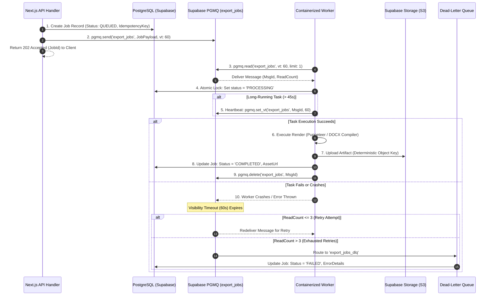

# DOCORA — Queues, Workers & Reliability Architecture (Phase 00.2)

**Document Reference:** `DOCORA-15-QUEUE-v1.2`  
**Status:** CONSOLIDATED ARCHITECTURE BASELINE  
**Audit Predecessors:** Phase 00 (`04-SYSTEM-ARCHITECTURE.md`), Phase 00.1 (`03-UPDATED-SYSTEM-ARCHITECTURE.md`)  

---

## 1. Architectural Role of Asynchronous Job Processing

Heavy document operations—such as multi-page PDF rasterization via Puppeteer, LibreOffice headless conversions, multi-page Tesseract OCR, and batch multi-agent reviews—must **never block HTTP API route handlers**. 

DOCORA leverages **asynchronous queue-driven workers** to buffer workloads, smooth traffic spikes, and guarantee fault-tolerant background execution.

---

## 2. Queue Selection Evaluation: PGMQ vs. Redis/BullMQ

| Evaluation Vector | Supabase PGMQ (`pgmq` Extension) | Redis + BullMQ | Architectural Decision & Rationale |
| :--- | :--- | :--- | :--- |
| **Infrastructure Footprint** | Native inside existing PostgreSQL DB | Requires separate Redis cluster / VPC | **PGMQ Selected for MVP & Growth** |
| **Transactional Enqueue** | Atomic with document state mutations | Requires 2-phase commit or outbox | **PGMQ Eliminates split-brain state** |
| **Operational Overhead** | Zero additional infrastructure to maintain | Redis memory management, backups | PGMQ minimizes operational burden |
| **Throughput Capacity** | ~1,000 to 5,000 jobs/sec | 50,000+ jobs/sec | PGMQ easily exceeds DOCORA MVP targets |
| **Cost Profile** | Included in Supabase compute plan | +$15 - $50/mo dedicated Redis | PGMQ reduces baseline infrastructure cost |

> **Cost & Maintenance Reality:**  
> *PGMQ is not "cost-free". It utilizes PostgreSQL WAL, table storage, and database connection pool slots. Queues must be regularly archived and vacuumed (`pgmq.archive()`), and workers must connect via Supabase PgBouncer / Supavisor connection poolers to prevent connection exhaustion.*

---

## 3. Delivery Semantics & At-Least-Once Reliability

### The Fallacy of "Exactly-Once" Execution
Distributed systems **cannot guarantee exactly-once delivery** across crash-prone worker fleets. If a worker completes a PDF render and uploads it to S3, but crashes before acknowledging the queue message, the message becomes visible again after the visibility timeout expires.

### DOCORA's Idempotent Design
DOCORA designs all background jobs for **At-Least-Once Delivery with Strict Idempotent Side Effects**:
1. **Stable Operation-Level Idempotency Key:**
   $$\text{IdempotencyKey} = \text{SHA-256}(\text{userId} + \text{jobType} + \text{documentId} + \text{contentVersionHash})$$
2. **Atomic Job Claiming:** Before executing, the worker attempts to acquire a lock on the job record in PostgreSQL:
   ```sql
   UPDATE public.export_jobs
   SET status = 'PROCESSING', worker_id = p_worker_id, updated_at = now()
   WHERE id = p_job_id AND status = 'QUEUED'
   RETURNING *;
   ```
   If zero rows are updated (another worker claimed it), the message is skipped.
3. **Idempotent S3 Writes:** Export assets are written to deterministic object keys:  
   `tenants/{userId}/exports/{documentId}/{versionHash}.pdf`  
   A redundant execution overwrites identical bytes with zero data corruption.
4. **Zero Duplicate Token Charges:** Token reservations are tied to the unique `IdempotencyKey`. A redelivered job reuses the existing reservation without double-debiting user quota.

---

## 4. Background Job Lifecycle

### Diagram 10: Asynchronous Background Job Lifecycle



---

## 5. Worker Fleet Scaling & Concurrency Controls

- **Worker Concurrency Limit:** Each container runs a Node.js 24 process pool capped at **5 concurrent jobs** to avoid memory exhaustion from headless Chromium instances.
- **Memory Allocation:** Worker containers are allocated **2 GB RAM** minimum to accommodate Puppeteer DOM rasterization of 50+ page documents.
- **Graceful Shutdown:** Upon receiving `SIGTERM` (e.g., during deployment or autoscaling), workers stop polling the queue, complete in-flight rendering jobs within a 25-second grace period, and exit cleanly.

---
*Verified against Phase 00.1 remediation directives. Approved as baseline queues, workers, and reliability architecture for Phase 00.2 consolidation.*
