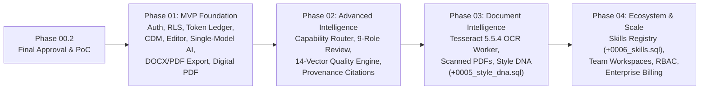

# DOCORA — الخطة التكاملية الشاملة لبناء وإتمام منصة DOCORA (Master Integration & Execution Plan v2.0)

**Document Reference:** `DOCORA-26-MASTER-EXECUTION-PLAN-v2.0`  
**Phase:** Transition Blueprint (`Phase 00.2` $\rightarrow$ `Stage 01.0 PoC` $\rightarrow$ `Phase 01 - Phase 04`)  
**Workspace:** `C:\Users\abdal\Desktop\DOCORA`  
**Skills Integrated:** `project-engineering-orchestrator`, `product-design-ux`, `frontend-craft`, `frontend-design`, `frontend-engineering`, `ui-ux-pro-max`, `modern-web-guidance`  
**Status:** **APPROVED BY PRODUCT OWNER — EXECUTING STAGE 01.0 & PHASE 01 MVP**  

---

## 1. تحليل النية التصميمية والهوية البصرية (`frontend-craft` + `frontend-design`)

تهدف هذه الخطة المنقحة والمعتمدة (**v2.0**) إلى بناء منصة **DOCORA** وفق فصل صارم للمراحل الهندسية (**Zero Phase Leakage**)، مع ضمان الأمان على مستوى قاعدة البيانات والـ Workers، وواقعية الوعود التقنية في معالجة الصفحات والتصدير والذكاء الاصطناعي.

### 1.1 تفكيك نية المشروع (Phase 0 — Intent-First Analysis)
> *"توجد منصة **DOCORA** لتمكين المهنيين والشركات في الشرق الأوسط والعالم من إنتاج مستندات وعقود وتقارير احترافية (Word/PDF) وتحليل الملفات الرقمية والمصورة عبر محرر مهيكل ثنائي الاتجاه (RTL/LTR) وذكاء اصطناعي منضبط التكلفة، ويجب أن تمنح المستخدم شعوراً بـ: **الفخامة الهندسية (Engineered Precision)، الموثوقية المؤسسية (Institutional Trust)، والانسيابية الفائقة (Effortless Fluidity)**."*

### 1.2 تصنيف النمط البصري المزدوج (Mode Classification)
1. **واجهة الاستوديو ومساحة العمل (`Mode B — SaaS / Product Utility: Linear-Vercel-Stripe Grade`):**
   - دقة هندسية عالية، تباين لوني محسوب رياضياً، استجابة تفاعلية ميدانية (`p75 INP <= 200ms` وميزانية إطار رسم `16.6ms` عند 60Hz)، خالية من الزخارف المشتتة.
2. **الصفحة الرئيسية التسويقية (`Mode C — High-Craft Marketing Hybrid`):**
   - عرض "المنتج كبطل" (**The Hero is a Thesis**) عبر **Interactive Demo معزول تماماً (Sandboxed & Pre-computed)** يعرض سيناريوهات عربية وإنجليزية حقيقية مخزنة مسبقاً دون استدعاء نماذج مدفوعة للزوار أو جمع بيانات خاصة.

### 1.3 نظام الألوان الدلالي المصحح رياضياً (Verified WCAG 2.2 AA Contrast $\ge 4.5:1$)

تم تدقيق وتصحيح جميع أزواج الألوان المستخدمة كنصوص لضمان اجتياز شرط `4.5:1` للنصوص العادية:

| فئة الرمز (Token) | الوضع الفاتح (Light Mode) | التباين (Light) | الوضع الداكن (Dark Mode) | التباين (Dark) | الاستخدام المسموح |
| :--- | :--- | :---: | :--- | :---: | :--- |
| `--surface-canvas` | `#F8FAFC` (Slate 50) | — | `#090A0F` (Obsidian) | — | خلفية طاولة العمل حول الورقة |
| `--surface-paper` | `#FFFFFF` (Pure Paper) | — | `#FFFFFF` / `#12141C` | — | سطح ورقة المستند |
| `--ink-primary` | `#0F172A` على `#F8FAFC` | **16.8:1** ✓ | `#F8FAFC` على `#090A0F` | **18.9:1** ✓ | النصوص والعناوين الأساسية |
| `--ink-secondary` | `#475569` على `#F8FAFC` | **7.21:1** ✓ | `#94A3B8` على `#090A0F` | **6.85:1** ✓ | النصوص الفرعية والتسميات (تم استبدال `#64748B` الحدي) |
| `--accent-text` | `#4F46E5` (Indigo 600) على `#FFFFFF` | **6.29:1** ✓ | `#818CF8` (Indigo 400) على `#090A0F` | **6.72:1** ✓ | الروابط والنصوص التفاعلية (تم استبدال `#6366F1` كنص داكن لأنه كان `4.43:1`) |
| `--accent-fill` | `#4F46E5` مع نص `#FFFFFF` | **6.29:1** ✓ | `#4F46E5` مع نص `#FFFFFF` | **6.29:1** ✓ | خلفية الأزرار الأساسية |
| `--status-verified-text` | `#047857` (Emerald 700) على `#ECFDF5` | **5.12:1** ✓ | `#34D399` (Emerald 400) على `#090A0F` | **10.4:1** ✓ | نصوص شارات التحقق (يُمنع استخدام `#10B981` كنص على الأبيض لأن تباينه `2.54:1`) |

### 1.4 نظام الخطوط المزدوج (Bilingual Typography Scale)
- **واجهة المستخدم والعناوين العربية (RTL UI & Headings):** `IBM Plex Sans Arabic` (الأوزان: 400, 500, 600, 700).
- **متن المستندات الرسمية والعقود العربية (RTL Document Body):** `Noto Naskh Arabic` و `Amiri`.
- **واجهة المستخدم والمتن الإنجليزي (LTR UI & Body):** `Geist Sans` / `Inter`.
- **العناوين التسويقية البارزة (Display Serif):** `Instrument Serif`.
- **الأكواد والبيانات الرقمية والجداول المالية:** `Geist Mono` (مع تفعيل `font-variant-numeric: tabular-nums`).

---

## 2. خارطة الطريق المفصولة بصرامة (Zero-Leakage Phased Roadmap)

> [!IMPORTANT]
> **قاعدة الفصل الصارم بين المراحل:** لا يتم إنشاء أي جدول قاعدة بيانات (Migration) أو كود لميزة مؤجلة قبل أوان مرحلتها المخصصة.



| الميزة / النظام | المرحلة المخصصة | حالة وجودها في `Phase 01 (MVP)` |
| :--- | :---: | :--- |
| المصادقة، RLS، `profiles`، `user_entitlements`، ودفتر الحصص الذري | **Phase 01** | **تُبنى بالكامل (`0001` & `0002`)** |
| نموذج `CDM v1.2`، محرر `Tiptap 3.x`، والحفظ التلقائي | **Phase 01** | **تُبنى بالكامل (`0003`)** |
| توليد الذكاء الاصطناعي الأساسي واستكمال التوليد (`Continue Generation`) | **Phase 01** | **تُبنى بالكامل** |
| التصدير المزدوج (`docx@9.15.2` + `Puppeteer`) واستخراج PDF الرقمي (`pdfjs-dist`) | **Phase 01** | **تُبنى بالكامل مع Worker مستقل (`0004`)** |
| موجه النماذج المتقدم + نظام الوكلاء الـ 9 + محرك الجودة ذي الـ 14 بُعداً | **Phase 02** | **مؤجلة بالكامل إلى Phase 02 (لا تدخل في P01)** |
| التعرف الضوئي `Tesseract 5.5.4` للملفات المصورة + بصمة الأسلوب (`Style DNA`) | **Phase 03** | **مؤجلة بالكامل إلى Phase 03 (بما في ذلك Migration الخاصة بها)** |
| سجل المهارات (`Skills Registry`) + الفرق والفوترة المؤسسية | **Phase 04** | **مؤجلة بالكامل إلى Phase 04 (بما في ذلك Migration الخاصة بها)** |

---

## 3. المعالجات الهندسية للعيوب السبعة والضوابط الستة الإضافية

### 3.1 إثبات جدوى محرك الصفحات (`ADR-001 PoC Gate` & Fallback Strategy)
> [!WARNING]
> `ResizeObserver` أداة قياس أبعاد وليس محرك تقسيم صفحات (`Pagination Engine`).

- **الخطوة الإلزامية قبل حسم `ADR-001` (`Stage 01.0 — Pagination PoC`):**
  - بناء نموذج إثبات جدوى معزول (`tests/poc/`) يختبر 5 حالات حرجة: (1) فقرة تنقسم بين صفحتين، (2) عنوان مرتبط بالفقرة التالية (`keep-with-next`)، (3) جدول يمتد عبر صفحتين، (4) نص عربي مختلط بإنجليزي وأرقام، (5) تحديد المؤشر والنسخ واللصق عبر فاصل الصفحات.
- **مسار الأمان المعماري المعتمد في `Phase 01` (Explicit Fallback):**
  - نظراً لأن تقسيم عقد ProseMirror الحية داخل الـ DOM يكسر استمرارية التحديد في الجداول الممتدة، نعتمد في `Phase 01` معمارية هجينة موثوقة: **محرر مهيكل مستمر فائق السرعة (Continuous Structured Editor) مع فواصل صفحات إرشادية محكومة بحساب تخطيط حتمي + لوحة معاينة صفحات طباعية حية ومستقلة (Synchronized Live Paged Print Preview)**، دون كسر حالة ProseMirror أو تقديم وعود غير واقعية.

### 3.2 التحصين الصارم لدفتر الرموز (`Token Ledger Security`)
تُكتب دوال قاعدة البيانات في `0002_entitlements_and_token_ledger.sql` وفق معايير أمان Supabase الرسمية:
1. **`SECURITY DEFINER` مع `SET search_path = ''`:** وتأهيل كافة الجداول بالمخطط الصريح (`public.user_entitlements`, `public.token_usage_ledger`).
2. **منع تمرير هوية المستخدم من المتصفح:**
   - الدالة العامة المتاحة للمستخدم المصادق تشتق الهوية حصرياً من `auth.uid()` وترفض أي استدعاء غير مصادق (`IF v_user_id IS NULL THEN RAISE EXCEPTION 'Unauthorized'`).
   - الدوال الخلفية الخاصة بالـ Worker تُحصر صلاحية تنفيذها بـ `service_role` فقط بعد سحب الصلاحيات:
     ```sql
     REVOKE ALL ON FUNCTION public.reserve_tokens(INT, TEXT) FROM PUBLIC, anon;
     GRANT EXECUTE ON FUNCTION public.reserve_tokens(INT, TEXT) TO authenticated, service_role;
     ```
3. **معاملة ذرية متكاملة (Reserve $\rightarrow$ Settle $\rightarrow$ Refund/Release):**
   - قفل صف الاستحقاق (`SELECT ... FOR UPDATE`) لمنع شروط السباق (Race Conditions).
   - فحص مفتاح عدم التكرار (`idempotency_key UNIQUE`) لمنع الخصم المكرر.
   - آلية تسوية واسترداد تلقائي للرموز المحجوزة غير المستهلكة عند فشل الطلب أو انتهاء صلاحية الحجز (Lease Expiry).

### 3.3 الدفاع متعدد الطبقات (Defense-in-Depth — عدم الاعتماد على `proxy.ts` وحده)
- يعمل `src/proxy.ts` (على **Node.js Runtime** في Next.js 16.4.5) كطبقة توجيه خفيفة لتحديث جلسة الكوكيز، توجيه اللغة (`/ar`, `/en`)، وإضافة ترويسات الأمان.
- **طبقة الوصول للبيانات (`src/lib/dal/`):** كل `Route Handler` و `Server Action` يستدعي `supabase.auth.getUser()` للتحقق المستقل من الهوية وملكية المورد، مدعوماً بسياسات `RLS` على مستوى PostgreSQL.

### 3.4 خدمة العمال الخلفية المستقلة (`Dedicated Worker Service`)
- لا يتم تشغيل `Puppeteer` أو مهام المعالجة الثقيلة داخل دوال Serverless القصيرة الخاصة بـ Next.js.
- يُبنى مجلد/خدمة مستقلة **`workers/` (`docora-worker` Docker Container / Node.js Process)** تتصل بطابور `PGMQ` عبر آلية:
  - **Lease & Visibility Timeout:** حجز المهمة لفترة محددة.
  - **Heartbeat:** تجديد الحجز أثناء المعالجة الطويلة.
  - **Fencing Token & Idempotency:** منع كتابة نتائج مكررة إذا تعطل عامل وتولى عامل آخر نفس المهمة.
  - **Dead-Letter Queue (DLQ):** عزل المهام التي تفشل بعد 3 محاولات لتحليلها واسترجاع الرموز المحجوزة.

### 3.5 التصحيح الدقيق لتكامل Tiptap `^3.0.0` واتجاه النص (`RTL/LTR`)
- **الاعتماد على ميزة Tiptap 3.x الأصلية:** استخدام خاصية `textDirection` الأصلية المدمجة في سلسلة Tiptap 3.x (`'ltr' | 'rtl' | 'auto'`) وأوامر `setTextDirection` الرسمية، بدلاً من افتراض حزم خارجية غير مثبتة.
- **ضبط Hydration الشامل:** استخدام `immediatelyRender: false` في `useEditor` لتجنب عدم تطابق ProseMirror أثناء SSR، مع عزل أي مكونات تعتمد على `window` أو التوقيت المحلي لتجنب أخطاء Hydration في باقي شجرة React.

### 3.6 الدقة الهندسية لمحرك التصدير (`docx@9.15.2` & `Puppeteer PDF`)
1. **إصدار `docx` المثبت:** تثبيت النسخة الدقيقة المنشورة **`docx@9.15.2`** في `package.json`.
2. **معالجة الجداول والفقرات العربية في Word:**
   - لا يكتفي المترجم بـ `<w:bidi/>` على الفقرة، بل يطبق:
     - `bidiVisual` على خصائص الجدول (`TableProperties`) لعكس ترتيب الأعمدة من اليمين لليسار في Word.
     - ضبط اتجاه النص (`rightToLeft` / `bidirectional`) ومحاذاة الخلايا (`AlignmentType.RIGHT` للعربية) وتحديد الخط العربي صراحةً في `RunFonts` (`ascii`, `hAnsi`, `cs`).
   - التحقق الفعلي من بنية OOXML بدون تحذيرات XML أو انقلاب في الجداول.
3. **التفريق بين طباعة PDF وتقييم التشابه البصري (SSIM):**
   - `Puppeteer` ينتج ملف PDF متجهي (Vector PDF) عبر `page.pdf({ format: 'A4', printBackground: true })` بعد اكتمال `document.fonts.ready` (بدون أي خيار `dpi` وهمي في `PDFOptions`).
   - دقة **300 DPI** تُستخدم فقط في **أداة الاختبار البصري** التي تحول صفحات PDF إلى صور نقطية (`PNG` عند 300 DPI) لمقارنتها بمعيار $\text{SSIM} \ge 0.95$.

### 3.7 التسعير الرسمي للنماذج وحدود `store: false`

| النموذج (Official Model ID) | تكلفة الإدخال (لكل 1M Token) | تكلفة الإخراج (لكل 1M Token) | ملاحظات التسعير والـ Free Tier (وفق توثيق Google الرسمي) | المرحلة والغرض |
| :--- | :---: | :---: | :--- | :--- |
| **`gemini-3.5-flash-lite`** | **\$0.30** | **\$2.50** | اقتصادي وسريع للمهام البسيطة والتصنيف | **P01 / P02** (المهام السريعة) |
| **`gemini-3.8-flash`** | **\$0.75** | **\$3.75** | النموذج الأساسي المتوازن لتوليد وتحرير المستندات في MVP | **P01** (النموذج الأساسي) |
| **`gemini-4-argon`** | **\$2.00** *(حتى 30 نوفمبر 2026)*<br>**\$4.00** *(من 1 ديسمبر 2026)* | **\$10.00** *(حتى 30 نوفمبر 2026)*<br>**\$20.00** *(من 1 ديسمبر 2026)* | **غير متاح في Free Tier**؛ يُحصر بالباقات المدفوعة والمراجعات العميقة في P02 | **P02** (التحليل المعقد فقط) |

- **الواقع التقني لإعداد `store: false`:**
  - في Interactions API، يعطل `store: false` تخزين كائن التفاعل لدى المزود، لكنه **يتعارض تقنياً** مع `background: true` ومع `previous_interaction_id` (لذا يدير DOCORA سياق المحادثة محلياً من قاعدة بياناته الخاصة).
  - لا يُسوّق `store: false` على أنه اتفاقية Zero Data Retention شاملة؛ بل نوضح بشفافية أنه يمنع تخزين كائنات التفاعل، بينما تتطلب سياسة ZDR التعاقدية الكاملة ربط **Vertex AI Enterprise ZDR**.

### 3.8 استكمال التوليد (`Continue Generation`) والوصولية (`WCAG 2.2 AA`)
- **عند انقطاع التدفق (Stream Interruption):** لا نعد باستئناف اتصال HTTP المقطوع؛ بل نحفظ الفقرات المكتملة في شجرة `CDM` ونعرض زر **`"إكمال التوليد (Continue Generation)"`** الذي يرسل السياق المتولد مع مفتاح عدم تكرار جديد ويسوي الرموز الفعلية فقط.
- **الوصولية (Accessibility):** نستهدف حجم أزرار لمسية `44x44px` كمعيار جودة عالية (يفوق الحد الأدنى `24x24px` في WCAG 2.2 AA SC 2.5.8)، ولا نعلن التوافق الكامل إلا بعد اجتياز اختبارات التنقل بلوحة المفاتيح، التركيز المرئي، قارئات الشاشة، وفحص `axe-core`.

---

## 4. هيكل الملفات المحدث للمرحلة الأولى (`Phase 01 MVP` — خالٍ من تسرب المراحل)

```text
c:\Users\abdal\Desktop\DOCORA\
├── supabase/
│   ├── config.toml
│   └── migrations/
│       ├── 0001_iam_and_profiles.sql             # profiles + RLS
│       ├── 0002_entitlements_and_token_ledger.sql# user_entitlements + atomic ledger (search_path = '')
│       ├── 0003_documents_and_cdm_versions.sql   # documents + document_versions + RLS
│       └── 0004_pgmq_export_jobs.sql             # PGMQ queues & worker leases for P01 exports
├── workers/                                      # خدمة العمال الخلفية المستقلة (Isolated Worker Runtime)
│   ├── Dockerfile
│   ├── package.json
│   └── src/
│       ├── index.ts                              # PGMQ Poller, Heartbeat, Lease & Fencing Manager
│       ├── export-docx.worker.ts                 # docx@9.15.2 OOXML Compiler Worker
│       └── export-pdf.worker.ts                  # Puppeteer Headless Chromium Worker
├── src/
│   ├── proxy.ts                                  # Next.js 16.4.5 Node.js Routing & Session Refresh
│   ├── app/
│   │   ├── [locale]/                             # ar (RTL) & en (LTR)
│   │   │   ├── layout.tsx
│   │   │   ├── page.tsx                          # Mode C: Landing with Sandboxed Pre-computed Demo
│   │   │   ├── (auth)/
│   │   │   └── (studio)/                         # Mode B: Dashboard & Document Studio
│   │   └── api/
│   │       ├── ai/generate/route.ts              # DAL Auth Check + Token Reserve + Gemini 3.8 Stream
│   │       ├── documents/[id]/export/route.ts    # Enqueue Export Job to PGMQ Worker
│   │       └── files/extract-pdf/route.ts        # Digital PDF Text Extraction (pdfjs-dist)
│   ├── components/
│   │   ├── primitives/                           # Layer 1: Accessible Tokenized Primitives
│   │   ├── composites/                           # Layer 2: AutosaveBadge, TokenMeter, DirectionControl
│   │   ├── features/                             # Layer 3: Tiptap 3 Editor (native textDirection)
│   │   └── views/                                # Layer 4: Studio & Dashboard Views
│   └── lib/
│       ├── dal/                                  # Data Access Layer (Independent auth.getUser() & Ownership)
│       ├── cdm/                                  # CDM v1.2 Zod Schemas & Transformers
│       ├── ai/                                   # Gemini 3.8 Client, Continue Generation & Token Settlement
│       ├── export/                               # Shared DOCX/PDF AST Mapping Logic
│       └── ingest/                               # Digital PDF Extraction & ZIP Bomb Guard
└── tests/
    ├── poc/                                      # Stage 01.0: Pagination PoC Stress Tests
    ├── unit/                                     # Vitest: CDM, Token Math, RTL Table XML
    ├── security/                                 # GATE-03R: RLS & SECURITY DEFINER Penetration Tests
    └── e2e/                                      # Playwright + axe-core + 300 DPI SSIM Raster Comparison
```

---

## 5. خطة التحقق والاختبار (`Verification Plan`)

1. **بوابة إثبات الجدوى (`Stage 01.0 Pagination PoC`):** اختبار الجداول الممتدة والفقرات المقسومة والعربية المختلطة قبل حسم `ADR-001` (محرر مستمر مهيكل مع دلائل صفحات + معاينة صفحات طباعية متزامنة).
2. **بوابة أمان دفتر الحصص (`GATE-03R Security Suite`):** اختبار محاولة تمرير `user_id` مغاير، اختبار السباق المتزامن (Concurrent Double-Spend)، والتحقق من `SET search_path = ''` وسحب الصلاحيات من `PUBLIC` و `anon`.
3. **بوابة التصدير والـ Worker (`Export & Fidelity Gate`):** فحص ملفات `docx@9.15.2` العربية (`bidiVisual`)، وتحويل PDF الناتج إلى صور 300 DPI لحساب $\text{SSIM} \ge 0.95$.
4. **بوابة الأداء والوصولية الحية (`/browser` + Playwright + `axe-core`):** التحقق من `0 console/hydration errors`، `p75 INP <= 200ms`، وتباين الألوان المحقق $\ge 4.5:1$ في الوضعين الفاتح والداكن.
