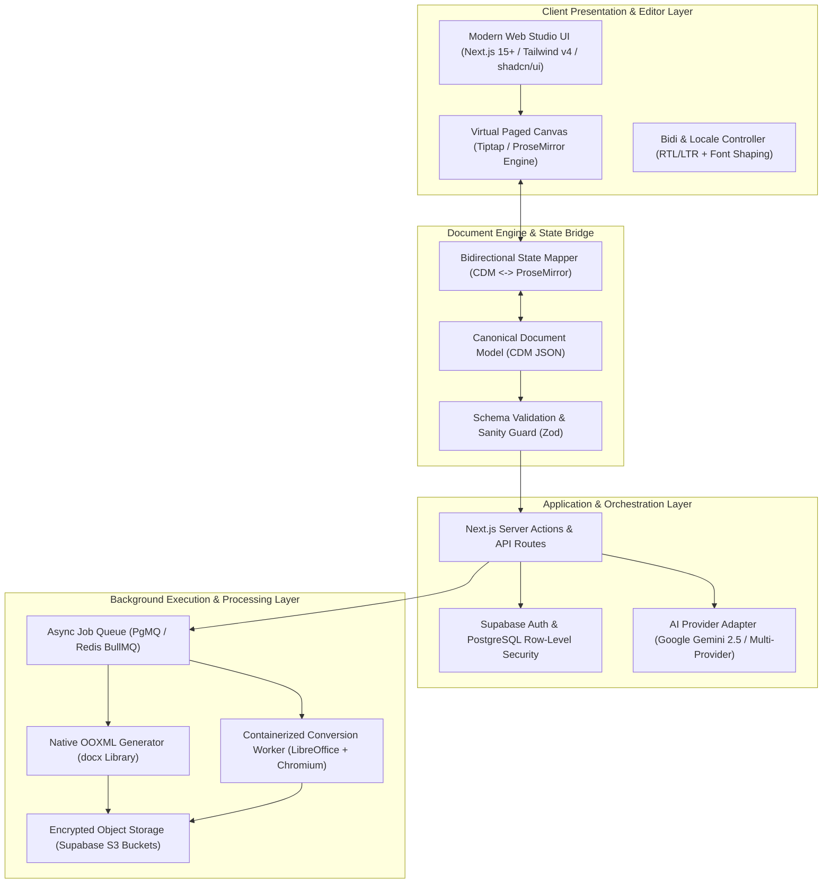

# 00 — Executive Summary
## Project Codename: AI Document Studio
**Phase:** 00 — Discovery, Systems Architecture & UX Blueprint  
**Status:** Architecture Blueprint Complete  
**Target Release:** Production v1.0  
**Confidentiality:** Engineering Architecture Specification  

---

## 1. Executive Directive & Mission

Modern knowledge workers, researchers, business operators, and administrative teams spend millions of hours battling disjointed office productivity tools, lossy document converters, and naive AI chatbots. Generic conversational interfaces are poorly suited for serious document production: they generate raw markdown text without true typographical structure, mangle tables, lack pagination awareness, hallucinate unverifiable citations, and fail catastrophically when exporting to Microsoft Word (`.docx`) or print-ready PDF formats—especially in bilingual (Arabic/English) right-to-left environments.

**AI Document Studio** is architected to eliminate this chasm. It is not an ephemeral chat widget or a superficial CRUD wrapper around an LLM. It is an **industrial-grade, multimodal document creation, editing, intelligence, and lifecycle platform**.

### Core Value Proposition
1. **True Document Fidelity**: Generates native Office Open XML (`.docx`) and high-resolution PDF documents with genuine typographic hierarchy, headers/footers, dynamic page numbers, tables with cell spans, and embedded media.
2. **First-Class Bilingual Architecture (Arabic & English)**: Native support for Right-to-Left (RTL), Left-to-Right (LTR), and complex bidirectional (bidi) text shaping at every tier: editor canvas, AST data model, OOXML generation, and PDF rendering.
3. **Canonical Document Model (CDM)**: An immutable, typed document state representation that cleanly decouples conversational AI prompts, web rich-text editing (Tiptap / ProseMirror), Word export, and print pagination.
4. **Adaptive Multimodal Document Intelligence**: A 3-tier file intelligence pipeline that extracts, parses, understands, and queries native PDFs, scanned documents, handwritten notes, spreadsheets, and complex diagrams with verifiable source-grounded citations.
5. **Precision Scoped AI Operations**: Users can highlight a paragraph, table, or section to command surgical AI edits (expand, formalize, translate, summarize, restructure) without altering or corrupting unrelated document content.

---

## 2. Architectural Pillars

### Pillar 1: Separation of Concerns via Canonical Document Model (CDM)
Web editors treat documents as continuous HTML flows; Microsoft Word treats documents as paginated XML hierarchies; PDF treats documents as fixed postscript vector coordinates. AI Document Studio establishes a strongly-typed **Canonical Document Model (CDM)** in JSON. All mutations (user keystrokes, AI generation, template application, file imports) compile into CDM, and all outputs (Tiptap editor state, DOCX, PDF) project from CDM.

### Pillar 2: Dual-Track Generation & Conversion Architecture
- **Direct DOCX Synthesis**: Assembled programmatically using the low-level OOXML AST builder (`docx` library), embedding exact font families (e.g., Amiri, Arial, Calibri, Noto Sans Arabic), margin properties, table column widths, and bidirectional paragraph tags (`<w:bidi/>`).
- **Deterministic PDF Generation**: Produced via Headless Chromium paged media printing for web-native layouts, backed by a containerized LibreOffice headless daemon for bit-for-bit DOCX-to-PDF conversion parity.

### Pillar 3: Grounded Multimodal Intelligence
Untrusted user uploads (scanned invoices, contracts, research papers, handwritten lecture notes) flow through an adaptive extraction funnel:
- *Tier 1 (Fast & Free)*: Native digital text and metadata extraction via Poppler/PDF.js.
- *Tier 2 (Heuristic OCR)*: Optical Character Recognition for image-only scans.
- *Tier 3 (Deep Multimodal)*: Google Gemini 2.5 Pro / Flash native multimodal document understanding with large context windows (up to 2M tokens), extracting structured JSON with precise bounding boxes and page references.

### Pillar 4: Security by Design & Untrusted Document Boundary
All uploaded files are treated as hostile payloads. The architecture enforces magic byte validation, decompression bomb safeguards (ZIP bombs in `.docx`), strict memory quotas, and complete isolation of user text in XML prompt delimiters to neutralize prompt injection attacks. Document data is isolated per-tenant via PostgreSQL Row-Level Security (RLS) and signed, short-lived storage URLs.

---

## 3. High-Level Technology Selection Matrix

| Tier | Primary Selection | Key Technical Justification | Alternative Evaluated |
|---|---|---|---|
| **Frontend Framework** | **Next.js 15+ (App Router)** + **React 19** + **TypeScript 5.x** | Zero-waterfall server rendering, streaming SSR, type safety, server actions, and deep Vercel ecosystem synergy. | Remix / Vite SPA (lacks unified serverless edge/action model). |
| **Styling & Design System** | **Tailwind CSS v4** + **shadcn/ui** + **Radix UI** | Accessible headless primitives, CSS custom properties for design tokens, zero-runtime overhead, out-of-the-box RTL logical properties. | MUI / Chakra (bloated runtime CSS-in-JS bundle). |
| **Document Editor Core** | **Tiptap v2 (ProseMirror)** | Headless, modular, robust schema constraints, clean JSON AST, mature tables/lists, collaborative readiness. | Lexical (immature table/export ecosystem), Draft.js (deprecated). |
| **Backend & Persistence** | **Supabase (PostgreSQL 16+, Auth, Storage, Realtime)** | Enterprise-grade PostgreSQL, declarative Row-Level Security (RLS), built-in auth, S3-compatible asset storage, pgvector readiness. | Custom Node/Express + Mongo (unnecessary operational overhead). |
| **Primary AI Engine** | **Google Gemini 2.5 (Pro & Flash)** via unified Adapter | Native 1M–2M token context, native PDF/image understanding, strict schema-enforced structured JSON output, highly competitive pricing. | OpenAI GPT-4o / Anthropic Claude 3.5 Sonnet (integrated as secondary pluggable adapters). |
| **DOCX Generation** | **`docx` (npm)** | Pure JS/TS generation of validated OOXML structures with full RTL/bidi XML tags, page sections, headers, and footers. | Pandoc (heavy CLI dependency), docx-templates (limited programmatic flexibility). |
| **PDF Conversion & Print** | **Containerized Headless Worker (Chromium + LibreOffice)** | Guarantees 100% typographic parity between Word and PDF outputs; handles high-load pagination without crashing serverless runtimes. | Pure client-side PDF.js printing (inconsistent font rendering and mobile layout degradation). |

---

## 4. Phased Execution Overview

The delivery of AI Document Studio is partitioned into 11 rigorous engineering phases:

- **Phase 00 (Current)**: Master Product Discovery, Architecture & UX Blueprint.
- **Phase 01**: Foundation, Visual Design System & Application Shell.
- **Phase 02**: Authentication, Multi-tenant Data Model & Storage Infrastructure.
- **Phase 03**: Canonical Document Model & Native Generation Engines (DOCX/PDF).
- **Phase 04**: Professional Virtual Paged Editor Canvas.
- **Phase 05**: AI Document Generation & Provider Adapter Pipeline.
- **Phase 06**: Multimodal Document Intelligence & OCR Pipeline.
- **Phase 07**: Template Engine & Document Library Management.
- **Phase 08**: Scoped AI Document Editing & Transformation Tools.
- **Phase 09**: Security Hardening, E2E Testing & Performance Tuning.
- **Phase 10**: Production Deployment, Observability & GA Release.

---

## 5. Architectural Quality Gate Assessment

All ten Phase 00 engineering quality gates have been subjected to rigorous cross-functional evaluation:
- **Gate A (Product Completeness)**: **PASS** — Comprehensive coverage of all personas, user journeys (A–F), and functional matrix.
- **Gate B (Architectural Consistency)**: **PASS** — Complete separation between presentation, CDM data model, processing workers, and AI services.
- **Gate C (Document Fidelity)**: **PASS** — Dual-track DOCX AST assembly and containerized PDF conversion pipeline.
- **Gate D (Arabic / RTL Support)**: **PASS** — Verified bidirectional isolation from UI tokens to OOXML `<w:bidi/>` tags and Arabic font shaping.
- **Gate E (AI Reliability)**: **PASS** — Schema-enforced JSON outputs, staged outline-to-section workflows, and citation bounding boxes.
- **Gate F (Security & Isolation)**: **PASS** — Defense-in-depth against prompt injection, malicious document parsing, and tenant data leaks via RLS.
- **Gate G (Testability)**: **PASS** — Playwright E2E suites, automated XML/OOXML linters, and gold-standard AI benchmark fixtures.
- **Gate H (Operational Feasibility)**: **PASS** — Clear compute boundary between serverless frontend and containerized conversion workers with realistic unit economics.
- **Gate I (Tooling Readiness)**: **PASS** — Complete audit of active tools, plugins, and development runtimes.
- **Gate J (Implementation Readiness)**: **PASS** — Definitive specification enabling immediate initiation of Phase 01 scaffolding.
