# 02 — Feature Prioritization & Scope Matrix
## Project Codename: AI Document Studio
**Phase:** 00 — Discovery & Architecture  
**Release Target:** MVP (v1.0) through Enterprise (v2.5)  

---

## 1. Prioritization Methodology & Principles

To prevent feature bloat, unrealistic execution timelines, and architectural fragility, every capability in AI Document Studio is prioritized against a strict multi-dimensional scoring rubric:
1. **Core Customer Value (CV)**: Does this solve an acute, non-negotiable pain point for our target personas?
2. **Implementation Complexity (IC)**: What is the engineering effort, architectural risk, and maintenance overhead?
3. **Execution Reliability (ER)**: Can this capability be delivered with production-grade determinism and <0.5% failure rate?
4. **Infrastructure & Operational Cost (OC)**: What are the recurring compute, GPU, and token cost implications?
5. **User Experience & Polish (UX)**: Does this elevate the perception of a premium, human-crafted document studio?

### Priority Tier Definitions
- **P0 (Must-Have for MVP v1.0)**: Non-negotiable core. Without these capabilities, the product cannot fulfill its fundamental promise of generating, editing, understanding, and exporting professional documents.
- **P1 (High-Priority Post-MVP v1.5)**: Critical enhancements that deepen workflow stickiness, expand utility coverage, and address secondary persona needs.
- **P2 (Advanced Capabilities v2.0+)**: Differentiating enterprise, automation, and deep intelligence capabilities that provide long-term competitive moats.
- **Out of Scope (Explicitly Excluded)**: Capabilities deliberately deferred to maintain technical focus and prevent dilution of quality.

---

## 2. Comprehensive Feature Matrix

### 2.1 Core Document Generation

| Feature Item | Priority | Justification & Technical Constraints | Target Release |
|---|---|---|---|
| **Text-to-Document Generation** | **P0** | Primary entry point. Generates full multi-page document from natural language brief via outline-to-section workflow. | v1.0 (MVP) |
| **Executive Reports & Proposals** | **P0** | High-value business use case with structured executive summaries, market tables, and recommendations. | v1.0 (MVP) |
| **Formal Letters & Official Memos** | **P0** | Essential for administrative and corporate personas; validates margin and letterhead styling. | v1.0 (MVP) |
| **Meeting Minutes with Action Items** | **P0** | High frequency, repeatable workflow converting unstructured notes into structured tables with owners and deadlines. | v1.0 (MVP) |
| **Tables & Structured Content** | **P0** | Critical differentiator against generic LLM markdown; requires native table nodes in AST and OOXML. | v1.0 (MVP) |
| **Multi-Section Documents** | **P0** | Required for documents with mixed portrait/landscape or multi-tier heading hierarchies. | v1.0 (MVP) |
| **Custom Tone & Style Presets** | **P0** | Allows switching between Executive, Academic, Legal, Technical, and Creative voice calibrations. | v1.0 (MVP) |
| **Research & Academic Papers** | **P1** | Adds automated APA/IEEE citation formatting, abstracts, and formal footnote numbering. | v1.5 |
| **Technical Documentation & RFCs** | **P1** | Incorporates syntax-highlighted code blocks, API schema tables, and callout callout boxes. | v1.5 |
| **Resumes & Professional CVs** | **P1** | High demand consumer use case; requires tight multi-column layout control and resume-specific templates. | v1.5 |
| **Business Plans & Financial Projections** | **P1** | Multi-chapter generation requiring complex financial forecast tables and executive narrative. | v1.5 |
| **Autonomous Multi-Agent Co-Authoring** | **P2** | Multi-agent research pipeline (fact-checker, reviewer, stylistic editor agents cooperating on a draft). | v2.0 |

---

### 2.2 Document Editing & Canvas

| Feature Item | Priority | Justification & Technical Constraints | Target Release |
|---|---|---|---|
| **Rich-Text Core (Tiptap / ProseMirror)** | **P0** | Non-negotiable foundation for formatted text manipulation, bold, italic, underline, strike, headings (H1–H4). | v1.0 (MVP) |
| **Headings & Numbered/Bullet Lists** | **P0** | Structural backbone of all formal documents; must serialize cleanly to Word `<w:numPr>`. | v1.0 (MVP) |
| **Interactive Table Manipulation** | **P0** | Add/delete rows/columns, resize column widths, cell background colors, header row toggle. | v1.0 (MVP) |
| **Image Insertion & Sizing** | **P0** | Embed uploaded PNG/JPG assets, adjust width/alignment, support image captions. | v1.0 (MVP) |
| **Hyperlinks & Bookmarks** | **P0** | Standard web and document navigation links; must survive DOCX export as active links. | v1.0 (MVP) |
| **Virtual Paged Canvas View** | **P0** | Visual representation of A4 / Letter pages with page shadow, margin gutters, and page break lines. | v1.0 (MVP) |
| **Margins & Page Setup (A4 / Letter)** | **P0** | Allows switching between Standard (25.4mm), Narrow (12.7mm), and Wide (38.1mm) margins. | v1.0 (MVP) |
| **Headers, Footers & Dynamic Page Numbers** | **P0** | Critical requirement for professional documents (`Page X of Y`); must compile to Word `<w:headerReference>`. | v1.0 (MVP) |
| **Undo / Redo & Local Autosave** | **P0** | Essential for user trust; prevents data loss via IndexedDB debounce and cloud snapshotting. | v1.0 (MVP) |
| **Cloud Version History (Snapshot Diff)** | **P1** | Allows browsing past saved versions, viewing diffs, and rolling back to earlier document states. | v1.5 |
| **Real-Time Multi-User Collaboration** | **P2** | CRDT / Yjs collaborative editing; high implementation complexity, deferred past initial single-user validation. | v2.0 |
| **Custom Watermarks & Backgrounds** | **P2** | "DRAFT" or "CONFIDENTIAL" diagonal watermarks for legal and corporate compliance. | v2.0 |

---

### 2.3 Document Intelligence & Multimodal Processing

| Feature Item | Priority | Justification & Technical Constraints | Target Release |
|---|---|---|---|
| **Native Digital PDF Text Extraction** | **P0** | Fast, zero-LLM-cost extraction using PDF.js/Poppler; extracts clean text, headings, and bookmarks. | v1.0 (MVP) |
| **Document Q&A with Grounded Citations** | **P0** | Users ask questions about uploaded documents; AI responds with verifiable page numbers and text excerpts. | v1.0 (MVP) |
| **Document Summarization** | **P0** | Generates executive, bulleted, or structured summaries of 50+ page documents. | v1.0 (MVP) |
| **Image Understanding (Printed Text & Invoices)** | **P0** | Extracts text, key-value pairs, and tables from smartphone photos and document scans via Gemini Vision. | v1.0 (MVP) |
| **Table Extraction to Editable Grid** | **P0** | Detects tabular data in images/PDFs and translates them directly into editable Tiptap/CDM table nodes. | v1.0 (MVP) |
| **Scanned PDF Optical Character Recognition (OCR)** | **P1** | Integrated OCR fallback pipeline for bitmap PDFs lacking embedded digital text streams. | v1.5 |
| **Handwriting Recognition** | **P1** | Extracts legible handwritten lecture notes, doctor prescriptions, and meeting whiteboard notes. | v1.5 |
| **Complex Diagram & Chart Semantic Analysis** | **P1** | Interprets flowcharts, bar graphs, and architectural diagrams to generate descriptive narratives. | v1.5 |
| **Cross-Document Semantic Comparison** | **P2** | Ingests two contract versions, identifies subtle clause modifications, and produces redline audit reports. | v2.0 |
| **Automated Compliance & PII Redaction** | **P2** | Automatically detects and masks sensitive data (national IDs, credit cards, health records) prior to processing. | v2.5 |

---

### 2.4 Document Management & Workspace

| Feature Item | Priority | Justification & Technical Constraints | Target Release |
|---|---|---|---|
| **Personal Workspace & Library** | **P0** | Document grid/list views with title, excerpt, last modified date, and format badges. | v1.0 (MVP) |
| **Folder Organization** | **P0** | Hierarchical folder tree for categorizing projects and client dossiers. | v1.0 (MVP) |
| **Full-Text Document Search** | **P0** | PostgreSQL full-text search indexing document titles, tags, and text content. | v1.0 (MVP) |
| **Recent Documents & Favorites** | **P0** | Fast filtering for active documents and pinned favorites. | v1.0 (MVP) |
| **Trash & Soft Deletion / Restore** | **P0** | 30-day soft deletion safeguard preventing accidental permanent loss of user work. | v1.0 (MVP) |
| **File Attachments & Source Library** | **P1** | Attaches raw reference PDFs, research briefs, and images directly to a parent document project. | v1.5 |
| **Shared Team Workspaces & RBAC** | **P2** | Multi-tenant organization accounts with Admin, Editor, and Viewer role permissions. | v2.0 |

---

### 2.5 Document Utilities & Conversions

| Feature Item | Priority | Justification & Technical Constraints | Target Release |
|---|---|---|---|
| **Export to Word (.docx)** | **P0** | Core capability. Programmatically generated via `docx` library with verified OOXML schema. | v1.0 (MVP) |
| **Export to High-Fidelity PDF** | **P0** | Core capability. Generated via Headless Chromium paged media / LibreOffice worker. | v1.0 (MVP) |
| **Image to Word (.docx)** | **P0** | Direct utility pipeline: uploads image -> extracts text/tables -> formats into downloadable Word document. | v1.0 (MVP) |
| **Image to PDF** | **P0** | Compiles single or multiple uploaded images into an aligned, compressed, searchable PDF. | v1.0 (MVP) |
| **Word (.docx) to PDF Conversion** | **P0** | Dedicated worker pipeline converting user DOCX to PDF using headless LibreOffice with font parity. | v1.0 (MVP) |
| **PDF to Editable Word (.docx)** | **P1** | Advanced reconstruction pipeline: converts PDF layout streams into structured OOXML paragraphs and tables. | v1.5 |
| **PDF Merge & Split Utilities** | **P1** | Client-side/worker PDF utility to combine multiple PDFs or extract specific page ranges. | v1.5 |
| **Bilingual Document Translation (Ar <-> En)** | **P1** | Translates entire document while preserving heading hierarchy, tables, and formatting tags. | v1.5 |

---

## 3. Explicitly Out-of-Scope (Excluded from Initial Architecture)

To maintain uncompromising quality and prevent architectural derailment, the following features are **explicitly out of scope** for Phases 00 through 10:

1. **Spreadsheet Application (Excel / Google Sheets Clone)**:
   - *Rationale*: Re-implementing a formula engine (VLOOKUP, financial modeling, dynamic recalculation graphs) is a separate category of software requiring distinct state architectures. AI Document Studio supports *tables inside documents*, not standalone analytical spreadsheets.
2. **Slide Deck & Presentation Generator (PowerPoint / Keynote Clone)**:
   - *Rationale*: Slide decks depend on absolute canvas positioning, animations, slide transitions, and vector graphics. Document authoring depends on flowable, paginated text layouts. Mixing both in v1.0 degrades both.
3. **Legacy Binary Office Formats (`.doc`, `.xls`, `.ppt`)**:
   - *Rationale*: Proprietary pre-2007 binary formats (OLE Compound File format) require fragile reverse-engineered C++ libraries with severe memory vulnerability histories. The platform strictly targets modern Open XML standards (`.docx`).
4. **OpenDocument Text (`.odt`) Support in v1.0**:
   - *Rationale*: OpenDocument Text is technically viable, but market demand is <3% compared to DOCX and PDF. Deferred to v2.5+.
5. **Direct Printing Hardware / Thermal Printer Protocols**:
   - *Rationale*: Modern printing is universally handled via system PDF print dialogs.

---

## 4. Supported File Formats Roadmap

```mermaid
graph LR
    subgraph MVP ["MVP v1.0 Formats (P0)"]
        DOCX_MVP[".docx (OOXML Word)"]
        PDF_MVP[".pdf (Native & Scanned)"]
        IMG_MVP[".png / .jpg / .webp"]
        TXT_MVP[".txt / .md (Markdown)"]
    end

    subgraph PostMVP ["Post-MVP v1.5 Formats (P1)"]
        CSV_P1[".csv (Table Data Ingest)"]
        JSON_P1[".json (CDM Schema Import/Export)"]
        HTML_P1[".html (Web Clean Import)"]
    end

    subgraph Future ["Future Enterprise v2.5+ (P2)"]
        ODT_P2[".odt (OpenDocument Text)"]
        EPUB_P2[".epub (E-Book Publishing)"]
    end

    MVP --> PostMVP
    PostMVP --> Future
```

- **Inbound Ingestion Formats (v1.0)**: `.docx`, `.pdf`, `.png`, `.jpg`, `.jpeg`, `.webp`, `.txt`, `.md`.
- **Outbound Export Formats (v1.0)**: `.docx`, `.pdf`, `.md`, `.txt`.
