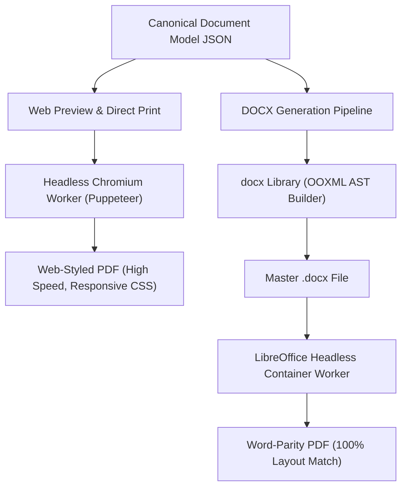

# 03 — Technical Stack Evaluation & Research
## Project Codename: AI Document Studio
**Phase:** 00 — Discovery & Architecture  
**Document Status:** Verified Technical Evaluation  

---

## 1. Evaluation Methodology

Every dependency, framework, and infrastructure service selected for AI Document Studio is evaluated across eight mandatory engineering criteria:
1. **Typographic & Layout Fidelity**: Does it support rigorous document structure, pagination, and multi-tier styling?
2. **Arabic & RTL Native Support**: Can it handle bidirectional text, Arabic font shaping, and logical layout without visual degradation?
3. **Ecosystem Maturity & Maintainability**: Is the project actively maintained by a reputable organization with transparent LTS releases?
4. **Licensing & Commercial Freedom**: Permissive open-source licenses (MIT, Apache 2.0, BSD) preferred; copyleft (GPL) strictly isolated to containerized workers.
5. **Performance & Memory Footprint**: Can it process 100+ page documents without unbounded memory growth or browser thread locking?
6. **Deployment & Cold-Start Behavior**: Compatibility with modern serverless edges and container runtimes.
7. **Type Safety & Developer Ergonomics**: First-class TypeScript type definitions and strict schema validation.
8. **Operational Unit Economics**: Predictable hosting, API token, and compute scaling costs.

---

## 2. Frontend Framework & Presentation Tier

### 2.1 Core Framework: Next.js 15+ (App Router) with React 19 & TypeScript 5.x
- **Official Documentation**: https://nextjs.org/docs
- **License**: MIT
- **Current Stable Version Track**: Next.js 15.x / React 19.x / TypeScript 5.x
- **Key Advantages**:
  - React Server Components (RSC) drastically reduce client bundle size by keeping heavy markdown, template catalogs, and metadata parsers on the server.
  - Server Actions provide type-safe, RPC-like client-server mutation without boilerplate REST routing.
  - Streaming SSR with Suspense boundaries allows progressive rendering of the studio shell while heavy editor assets initialize.
  - Dynamic routing with route groups (`(auth)`, `(dashboard)`, `(editor)`) enables clean layout isolation.
- **Known Limitations**:
  - Rich text editors (Tiptap / ProseMirror) are inherently client-only interactive DOM components and must be marked with `'use client'` and dynamically imported (`ssr: false`) to prevent hydration mismatches.
- **Alternative Evaluated**: Vite + React SPA.
  - *Why Not Selected*: Lacks unified serverless API routes, requiring a separate Express/Fastify backend repository, doubling infrastructure operational burden.
- **Final Recommendation**: **ADOPT Next.js 15+ App Router**.

---

### 2.2 Styling, Design Tokens & Component Primitives: Tailwind CSS v4 + shadcn/ui (Radix UI)
- **Official Documentation**:
  - Tailwind CSS: https://tailwindcss.com/docs
  - Radix UI: https://www.radix-ui.com/primitives/docs/overview/introduction
  - shadcn/ui: https://ui.shadcn.com/
- **License**: MIT
- **Key Advantages**:
  - Tailwind CSS v4 features a high-performance Rust-based engine with native CSS custom properties integration for seamless Light/Dark theme switching.
  - Built-in support for CSS Logical Properties (`ms-`, `me-`, `ps-`, `pe-`, `border-s-`, `border-e-`), ensuring the same styling classes adapt automatically when switching between `dir="ltr"` and `dir="rtl"`.
  - shadcn/ui is not an external packaged library; source code lives directly inside `components/ui/`, giving engineering 100% control over DOM markup, accessibility attributes, and keyboard listeners.
  - Radix UI primitives comply fully with WAI-ARIA guidelines, handling focus trapping, roving tabindexes, and screen reader announcements.
- **Alternative Evaluated**: Material UI (MUI) or Ant Design.
  - *Why Not Selected*: Heavy runtime CSS-in-JS style injection impairs editor keystroke latency (INP); rigid opinionated design conflicts with modern high-craft AI SaaS aesthetics.
- **Final Recommendation**: **ADOPT Tailwind CSS v4 + shadcn/ui (Radix Primitives)**.

---

### 2.3 Animation & Micro-Interactions: Motion (Framer Motion)
- **Official Documentation**: https://motion.dev/
- **License**: MIT
- **Key Advantages**:
  - Declarative physics-based spring animations for smooth modal transitions, drawer expansions, and toolbar popovers.
  - `AnimatePresence` simplifies exit transitions for deleted document items and notifications.
  - Native support for reduced-motion media queries (`prefers-reduced-motion: reduce`) for accessibility compliance.
- **Final Recommendation**: **ADOPT Motion (Framer Motion)** for interface transitions; enforce zero animation inside the active text editing canvas to prevent input lag.

---

## 3. Document Editor Core Engine

### 3.1 In-Depth Comparison: Tiptap v2 vs. Lexical vs. ProseMirror

| Dimension | Tiptap v2 (Recommended) | Lexical (Meta) | ProseMirror (Raw) |
|---|---|---|---|
| **Underlying Architecture** | ProseMirror wrapped in modular TypeScript API | React-centric tree mutation model | Low-level functional state machine & transform transactions |
| **Document State Model** | Structured JSON Abstract Syntax Tree (ProseMirror JSON) | Proprietary JSON node hierarchy | Canonical ProseMirror Node/Fragment tree |
| **Table Manipulation** | High maturity (`@tiptap/extension-table` with cell merging, col resizing) | Moderate (tables supported, but cell span & resizing require complex custom code) | High maturity, but requires writing complex custom view wrappers |
| **RTL & Bidirectional Text** | Native attribute support (`dir="rtl"`, text-align, bidi isolation) | Supported, but requires manual node-level direction synchronization | Fully supported at schema and node level |
| **AI Scoped Mutation** | High: ProseMirror JSON slices allow surgical node-level replacement | High: Tree transform nodes allow targeted mutation | High: Slices and step transactions provide atomic diffing |
| **Ecosystem & Community** | Vast ecosystem of extensions (collaboration, typography, bubble menus) | Active Meta backing, but smaller external extension ecosystem | Battle-tested for 10+ years (powers The Guardian, Atlassian, Notion) |
| **Word-Like Pagination Reality** | Continuous flow by default; requires virtual page calculation layer | Continuous flow by default; lacks out-of-the-box paged layout | Continuous flow by default; requires virtual page calculation layer |
| **Licensing** | MIT (Open Core); commercial extensions optional | MIT | MIT |

### Critical Architectural Finding: The Pagination Fallacy
> [!IMPORTANT]
> **No web rich-text editor (Tiptap, Lexical, ProseMirror, or Slate) functions as a true Microsoft Word clone out of the box.**  
> Web editors operate on a continuous vertical DOM flow. Microsoft Word operates on physical sheet constraints (A4 / US Letter height, header/footer zones, balance margins, dynamic footnote accumulation, and orphan/widow paragraph rules).  
> **Solution**: AI Document Studio implements a **Virtual Paged Canvas**:
> 1. In the Web Editor: A dual-mode view where the user can choose Continuous Flow (fast writing) or Virtual Paged View (renders CSS sheet containers with simulated page breaks based on vertical pixel thresholds).
> 2. In Export Engines: Word layout is determined authoritatively by Microsoft Word's engine via pure OOXML rules; PDF layout is calculated via Paged Media CSS in Headless Chromium or LibreOffice.

- **Final Recommendation**: **ADOPT Tiptap v2 (built on ProseMirror)** as the primary web editing engine.

---

## 4. Backend & Persistence Infrastructure

### 4.1 Supabase (PostgreSQL 16+, Auth, Storage & Realtime)
- **Official Documentation**: https://supabase.com/docs
- **License**: Apache 2.0 / PostgreSQL License
- **Key Advantages**:
  - PostgreSQL 16+ provides ACID transaction integrity, native JSONB querying for document AST schemas, and `pgvector` for semantic search across uploaded files.
  - Supabase Auth handles email/password, OAuth2 providers (Google, GitHub, Microsoft), and magic links with JWT token verification.
  - Row-Level Security (RLS) guarantees cryptographic tenant isolation directly at the database engine level, neutralizing IDOR (Insecure Direct Object Reference) vulnerabilities.
  - Supabase Storage provides S3-compatible, private file storage buckets with native signed URL generation for uploads and exports.
  - Supabase Realtime enables instant WebSocket push notifications when long-running AI generation jobs complete.
- **Operational Boundaries**:
  - Supabase Edge Functions (Deno) have strict execution timeout limits (maximum 60-150s). They cannot execute heavy headless binaries (LibreOffice or full Chromium instances).
  - Heavy background processing must be delegated to a dedicated worker service.
- **Final Recommendation**: **ADOPT Supabase** for Database, Authentication, File Storage, and Realtime state.

---

## 5. AI Provider Architecture & Model Selection

### 5.1 Primary Provider: Google Gemini 2.5 (Pro & Flash)
- **Official Documentation**: https://ai.google.dev/gemini-api/docs
- **Key Capabilities Evaluated**:
  - **Massive Context Window (1M to 2M Tokens)**: Eliminates the need for aggressive text chunking. Entire 100-page contracts, technical specifications, and research books can be passed in a single prompt context.
  - **Native Multimodal Understanding**: Direct ingestion of image buffers and multi-page PDFs without requiring external OCR preprocessing.
  - **Schema-Enforced Structured Outputs**: Native JSON Schema validation (`responseSchema`) guarantees that the AI returns exact typed CDM node structures without markdown wrapping.
  - **Cost-to-Performance Ratio**: Gemini 2.5 Flash provides industry-leading pricing per million tokens, making outline iteration and section drafts economically viable.
- **Provider Abstraction Architecture**:
  - All AI calls are encapsulated behind a unified TypeScript adapter interface (`IAIGeneratorProvider`).
  - Allows seamless fallback or routing to Anthropic Claude 3.5 Sonnet (for complex legal writing) or OpenAI GPT-4o without altering business logic.
- **Final Recommendation**: **ADOPT Google Gemini 2.5 Pro & Flash as Primary**, accessed via the official `@google/genai` SDK and Vercel AI SDK adapter.

---

## 6. Document Generation & Conversion Engines

### 6.1 Native Word Generation: `docx` (npm)
- **Official Documentation**: https://docx.js.org/
- **License**: MIT
- **Current Stable Version**: 8.x / 9.x
- **Key Advantages**:
  - Pure JavaScript/TypeScript library with zero native C++ binaries, compiling valid Open Packaging Convention ZIP archives containing standard OOXML (`[Content_Types].xml`, `word/document.xml`, `word/styles.xml`).
  - Supports comprehensive Word document primitives: sections, headers, footers, page numbering, table cell merging (`gridSpan`, `vMerge`), borders, custom paragraph spacing, and images.
  - **Critical Arabic Support**: Full support for bidirectional paragraph properties (`rightToLeft: true`, `<w:bidi/>`), ensuring Arabic text flows from right to left with correct punctuation alignment.
- **Final Recommendation**: **ADOPT `docx`** for native Word document synthesis.

---

### 6.2 PDF Generation & Conversion: Dual-Track Architecture

#### Track A: Direct Web-Styled PDF via Headless Chromium (Puppeteer)
- **Purpose**: Generates PDFs matching the exact visual style of the web application and virtual canvas using Paged Media CSS (`@page { size: A4; margin: 25mm; }`).
- **Strengths**: Lightning fast; uses modern web fonts (Noto Sans Arabic, Inter); pixel-perfect CSS grid and flexbox fidelity.

#### Track B: Word-to-PDF Parity Conversion via Headless LibreOffice
- **Purpose**: When the user exports a generated Word document to PDF, running `libreoffice --headless --convert-to pdf` guarantees that the downloaded PDF is an exact visual clone of what Microsoft Word prints.
- **Deployment Requirement**: Must run in a Linux container (Docker) on a background worker service (Render / Fly.io) with Microsoft TrueType and Arabic Google Fonts installed.

---

### 6.3 PDF Client-Side Rendering: Mozilla PDF.js
- **Official Documentation**: https://mozilla.github.io/pdf.js/
- **License**: Apache 2.0
- **Purpose**: Provides client-side PDF rendering inside the studio preview pane, text layer extraction for search and highlight, and canvas thumbnail generation.
- **Final Recommendation**: **ADOPT PDF.js** for browser PDF viewing and interactive citation navigation.

---

## 7. Technology Stack Summary Table

| Category | Technology | Primary Function | License |
|---|---|---|---|
| **Frontend Framework** | Next.js 15+ (App Router) | Web application shell, SSR, server actions | MIT |
| **Language & Runtime** | TypeScript 5.x / Node.js 24 | Type-safe business logic & AST compilation | Apache 2.0 |
| **UI Styling** | Tailwind CSS v4 | Responsive layout & RTL logical properties | MIT |
| **Component Primitives** | shadcn/ui (Radix UI) | Accessible dialogs, dropdowns, toolbars | MIT |
| **Icons** | Lucide React | Consistent, scalable UI iconography | ISC |
| **Animation** | Motion (Framer Motion) | Interface transitions & modal animations | MIT |
| **Editor Core** | Tiptap v2 / ProseMirror | Web rich-text editing & AST mutation | MIT |
| **Database & Auth** | Supabase (PostgreSQL 16) | Relational persistence, RLS, auth, Realtime | Apache / PG |
| **File Storage** | Supabase Storage (S3) | Encrypted storage of uploads & generated exports | Apache 2.0 |
| **Primary AI Engine** | Google Gemini 2.5 Pro & Flash | Outline generation, multimodal vision, Q&A | Commercial API |
| **DOCX Generator** | `docx` (npm) | Native OOXML compilation with RTL tags | MIT |
| **PDF Conversion** | LibreOffice Headless + Puppeteer | Bit-for-bit DOCX to PDF conversion & print | LGPL / Apache |
| **PDF Viewer** | Mozilla PDF.js | Browser-based PDF rendering & text highlighting | Apache 2.0 |
| **Schema Validation** | Zod v3 | Strict runtime validation of AI outputs & CDM | MIT |
| **E2E Testing** | Playwright | Multi-browser regression and visual testing | Apache 2.0 |
