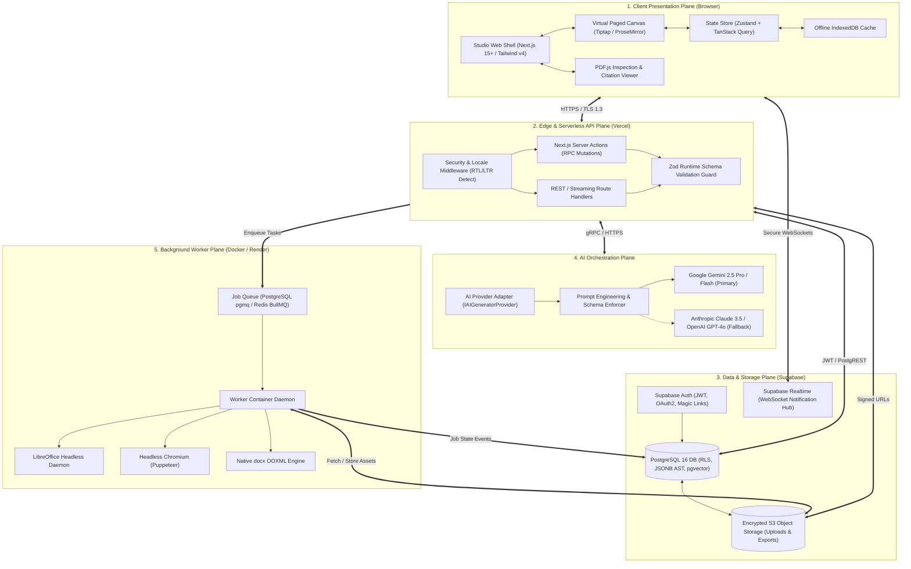
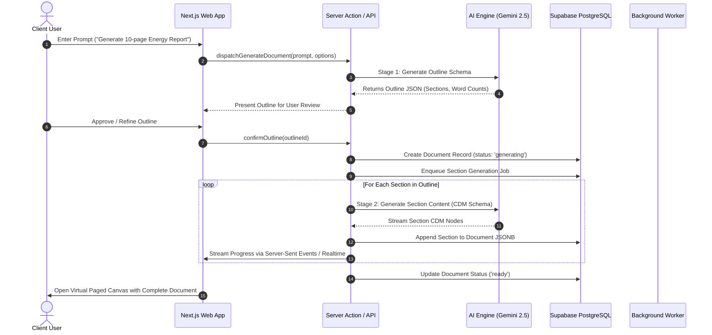
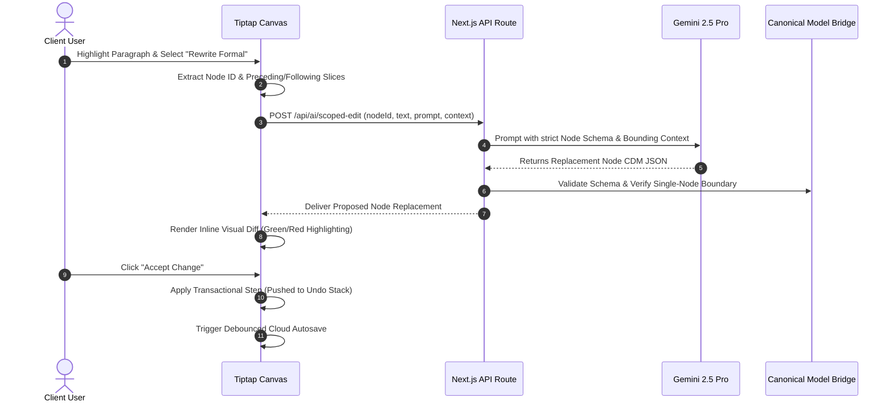
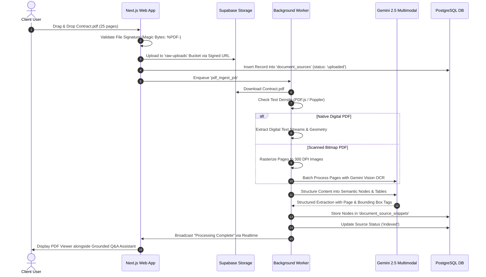
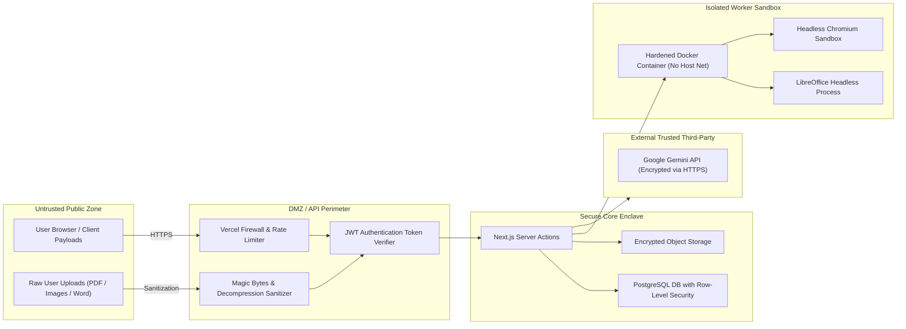

# 04 — System Architecture & Topology
## Project Codename: AI Document Studio
**Phase:** 00 — Discovery & Architecture  
**Document Status:** Complete System Architecture  

---

## 1. High-Level System Topology

AI Document Studio is designed as a **decoupled, multi-tier cloud-native architecture**. The system is partitioned into five distinct operational planes:
1. **Client Presentation Plane**: Next.js 15+ single-page application and virtual paged editing canvas running in the user's browser.
2. **Edge & API Gateway Plane**: Next.js Server Actions and Route Handlers running on Vercel's global edge and serverless runtime.
3. **Data, Authentication & Storage Plane**: Managed Supabase PostgreSQL 16 with Row-Level Security, Supabase Auth, and private S3-compatible object storage.
4. **Autonomous AI Orchestration Plane**: Provider-agnostic AI Gateway executing staged prompt pipelines, schema enforcement, and streaming responses (primarily via Google Gemini 2.5).
5. **Asynchronous Compute & Conversion Worker Plane**: Hardened Docker containers running on Render/Fly.io executing heavy background jobs (LibreOffice headless conversions, Puppeteer PDF printing, and OCR extraction).

---

## 2. Core Subsystems & Responsibilities

### 2.1 Client Presentation Plane
- **Studio Shell**: Delivers a responsive, accessible three-zone workspace:
  - Left: Collapsible Document Tree / Section Navigator / Thumbnail Bar.
  - Center: Virtual Paged Canvas with physical A4 margins, ruler, zoom controller, and print layout simulation.
  - Right: Contextual AI Copilot & Source Document Inspector.
- **State Management**:
  - `TanStack Query (React Query)`: Server state caching, optimistic UI updates, and stale-while-revalidate synchronization.
  - `Zustand`: Ephemeral editor client state (zoom level, active selection range, floating toolbar visibility, side panel toggle).
  - `IndexedDB (idb-keyval)`: Real-time offline keystroke buffer ensuring zero data loss if network connection drops.

### 2.2 Edge & Serverless API Plane
- **Route Handlers (`app/api/*`)**:
  - Streaming LLM completions using Server-Sent Events (SSE) via the Vercel AI SDK.
  - Binary download streaming for pre-generated DOCX/PDF files.
  - Webhook ingestion for asynchronous worker job completions.
- **Server Actions**:
  - Atomic document mutations (create, rename, move to folder, duplicate, soft delete).
  - Version creation and manual snapshot checkpoints.
  - Generation job dispatching.

### 2.3 Data, Authentication & Persistence Plane
- **PostgreSQL 16**:
  - Serves as the authoritative source of truth.
  - Document bodies are stored as structured JSONB representing the **Canonical Document Model (CDM)**.
  - Enforces strict tenant isolation via Row-Level Security (RLS) policies on every table.
  - Integrates `pgvector` to enable semantic vector search over uploaded PDF document chunks.
- **Supabase Storage**:
  - Private storage buckets: `raw-uploads` (quarantined uploaded files), `document-assets` (user-uploaded images embedded in documents), and `generated-exports` (compiled DOCX and PDF binaries).
  - All client access is governed by temporary signed URLs with 15–30 minute TTLs.

### 2.4 Autonomous AI Orchestration Plane
- **Staged Document Generation Pipeline**:
  - Prevents the classic failure mode of asking an LLM to generate a 20-page document in a single prompt.
  - Decomposes generation into: Intent Clarification -> Outline Synthesis -> Section-by-Section Expansion -> Final Consistency Review.
- **Schema Enforcement**:
  - Utilizes Gemini's native `responseSchema` to guarantee that the output matches the required CDM AST format without markdown fences or extraneous conversational chatter.

### 2.5 Compute & Conversion Worker Plane
- **Job Lifecycle Engine**:
  - Long-running, compute-heavy tasks (converting a 50-page DOCX to PDF, batch OCR processing, large file decompression) are enqueued into `generation_jobs`.
  - Containerized worker processes consume jobs, execute headless tasks in isolated Linux environments, write results to S3 storage, and notify the user via Supabase Realtime.

---

## 3. End-to-End Component Interaction Sequences

### 3.1 Document Generation Workflow (Staged Pipeline)

---

### 3.2 Scoped In-Place AI Editing Workflow

---

### 3.3 File Upload, Multimodal Extraction & Source Grounding Workflow

---

## 4. Trust Boundaries & Security Enclaves

### Boundary Security Controls:
1. **Perimeter Boundary**: Vercel WAF enforces rate limiting, DDoS mitigation, and cross-site scripting (XSS) header policies.
2. **Untrusted Upload Boundary**: All user-supplied files are quarantined. Magic byte inspection prevents executable spoofing (e.g., renaming an `.exe` to `.pdf`). DOCX files undergo ZIP decompression ratio checks to eliminate ZIP-bomb decompression memory exhaustion.
3. **Database Boundary**: PostgreSQL Row-Level Security guarantees that queries can only access rows where `user_id = auth.uid()`.
4. **Compute Sandbox Boundary**: LibreOffice and Chromium execute within non-root, memory-limited Docker containers with restricted network egress, preventing Server-Side Request Forgery (SSRF) or arbitrary code execution via compromised document parsers.
