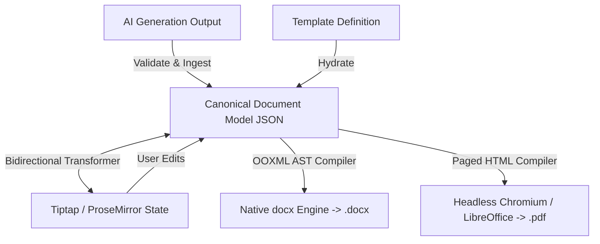
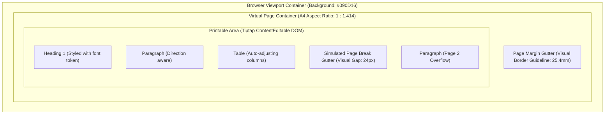

# 05 — Document Engine & Canonical Data Model
## Project Codename: AI Document Studio
**Phase:** 00 — Discovery & Architecture  
**Document Status:** Complete Document Engine Architecture  

---

## 1. Architectural Philosophy: The Single Source of Truth

The most critical architectural failure of modern web document editors is storing documents as loose HTML strings or raw markdown. 
- HTML lacks strict typographical constraints, page orientation metadata, and headers/footers.
- Markdown lacks native table styling, page breaks, cell spans, and bidirectional paragraph control.
- Directly storing Microsoft Word OOXML (`.docx`) in the browser causes severe serialization friction and blocks real-time web rendering.

**AI Document Studio solves this with a normalized Canonical Document Model (CDM)**. The CDM is a versioned, strongly-typed JSON Abstract Syntax Tree (AST). It acts as the single authoritative state representation:
- Conversational AI outputs are validated against CDM schemas.
- The web editor (Tiptap / ProseMirror) bidirectionally translates to and from CDM.
- The Word generator (`docx`) compiles CDM directly into OOXML.
- The PDF generator renders CDM via paged media templates.



---

## 2. Canonical Document Model (CDM) Specification

The CDM schema is versioned (`cdm_version: "1.0.0"`) and enforced via TypeScript types and runtime Zod validators.

### 2.1 Complete JSON Schema Representation

```json
{
  "$schema": "https://json-schema.org/draft/2020-12/schema",
  "title": "CanonicalDocumentModel",
  "type": "object",
  "required": ["cdm_version", "document_id", "metadata", "page_setup", "styles", "content"],
  "properties": {
    "cdm_version": { "type": "string", "const": "1.0.0" },
    "document_id": { "type": "string", "format": "uuid" },
    "metadata": {
      "type": "object",
      "required": ["title", "created_at", "updated_at", "default_language", "default_direction"],
      "properties": {
        "title": { "type": "string" },
        "author": { "type": "string" },
        "description": { "type": "string" },
        "created_at": { "type": "string", "format": "date-time" },
        "updated_at": { "type": "string", "format": "date-time" },
        "default_language": { "type": "string", "enum": ["ar", "en", "mixed"] },
        "default_direction": { "type": "string", "enum": ["rtl", "ltr"] },
        "tags": { "type": "array", "items": { "type": "string" } }
      }
    },
    "page_setup": {
      "type": "object",
      "required": ["paper_size", "orientation", "margins", "header", "footer"],
      "properties": {
        "paper_size": { "type": "string", "enum": ["A4", "LETTER", "LEGAL"] },
        "orientation": { "type": "string", "enum": ["portrait", "landscape"] },
        "margins": {
          "type": "object",
          "required": ["top_mm", "bottom_mm", "left_mm", "right_mm"],
          "properties": {
            "top_mm": { "type": "number", "default": 25.4 },
            "bottom_mm": { "type": "number", "default": 25.4 },
            "left_mm": { "type": "number", "default": 25.4 },
            "right_mm": { "type": "number", "default": 25.4 }
          }
        },
        "header": {
          "type": "object",
          "properties": {
            "enabled": { "type": "boolean" },
            "first_page_different": { "type": "boolean" },
            "content": { "type": "array", "items": { "$ref": "#/$defs/block_node" } }
          }
        },
        "footer": {
          "type": "object",
          "properties": {
            "enabled": { "type": "boolean" },
            "show_page_numbers": { "type": "boolean" },
            "number_format": { "type": "string", "enum": ["PAGE_X", "PAGE_X_OF_Y"] },
            "alignment": { "type": "string", "enum": ["left", "center", "right"] }
          }
        }
      }
    },
    "styles": {
      "type": "object",
      "properties": {
        "primary_font_en": { "type": "string", "default": "Inter" },
        "primary_font_ar": { "type": "string", "default": "Noto Sans Arabic" },
        "serif_font_ar": { "type": "string", "default": "Amiri" },
        "base_font_size_pt": { "type": "number", "default": 11 },
        "line_spacing": { "type": "number", "default": 1.35 },
        "paragraph_spacing_pt": { "type": "number", "default": 6 }
      }
    },
    "content": {
      "type": "array",
      "items": { "$ref": "#/$defs/block_node" }
    }
  },
  "$defs": {
    "block_node": {
      "type": "object",
      "required": ["id", "type"],
      "properties": {
        "id": { "type": "string" },
        "type": {
          "type": "string",
          "enum": ["paragraph", "heading", "table", "bullet_list", "ordered_list", "image", "callout", "page_break", "divider"]
        },
        "attributes": { "type": "object" },
        "runs": { "type": "array", "items": { "$ref": "#/$defs/text_run" } },
        "children": { "type": "array", "items": { "$ref": "#/$defs/block_node" } }
      }
    },
    "text_run": {
      "type": "object",
      "required": ["text"],
      "properties": {
        "text": { "type": "string" },
        "bold": { "type": "boolean" },
        "italic": { "type": "boolean" },
        "underline": { "type": "boolean" },
        "strike": { "type": "boolean" },
        "color": { "type": "string" },
        "highlight": { "type": "string" },
        "link_url": { "type": "string" },
        "direction": { "type": "string", "enum": ["rtl", "ltr", "auto"] },
        "footnote_ref": { "type": "string" }
      }
    }
  }
}
```

---

## 3. Web Editor Translation: CDM <-> Tiptap (ProseMirror)

Tiptap is built upon ProseMirror’s functional document schema. The CDM maps cleanly to ProseMirror JSON nodes and marks.

### 3.1 Mapping Table

| CDM Block Node | ProseMirror Node | Tiptap Extension | Notes & Constraints |
|---|---|---|---|
| `heading` (level: 1–4) | `heading` (attrs: level) | `@tiptap/extension-heading` | Inherits section numbering & document font tokens |
| `paragraph` | `paragraph` | `@tiptap/extension-paragraph` | Supports `dir` and `textAlign` attributes |
| `bullet_list` | `bulletList` | `@tiptap/extension-bullet-list` | Compiles to `<w:numPr>` in OOXML |
| `ordered_list` | `orderedList` | `@tiptap/extension-ordered-list` | Supports Arabic-Indic (١, ٢, ٣) and Latin (1, 2, 3) |
| `table` | `table` | `@tiptap/extension-table` | Stores row/col spans, background colors, and widths |
| `image` | `image` | Custom Studio Image Node | Includes URL, caption, width percentage, and alignment |
| `callout` | `callout` (custom) | Custom Studio Callout Node | Rendered as left/right bordered accent card in editor |
| `page_break` | `pageBreak` (custom) | Custom Studio Page Break | Renders physical sheet break line in canvas |

### 3.2 Bidirectional Transformation Architecture
- **Inbound (CDM -> Tiptap)**:
  `transformCdmToProseMirror(cdmDoc: CanonicalDocument): ProseMirrorDoc`
  - Iterates over CDM blocks, recursing into table cells and nested list items.
  - Transforms CDM `text_run` objects into ProseMirror text nodes with active mark arrays (`bold`, `italic`, `link`).
- **Outbound (Tiptap -> CDM)**:
  `transformProseMirrorToCdm(pmDoc: ProseMirrorDoc, baseCdm: CanonicalDocument): CanonicalDocument`
  - Traverses the ProseMirror tree, extracting typed block nodes.
  - Generates immutable UUIDs for every node to support scoped AI editing.
  - Preserves top-level document metadata and page setup settings.

---

## 4. Native Word (`.docx`) Generation Architecture

The `.docx` engine is built upon the TypeScript `docx` library. It translates CDM into a verified Open Packaging Convention archive containing genuine Microsoft Office Open XML (`w:document`).

### 4.1 Arabic & Bidirectional (RTL) OOXML Tags

To guarantee that Arabic text is correctly shaped, aligned, and isolated in Microsoft Word, the engine injects explicit OOXML XML elements:

```xml
<!-- Example of a generated Word paragraph with strict RTL properties -->
<w:p>
  <w:pPr>
    <!-- Sets paragraph-level reading order to Right-to-Left -->
    <w:bidi/>
    <!-- Sets visual justification to right -->
    <w:jc w:val="right"/>
    <w:spacing w:before="120" w:after="120" w:line="276" w:lineRule="auto"/>
  </w:pPr>
  <w:r>
    <w:rPr>
      <!-- Sets run-level bidirectional text flag -->
      <w:rtl/>
      <!-- Specifies complex script font for Arabic -->
      <w:rFonts w:ascii="Amiri" w:hAnsi="Amiri" w:cs="Amiri"/>
      <w:sz w:val="24"/>
      <w:szCs w:val="24"/>
    </w:rPr>
    <w:t>هذا التقرير يستعرض تطورات الطاقة المتجددة في الشرق الأوسط.</w:t>
  </w:r>
</w:p>
```

### 4.2 Document Section, Header & Footer Configuration

The `.docx` compiler structures the document into sections containing margin and page setup parameters:

```typescript
// Architecture snippet: docx Section Properties
const docxSection = {
  properties: {
    page: {
      size: {
        width: pageSetup.paper_size === 'A4' ? 11906 : 12240, // Twips (1/20th of a point)
        height: pageSetup.paper_size === 'A4' ? 16838 : 15840,
        orientation: pageSetup.orientation === 'portrait' ? PageOrientation.PORTRAIT : PageOrientation.LANDSCAPE,
      },
      margin: {
        top: Math.round(pageSetup.margins.top_mm * 56.7), // Convert mm to twips
        bottom: Math.round(pageSetup.margins.bottom_mm * 56.7),
        left: Math.round(pageSetup.margins.left_mm * 56.7),
        right: Math.round(pageSetup.margins.right_mm * 56.7),
      },
    },
  },
  headers: {
    default: new Header({
      children: [
        new Paragraph({
          children: [new TextRun({ text: cdm.metadata.title, font: "Inter", size: 18 })],
          alignment: AlignmentType.RIGHT,
        }),
      ],
    }),
  },
  footers: {
    default: new Footer({
      children: [
        new Paragraph({
          children: [
            new TextRun({ text: "Page ", font: "Inter", size: 18 }),
            new SimpleField("PAGE"),
            new TextRun({ text: " of ", font: "Inter", size: 18 }),
            new SimpleField("NUMPAGES"),
          ],
          alignment: AlignmentType.CENTER,
        }),
      ],
    }),
  },
  children: compiledDocxBlocks,
};
```

---

## 5. PDF Generation & Parity Architecture

### 5.1 The Dual-Pipeline Strategy
1. **Pipeline 1: High-Speed Web Print (Puppeteer / Headless Chromium)**
   - Used for instant web document downloads and visual previews.
   - Compiles CDM into a clean, modern HTML document utilizing CSS Paged Media specifications:
     ```css
     @page {
       size: A4 portrait;
       margin-top: 25.4mm;
       margin-bottom: 25.4mm;
       margin-left: 25.4mm;
       margin-right: 25.4mm;
       @top-right { content: string(docTitle); font-family: 'Inter'; font-size: 9pt; }
       @bottom-center { content: "Page " counter(page) " of " counter(pages); font-family: 'Inter'; font-size: 9pt; }
     }
     body[dir="rtl"] {
       font-family: 'Noto Sans Arabic', 'Amiri', sans-serif;
       direction: rtl;
       text-align: right;
     }
     ```
2. **Pipeline 2: Word-to-PDF Parity Conversion (LibreOffice Container)**
   - Used when users request "Export to PDF with Exact Word Layout" or convert an uploaded DOCX file.
   - The worker executes:
     `libreoffice --headless --convert-to pdf --outdir /tmp/exports /tmp/inputs/document.docx`
   - Guarantees 100% fidelity with the generated Word document, eliminating line-wrap discrepancies and table clipping.

---

## 6. Virtual Paged Canvas Implementation

To provide users with an authentic desktop-publishing experience without the performance degradation of canvas re-rendering on every keystroke, AI Document Studio implements a **Virtual Paged Canvas**:



### Virtual Paged Mechanics:
- **Sheet Dimensions**: CSS fixed width matching standard A4 at 96 DPI (`794px × 1123px`), dynamically scaled via CSS `transform: scale(zoomLevel)` based on user zoom controls (50% to 200%).
- **Visual Page Breaks**: A mutation observer monitors vertical scroll height inside the editor DOM. When child block nodes cross integer multiples of the page content height (`1123px - topMargin - bottomMargin`), a subtle dashed boundary and page number label are dynamically positioned.
- **Orphan & Widow Control**: CSS rules (`break-inside: avoid;` on table rows and headings; `orphans: 2; widows: 2;` on paragraphs) prevent headings from being stranded at the bottom of a page without trailing text.

---

## 7. Unsupported Mappings & Potential Fidelity Loss

| Feature / Element | Supported in Editor | Supported in DOCX | Supported in PDF | Known Limitations & Mitigation |
|---|---|---|---|---|
| **Complex Math (LaTeX)** | KaTeX preview | Word OMML Math | Rendered SVG | Word native OMML math converter requires custom AST mapping; MVP renders equations as high-resolution SVGs in DOCX. |
| **Multi-Column Sections** | Single / Two-col | Full `<w:cols>` | Full CSS columns | Dynamic column balancing inside continuous web editors has minor visual jitter; export engines render with 100% precision. |
| **Custom Embedded Fonts** | Web Fonts | System Font Refs | Fully Embedded | If a recipient opens the DOCX on a machine without Amiri or Noto Sans Arabic, Word falls back to Tahoma/Arial. Mitigation: We embed standard fallback font declarations in `<w:rFonts>`. |
| **Nested Tables** | Yes (Tiptap) | Yes (OOXML) | Yes (HTML) | Complex nested tables can exceed page width on mobile viewports. Mitigation: Canvas provides horizontal scrolling container. |
