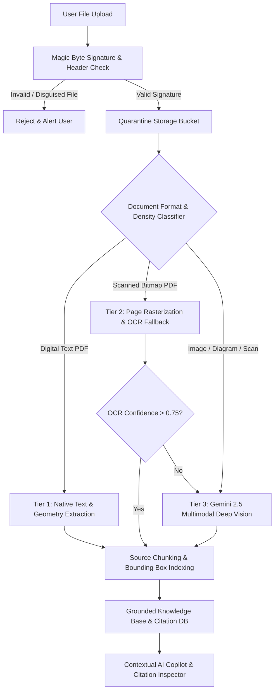
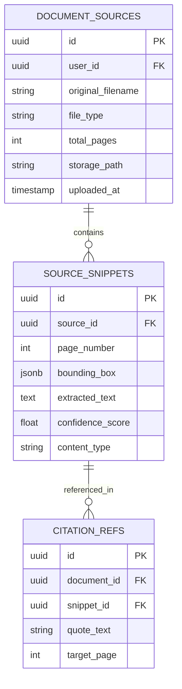
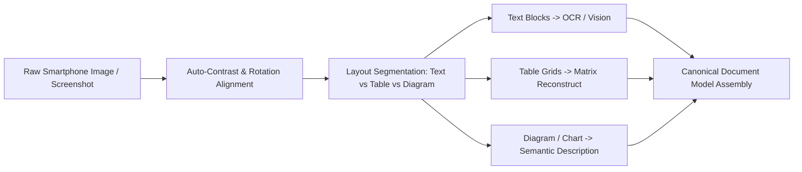

# 07 — File Intelligence & Multimodal Extraction Pipeline
## Project Codename: AI Document Studio
**Phase:** 00 — Discovery & Architecture  
**Document Status:** Complete File Processing Architecture  

---

## 1. Architectural Overview & The Untrusted Upload Boundary

Uploaded files (PDFs, images, Word documents, text files) are the primary vector for system security vulnerabilities, memory exhaustion, and prompt injection attacks. 

AI Document Studio establishes an **Untrusted Upload Boundary**:
1. No uploaded file is ever executed or processed directly in the main web server process.
2. File types are determined exclusively via **magic byte file signatures**, never trusting file extensions or client-supplied MIME headers.
3. Heavy extraction and OCR tasks are isolated within containerized sandboxes with restricted network access and tight memory boundaries.

---

## 2. Ingestion Validation & Security Quarantine

### 2.1 Magic Byte File Signature Verification
Clients frequently rename malicious files (e.g., disguising an `.exe` or `.bat` as `.pdf`). The ingest handler reads the first 16 bytes of the binary buffer to verify authentic signatures:

| Format | Expected Magic Byte Signature (Hex) | ASCII Representation | Max Upload Size |
|---|---|---|---|
| **PDF** | `25 50 44 46 2D` | `%PDF-` | 50 MB / 100 Pages |
| **DOCX** | `50 4B 03 04` (ZIP archive signature) | `PK..` | 30 MB |
| **PNG** | `89 50 4E 47 0D 0A 1A 0A` | `.PNG....` | 20 MB |
| **JPEG** | `FF D8 FF` | `...` | 20 MB |
| **WEBP** | `52 49 46 46 ... 57 45 42 50` | `RIFF....WEBP` | 20 MB |

### 2.2 ZIP Decompression Bomb Defense for DOCX
Word documents (`.docx`) are ZIP archives. A malicious user could craft a 10KB ZIP file that decompresses into 50GB of null bytes, exhausting server memory.
- **Enforced Safeguards**:
  - Maximum uncompressed size ceiling: 100 MB.
  - Maximum compression ratio threshold: 100:1.
  - Stream decompression terminates immediately if the byte threshold is breached.

---

## 3. Adaptive 3-Tier PDF Intelligence Pipeline

Sending every page of a 50-page digital PDF through a multimodal LLM is an irresponsible waste of compute, latency, and money. AI Document Studio implements an **Adaptive 3-Tier Processing Strategy**:

### Tier 1: Fast Native Text & Layout Extraction (Zero LLM Cost)
- **Engine**: Mozilla PDF.js / Poppler utilities.
- **Workflow**:
  - Extracts raw digital text streams, font family declarations, font sizes, and bounding box coordinates (`x, y, width, height`).
  - Evaluates text density: `character_count / page_count`.
  - If text density exceeds 300 characters per page and no blank pages are detected, the system extracts the entire document in <500ms with 0 token expenditure.
  - Captures table gridlines and structural headers based on font weight and coordinate geometry.

### Tier 2: Optical Character Recognition (OCR) Fallback
- **Trigger**: Pages with text density < 50 characters (indicative of a scanned bitmap or photocopied document).
- **Engine**: Containerized Tesseract OCR or Google Cloud Vision OCR.
- **Workflow**:
  - Rasterizes the page at 300 DPI.
  - Generates hOCR / bounding-box text tokens.
  - Assigns per-word confidence metrics.

### Tier 3: Multimodal Deep Understanding (Google Gemini 2.5 Pro / Flash)
- **Trigger**: Complex layouts, handwritten notes, financial balance sheets, flowcharts, architectural diagrams, or pages failing Tier 2 confidence checks (< 0.75).
- **Engine**: Gemini 2.5 Flash / Pro native multimodal vision.
- **Workflow**:
  - Passes page images directly to Gemini with a structured extraction schema.
  - Gemini outputs a structured JSON AST representing table structures (with merged header cells), numeric data, handwritten notes, and descriptive diagram summaries.

---

## 4. Source-Aware Grounding & Citation Architecture

A critical differentiator of AI Document Studio is that **AI never cites information without verifiable provenance**.

### 4.1 Provenance Tracking Schema
Every extracted fact stored in `SOURCE_SNIPPETS` records:
- `source_id`: UUID of the parent uploaded document.
- `page_number`: Exact physical page number in the original file.
- `bounding_box`: Normalized coordinates `[top, left, width, height]` relative to page dimensions.
- `confidence_score`: Metric from 0.00 to 1.00 indicating extraction certainty.
- `is_verified`: Boolean flag indicating whether the user has reviewed or confirmed the extraction.

### 4.2 Interactive Citation Navigation in Studio UI
When the AI co-pilot references a fact in the right-hand assistant pane (e.g., *"Operating revenue increased by 14.2% in FY2023 [Source: Q4_Report.pdf, Page 12]"*):
1. The citation is rendered as an interactive clickable badge.
2. Clicking the badge immediately loads the PDF in the embedded PDF.js viewer, scrolls smoothly to Page 12, and renders a translucent amber highlight box over the exact table bounding box.
3. The user can verify the factual accuracy in seconds without manually hunting through a 50-page document.

---

## 5. Image & Diagram Understanding Pipeline

Smartphone photographs of printed sheets, receipts, whiteboard sessions, and handwritten lecture notes require specialized preprocessing:

1. **Preprocessing**: Automatically corrects skew, compensates for lens distortion, and normalizes orientation based on EXIF metadata.
2. **Tabular Matrix Reconstruction**: Rather than treating a table image as plain text, Gemini extracts it as a strict 2D array (`rows[ cols[] ]`), preserving column headers and numeric decimal alignment.
3. **Diagram Semantic Modeling**: For flowcharts, architecture diagrams, and charts, the system generates both a descriptive narrative summary and, where applicable, a Mermaid.js code representation that can be rendered natively inside the document.
