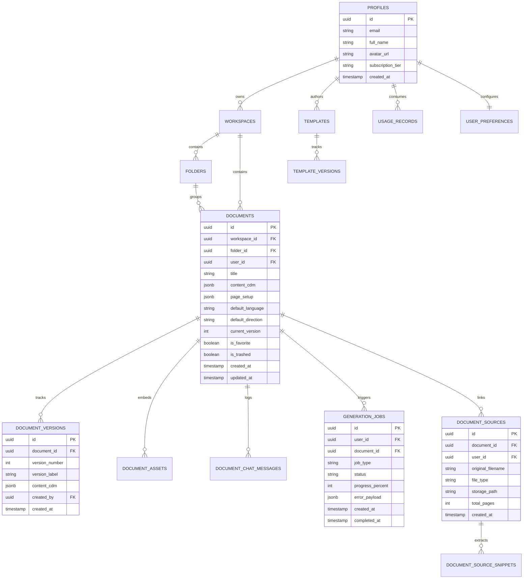

# 08 — Database & Storage Architecture
## Project Codename: AI Document Studio
**Phase:** 00 — Discovery & Architecture  
**Database Engine:** PostgreSQL 16+ (Supabase)  
**Document Status:** Complete Relational Schema Specification  

---

## 1. Relational Architecture Principles

The database schema is engineered for high-concurrency document operations, tenant isolation, and auditability:
1. **Separation of Document State from Heavy Binaries**: Large binary assets (PDFs, images, DOCX exports) reside in encrypted S3 object storage. The database stores strictly typed metadata, structured JSONB AST trees, and foreign keys.
2. **Cryptographic Tenant Isolation (RLS)**: Row-Level Security is enabled on **every** table without exception. All queries inherit the authenticated user context (`auth.uid()`).
3. **Immutable Version Snapshots**: Document edits are versioned. Active documents update in place for performance, but milestones and autosave snapshots create immutable rows in `document_versions`.
4. **Normalized Source Lineage**: Factual grounding is normalized across `document_sources` and `document_source_snippets` to power verifiable citations.

---

## 2. Complete Entity-Relationship (ER) Diagram



---

## 3. Relational Table Specifications

### 3.1 `profiles`
- **Purpose**: Extends Supabase `auth.users` with application-specific profile metadata, billing tier, and token quotas.
- **Columns**:
  - `id` (UUID, PK, References `auth.users.id` ON DELETE CASCADE)
  - `email` (TEXT, NOT NULL, UNIQUE)
  - `full_name` (TEXT)
  - `avatar_url` (TEXT)
  - `subscription_tier` (TEXT, NOT NULL, DEFAULT 'free', CHECK in ('free', 'pro', 'enterprise'))
  - `monthly_token_quota` (INTEGER, NOT NULL, DEFAULT 250000)
  - `tokens_used_this_cycle` (INTEGER, NOT NULL, DEFAULT 0)
  - `created_at` (TIMESTAMPTZ, NOT NULL, DEFAULT NOW())
  - `updated_at` (TIMESTAMPTZ, NOT NULL, DEFAULT NOW())
- **Indexes**: `CREATE INDEX idx_profiles_email ON profiles(email);`
- **RLS**: Users can SELECT and UPDATE only their own profile (`auth.uid() = id`).

---

### 3.2 `workspaces`
- **Purpose**: Groups documents and assets for individual users or shared team environments.
- **Columns**:
  - `id` (UUID, PK, DEFAULT gen_random_uuid())
  - `owner_id` (UUID, NOT NULL, References `profiles.id` ON DELETE CASCADE)
  - `name` (TEXT, NOT NULL)
  - `is_personal` (BOOLEAN, NOT NULL, DEFAULT TRUE)
  - `created_at` (TIMESTAMPTZ, NOT NULL, DEFAULT NOW())
- **Indexes**: `CREATE INDEX idx_workspaces_owner ON workspaces(owner_id);`
- **RLS**: Access restricted to the workspace owner.

---

### 3.3 `folders`
- **Purpose**: Provides hierarchical folder organization within workspaces.
- **Columns**:
  - `id` (UUID, PK, DEFAULT gen_random_uuid())
  - `workspace_id` (UUID, NOT NULL, References `workspaces.id` ON DELETE CASCADE)
  - `parent_folder_id` (UUID, References `folders.id` ON DELETE CASCADE)
  - `name` (TEXT, NOT NULL)
  - `color_hex` (TEXT, DEFAULT '#4F46E5')
  - `created_at` (TIMESTAMPTZ, NOT NULL, DEFAULT NOW())
- **Indexes**: `CREATE INDEX idx_folders_workspace ON folders(workspace_id);`

---

### 3.4 `documents`
- **Purpose**: Authoritative record for every document project.
- **Columns**:
  - `id` (UUID, PK, DEFAULT gen_random_uuid())
  - `workspace_id` (UUID, NOT NULL, References `workspaces.id` ON DELETE CASCADE)
  - `folder_id` (UUID, References `folders.id` ON DELETE SET NULL)
  - `user_id` (UUID, NOT NULL, References `profiles.id` ON DELETE CASCADE)
  - `title` (TEXT, NOT NULL, DEFAULT 'Untitled Document')
  - `content_cdm` (JSONB, NOT NULL, DEFAULT '{"cdm_version":"1.0.0","content":[]}'::jsonb)
  - `page_setup` (JSONB, NOT NULL, DEFAULT '{"paper_size":"A4","orientation":"portrait","margins":{"top_mm":25.4,"bottom_mm":25.4,"left_mm":25.4,"right_mm":25.4}}'::jsonb)
  - `styles` (JSONB, NOT NULL, DEFAULT '{"primary_font_en":"Inter","primary_font_ar":"Noto Sans Arabic"}'::jsonb)
  - `default_language` (TEXT, NOT NULL, DEFAULT 'en', CHECK in ('ar', 'en', 'mixed'))
  - `default_direction` (TEXT, NOT NULL, DEFAULT 'ltr', CHECK in ('rtl', 'ltr'))
  - `current_version` (INTEGER, NOT NULL, DEFAULT 1)
  - `is_favorite` (BOOLEAN, NOT NULL, DEFAULT FALSE)
  - `is_trashed` (BOOLEAN, NOT NULL, DEFAULT FALSE)
  - `trashed_at` (TIMESTAMPTZ)
  - `created_at` (TIMESTAMPTZ, NOT NULL, DEFAULT NOW())
  - `updated_at` (TIMESTAMPTZ, NOT NULL, DEFAULT NOW())
- **Indexes**:
  - `CREATE INDEX idx_documents_workspace ON documents(workspace_id) WHERE is_trashed = FALSE;`
  - `CREATE INDEX idx_documents_user ON documents(user_id);`
  - `CREATE INDEX idx_documents_title_search ON documents USING gin(to_tsvector('simple', title));`
- **RLS**: Full CRUD permitted only when `auth.uid() = user_id`.

---

### 3.5 `document_versions`
- **Purpose**: Point-in-time immutable snapshot history for rollbacks and diffing.
- **Columns**:
  - `id` (UUID, PK, DEFAULT gen_random_uuid())
  - `document_id` (UUID, NOT NULL, References `documents.id` ON DELETE CASCADE)
  - `version_number` (INTEGER, NOT NULL)
  - `version_label` (TEXT)
  - `content_cdm` (JSONB, NOT NULL)
  - `created_by` (UUID, References `profiles.id` ON DELETE SET NULL)
  - `created_at` (TIMESTAMPTZ, NOT NULL, DEFAULT NOW())
- **Constraints**: `UNIQUE (document_id, version_number)`
- **Retention Strategy**: Automatically retains the latest 20 versions per document; versions with explicit user-provided labels (milestones) are preserved indefinitely.

---

### 3.6 `generation_jobs`
- **Purpose**: Manages lifecycle, execution state, and progress of asynchronous AI generation and conversion tasks.
- **Columns**:
  - `id` (UUID, PK, DEFAULT gen_random_uuid())
  - `user_id` (UUID, NOT NULL, References `profiles.id` ON DELETE CASCADE)
  - `document_id` (UUID, References `documents.id` ON DELETE SET NULL)
  - `job_type` (TEXT, NOT NULL, CHECK in ('text_to_doc', 'docx_to_pdf', 'image_to_doc', 'pdf_extract', 'batch_ocr'))
  - `status` (TEXT, NOT NULL, DEFAULT 'queued', CHECK in ('queued', 'processing', 'completed', 'failed', 'cancelled'))
  - `progress_percent` (INTEGER, NOT NULL, DEFAULT 0, CHECK (progress_percent BETWEEN 0 AND 100))
  - `input_payload` (JSONB, NOT NULL)
  - `output_payload` (JSONB)
  - `error_message` (TEXT)
  - `retry_count` (INTEGER, NOT NULL, DEFAULT 0)
  - `created_at` (TIMESTAMPTZ, NOT NULL, DEFAULT NOW())
  - `started_at` (TIMESTAMPTZ)
  - `completed_at` (TIMESTAMPTZ)
- **Indexes**: `CREATE INDEX idx_generation_jobs_user_status ON generation_jobs(user_id, status);`

---

### 3.7 `document_sources` & `document_source_snippets`
- **Purpose**: Stores provenance and chunk-level metadata for uploaded reference files (PDFs, images).
- **`document_sources` Columns**:
  - `id` (UUID, PK, DEFAULT gen_random_uuid())
  - `document_id` (UUID, References `documents.id` ON DELETE CASCADE)
  - `user_id` (UUID, NOT NULL, References `profiles.id` ON DELETE CASCADE)
  - `original_filename` (TEXT, NOT NULL)
  - `file_type` (TEXT, NOT NULL)
  - `file_size_bytes` (BIGINT, NOT NULL)
  - `storage_path` (TEXT, NOT NULL)
  - `total_pages` (INTEGER)
  - `created_at` (TIMESTAMPTZ, NOT NULL, DEFAULT NOW())
- **`document_source_snippets` Columns**:
  - `id` (UUID, PK, DEFAULT gen_random_uuid())
  - `source_id` (UUID, NOT NULL, References `document_sources.id` ON DELETE CASCADE)
  - `page_number` (INTEGER, NOT NULL)
  - `bounding_box` (JSONB)
  - `extracted_text` (TEXT, NOT NULL)
  - `confidence_score` (FLOAT, DEFAULT 1.0)
  - `content_type` (TEXT, DEFAULT 'text', CHECK in ('text', 'table', 'diagram', 'handwriting'))

---

## 4. Row-Level Security (RLS) Policy Specifications

### 4.1 Documents Table RLS

```sql
-- Enable RLS
ALTER TABLE documents ENABLE ROW LEVEL SECURITY;

-- Select Policy: Users can only see documents they own
CREATE POLICY "Users can view own documents"
ON documents FOR SELECT
USING (auth.uid() = user_id);

-- Insert Policy: Users can only create documents for themselves
CREATE POLICY "Users can create own documents"
ON documents FOR INSERT
WITH CHECK (auth.uid() = user_id);

-- Update Policy: Users can only update their own documents
CREATE POLICY "Users can update own documents"
ON documents FOR UPDATE
USING (auth.uid() = user_id)
WITH CHECK (auth.uid() = user_id);

-- Delete Policy: Users can delete their own documents
CREATE POLICY "Users can delete own documents"
ON documents FOR DELETE
USING (auth.uid() = user_id);
```

### 4.2 Generation Jobs RLS

```sql
ALTER TABLE generation_jobs ENABLE ROW LEVEL SECURITY;

CREATE POLICY "Users can view their own jobs"
ON generation_jobs FOR SELECT
USING (auth.uid() = user_id);

CREATE POLICY "Users can insert their own jobs"
ON generation_jobs FOR INSERT
WITH CHECK (auth.uid() = user_id);

-- Only worker service role can update job execution states
CREATE POLICY "Service role can update jobs"
ON generation_jobs FOR UPDATE
USING (auth.role() = 'service_role');
```

---

## 5. Storage Bucket Architecture & Access Control

AI Document Studio partitions storage into three dedicated Supabase Storage buckets:

| Bucket Name | Purpose | Max Size | Public? | Access Policy |
|---|---|---|---|---|
| `raw-uploads` | Quarantined user PDFs, scans, DOCX uploads | 50 MB | NO (Private) | Signed URLs only (TTL: 15 min); strict user folder isolation: `raw-uploads/{user_id}/*` |
| `document-assets` | User images embedded inside active documents | 20 MB | NO (Private) | Read via signed URL or secure proxy; `document-assets/{user_id}/{doc_id}/*` |
| `generated-exports` | Compiled DOCX and PDF binaries ready for download | 100 MB | NO (Private) | Ephemeral signed download URLs (TTL: 30 min); auto-purged after 7 days |
