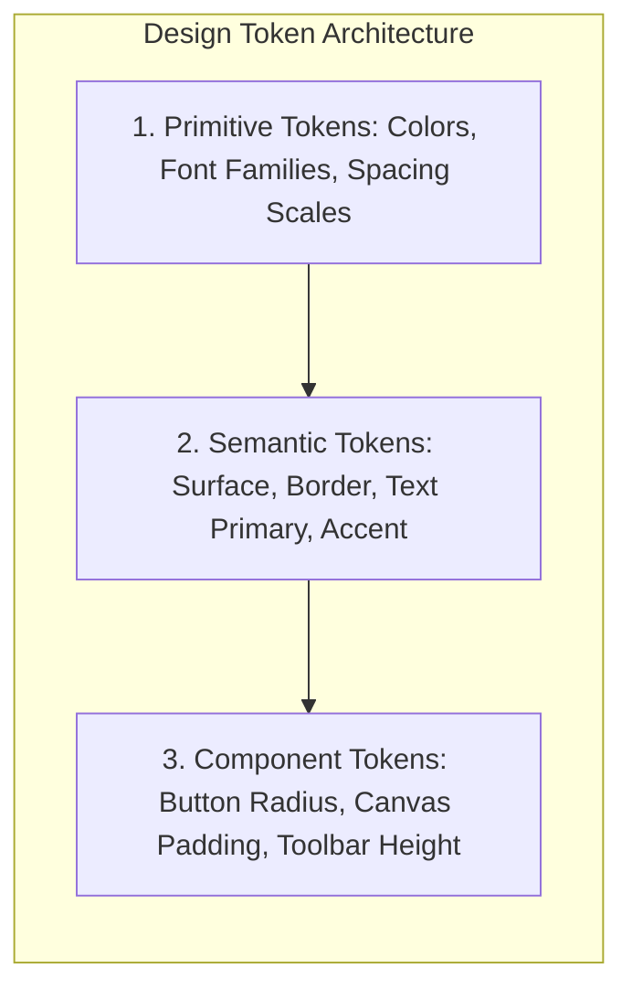
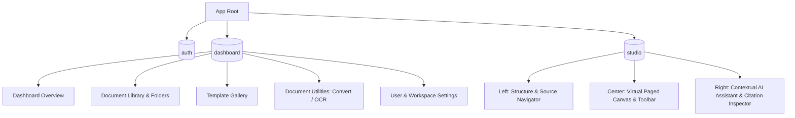

# 09 — UI/UX Design System & Screen Specifications
## Project Codename: AI Document Studio
**Phase:** 00 — Discovery & Architecture  
**Design Direction:** Modern AI × Professional Productivity × Document Intelligence  
**Document Status:** Complete Design System & Specification  

---

## 1. Visual Design Philosophy & Aesthetics

AI Document Studio rejects the cluttered, generic, over-decorated AI aesthetic (no neon gradient blobs, no floating purple sparkles, and no low-contrast illegible cards). Instead, it adopts the aesthetic standards of **high-craft enterprise productivity suites** (Linear, Apple, Vercel, Stripe Press).

### Core Aesthetic Pillars:
1. **Restraint & Editorial Prestige**: The user interface recedes into the background; the document content and typography take center stage.
2. **Tactile Virtual Canvas**: The document canvas feels physical, rendering crisp sheet boundaries, realistic page drop-shadows, and typographic margins.
3. **Information Density & Micro-Precision**: Compact, deliberate toolbars, keyboard shortcuts for every action, and zero wasted vertical space.
4. **First-Class Bilingual Elegance**: Arabic is treated with typographic reverence—using authentic Naskh and Modern Grotesque Arabic typefaces with balanced baselines that never look like crude translations of Latin layouts.

---

## 2. Design Tokens & Visual Hierarchy

### 2.1 Color Palette & Semantic Surfaces

The design system supports both **Dark Mode (Default Studio Aesthetic)** and **Light Mode (Editorial Day Aesthetic)** using CSS Custom Properties.

#### Dark Mode Palette (Studio Focused)
- **Canvas Backdrop**: `#090D16` (Deep Obsidian Ink)
- **Sheet Background**: `#FFFFFF` (Crisp Bright Sheet in Paged Mode) or `#111827` (Dark Canvas Mode)
- **Surface Elevation 1 (Sidebar / Panels)**: `#0F172A` (Slate Navy)
- **Surface Elevation 2 (Cards / Popovers)**: `#1E293B` (Elevated Slate)
- **Border Subtle**: `rgba(255, 255, 255, 0.08)`
- **Border Strong**: `rgba(255, 255, 255, 0.16)`
- **Text Primary**: `#F8FAFC` (Slate 50)
- **Text Secondary**: `#94A3B8` (Slate 400)
- **Text Muted**: `#64748B` (Slate 500)
- **Accent Primary**: `#4F46E5` (Electric Indigo)
- **Accent Hover**: `#6366F1` (Indigo 500)
- **Accent Subdued**: `rgba(79, 70, 229, 0.15)`
- **Success / Added**: `#10B981` (Emerald 500)
- **Warning / Unverified**: `#F59E0B` (Amber 500)
- **Destructive / Deleted**: `#EF4444` (Rose 500)

#### Light Mode Palette (Executive Print Focused)
- **Canvas Backdrop**: `#F1F5F9` (Subtle Cool Grey)
- **Sheet Background**: `#FFFFFF` (Pure White)
- **Surface Elevation 1 (Sidebar / Panels)**: `#FFFFFF`
- **Surface Elevation 2 (Cards / Popovers)**: `#F8FAFC`
- **Border Subtle**: `#E2E8F0`
- **Border Strong**: `#CBD5E1`
- **Text Primary**: `#0F172A` (Slate 900)
- **Text Secondary**: `#475569` (Slate 600)
- **Accent Primary**: `#4338CA` (Indigo 700)

---

### 2.2 Typography System & Font Stack

To ensure typographic balance between Latin and Arabic scripts without baseline jumping or clipping:

| Purpose | Latin / English Font Stack | Arabic Font Stack | Fallback |
|---|---|---|---|
| **Studio UI & Controls** | `Inter`, `Plus Jakarta Sans` | `IBM Plex Sans Arabic`, `Noto Sans Arabic` | `system-ui, sans-serif` |
| **Document Editorial (Serif)** | `Source Serif 4`, `Merriweather` | `Amiri`, `Noto Naskh Arabic` | `Georgia, serif` |
| **Document Modern (Sans)** | `Inter`, `Calibri` | `Noto Sans Arabic`, `Tahoma` | `Arial, sans-serif` |
| **Technical & Code Blocks** | `JetBrains Mono` | `JetBrains Mono` | `monospace` |

#### Typographic Scale:
- `text-xs`: 12px / Line Height: 16px (Badges, metadata timestamps, keyboard shortcuts)
- `text-sm`: 14px / Line Height: 20px (Standard UI controls, sidebar items, table cells)
- `text-base`: 16px / Line Height: 24px (Document body text, standard inputs)
- `text-lg`: 18px / Line Height: 28px (Document Subheading H3, modal headers)
- `text-xl`: 20px / Line Height: 28px (Document Heading H2, section titles)
- `text-2xl`: 24px / Line Height: 32px (Document Title H1, page headers)
- `text-3xl`: 30px / Line Height: 36px (Marketing hero headlines)

---

### 2.3 Spacing, Borders & Shadows
- **Base Grid**: 4px base increment (`space-1`: 4px, `space-2`: 8px, `space-4`: 16px, `space-6`: 24px, `space-8`: 32px).
- **Border Radii**:
  - `rounded-sm`: 4px (Buttons, badges, table cells)
  - `rounded-md`: 8px (Cards, input fields, dropdown menus)
  - `rounded-lg`: 12px (Modals, studio panels)
  - `rounded-xl`: 16px (Virtual sheet paper container)
- **Sheet Elevation Shadows**:
  - Paged Sheet Shadow: `0 10px 30px -5px rgba(0, 0, 0, 0.35), 0 0 0 1px rgba(0, 0, 0, 0.05)`

---

## 3. Bilingual RTL / LTR Architecture

The user interface and document canvas support full bidirectional operation:
1. **CSS Logical Properties**: Layouts use `margin-inline-start`, `margin-inline-end`, `padding-inline-start`, `padding-inline-end`, and `border-inline-start`, ensuring the interface automatically flips when switching between English (`dir="ltr"`) and Arabic (`dir="rtl"`).
2. **Independent Document Direction**: A user can run the application shell in English while authoring a strictly Arabic RTL document, or run the application in Arabic while authoring an English report.
3. **Punctuation & Number Handling**: Arabic documents enforce standard Modern Arabic numeral conventions (Western Arabic `1, 2, 3` or Eastern Arabic `١, ٢, ٣` based on locale preference) and prevent reversed punctuation inside parentheses.

---

## 4. Application Information Architecture & Navigation

---

## 5. Specifications for 15 Required Screens

### Screen 01: Landing Page
- **Purpose**: High-conversion marketing showcase communicating AI Document Studio's unique value: true Word/PDF fidelity, multimodal intelligence, and bilingual mastery.
- **Key Components**:
  - Sticky glassmorphic navbar with logo, feature links, language toggle, and "Open Studio" CTA.
  - Interactive Hero Section featuring an animated split view: on the left, a natural language prompt; on the right, a live rendering of an authentic, paginated Word document with tables and charts.
  - Interactive Format Comparison: Slide toggle showing the difference between crude markdown output vs. AI Document Studio's styled OOXML document.
  - Interactive Persona Tabs: Tailored previews for Researchers, Consultants, Engineers, and Legal Admins.
  - Live Interactive Widget: Test image-to-document extraction directly on the page.

### Screen 02: Authentication Pages (Sign In / Sign Up / Reset)
- **Purpose**: Secure, frictionless onboarding and identity verification.
- **Key Components**:
  - Split screen layout: left side showcases an editorial document aesthetic and customer testimonial; right side hosts the authentication card.
  - Social OAuth providers: "Continue with Google", "Continue with Microsoft 365", "Continue with GitHub".
  - Passwordless Magic Link option and standard email/password authentication.
  - Direction aware: flips seamlessly when Arabic is chosen on the language toggle.

### Screen 03: Main Dashboard
- **Purpose**: Central hub providing quick actions, recent documents, quota status, and activity feeds.
- **Key Components**:
  - Top Action Bar: Search bar (`Cmd+K`), Quick Create button, Notifications, User Avatar.
  - Quick Launch Shelf: 4 prominent action cards: "Generate with AI", "Upload Image / Scan", "Understand PDF", "Start from Template".
  - Recent Documents Carousel / Grid: Cards showing thumbnail preview of page 1, title, last modified timestamp, and format tag (`.docx`, `.pdf`).
  - Storage & Token Meter: Visual progress bar displaying remaining monthly generation tokens.

### Screen 04: New Document Creation Modal & Wizard
- **Purpose**: Guided flow to configure document parameters prior to writing or generating.
- **Key Components**:
  - Choice of start mode: "Blank Canvas", "AI Prompt Co-Pilot", "Upload Reference Material", or "Select Template".
  - Configuration Drawer: Language (Arabic/English/Mixed), Paper Size (A4/Letter), Orientation (Portrait/Landscape), Style Preset (Executive, Academic, Minimal).

### Screen 05: AI Document Generator (Prompt to Outline to Document)
- **Purpose**: 2-stage generation interface keeping the user in full control of structure before content is written.
- **Key Components**:
  - Stage 1 Input: Multi-line prompt box with tone pills, length slider (Short: 2–3 pages, Medium: 5–8 pages, Comprehensive: 10–20 pages), and file attachment chip bucket.
  - Stage 2 Outline Tree: Interactive tree view displaying generated sections and subsections with editable titles, drag-and-drop reordering, and "Regenerate Outline" trigger.
  - Progress Streaming Modal: Visual timeline showing real-time progress as sections are synthesized and validated.

### Screen 06: Professional Document Editor (The Master Workspace)
- **Layout**: 3-zone high-density workspace:
  - **Left Rail (260px)**: Collapsible Document Tree, Page Thumbnails, Bookmarks, and Attached Sources.
  - **Center Canvas**: Virtual Paged Canvas with horizontal ruler, zoom slider (50%–200%), page break indicators, and floating format bubble toolbar.
  - **Right Panel (320px)**: Contextual AI Assistant, Citation Inspector, and Document Settings drawer.
- **States**: Loading skeleton, Read-only view, Active editing, Streaming AI insertion, Offline cached mode.

### Screen 07: Document Print & Export Preview
- **Purpose**: Full-screen modal simulating physical print output prior to downloading binaries.
- **Key Components**:
  - Multi-page grid view showing all pages side-by-side with zoom controls.
  - Export Format Switcher: "Microsoft Word (.docx)" with formatting options vs. "Print PDF (.pdf)" with compression options.
  - Validation Alert Box: Confirms font embedding status and verifies that no tables overflow sheet margins.

### Screen 08: Upload & Analysis Workspace
- **Purpose**: Dedicated ingestion drop-zone for batch uploading PDFs, scans, and images.
- **Key Components**:
  - Drag-and-drop zone with format chips and size limit warnings.
  - File Analysis List: Real-time status cards showing upload progress, magic byte verification, OCR processing stage, and extraction confidence badge.

### Screen 09: PDF Viewer & Citation Inspector
- **Purpose**: Side-by-side PDF reference viewer embedded directly within the editor.
- **Key Components**:
  - PDF.js rendering canvas with page navigation, zoom, and text search.
  - Visual Bounding Box Layer: Highlights referenced passages in translucent amber whenever a citation in the AI panel is clicked.
  - "Insert Quote to Document" one-click button.

### Screen 10: Template Gallery
- **Purpose**: Searchable, categorized repository of professional document templates.
- **Key Components**:
  - Category filters: Business & Consulting, Academic & Research, Legal & Contracts, HR & Admin, Technical Writing.
  - Template Card: Shows high-resolution cover preview, estimated page length, language badge, and "Preview" / "Use Template" actions.

### Screen 11: Document Library & File Manager
- **Purpose**: Comprehensive asset management for all user documents.
- **Key Components**:
  - View toggle: Grid view with visual thumbnails vs. List view with sortable columns (Name, Date, Size, Format).
  - Folder hierarchy tree in left sidebar with drag-and-drop organization.
  - Batch action toolbar: Move, Tag, Duplicate, Export, Trash.

### Screen 12: Document History & Version Compare
- **Purpose**: Visual audit trail allowing users to browse past versions and inspect changes.
- **Key Components**:
  - Chronological timeline of autosave snapshots and named milestones.
  - Split-screen diff viewer: Old version on left, current on right, with green additions and red strikethrough deletions.
  - "Restore this Version" action button.

### Screen 13: Contextual AI Assistant Panel
- **Purpose**: Dedicated right-hand panel for interactive co-authoring and document querying.
- **Key Components**:
  - Chat history scoped exclusively to the active document.
  - Quick action chips: "Summarize Document", "Extract Action Items Table", "Check Citations", "Translate to Arabic".
  - Floating Selection Command Bar: Appears directly above highlighted text offering scoped edits ("Rewrite", "Expand", "Formalize").

### Screen 14: User & Workspace Settings
- **Purpose**: Configuration of user profile, interface preferences, and editor defaults.
- **Key Components**:
  - General Settings: Language preference, default text direction, theme mode (Dark/Light/System).
  - Editor Defaults: Default paper size (A4 vs Letter), default font pairings, default margins.
  - Connected Accounts & Integration status.

### Screen 15: Usage, Quotas & Account Management
- **Purpose**: Transparent visibility into AI token consumption and subscription tier.
- **Key Components**:
  - Plan card showing current tier (Free / Pro / Enterprise) with upgrade triggers.
  - Detailed Usage Breakdown: Visual bar chart displaying tokens spent on Outline Generation, Full Synthesis, OCR/Multimodal Vision, and Scoped Edits.
  - Billing & Invoice history table with PDF receipt downloads.

---

## 6. Motion & Interaction Design Principles

Motion in AI Document Studio is strictly functional—designed to reduce cognitive load and provide tactile feedback:
- **Duration & Easing**: Micro-interactions (hover, button click) use snappy 150ms transitions (`cubic-bezier(0.16, 1, 0.3, 1)`). Larger drawer/modal transitions use 250ms springs.
- **Canvas Rule**: The active editable canvas maintains **0ms animation** on text input to guarantee zero perceived keystroke latency.
- **Reduced Motion Support**: When `prefers-reduced-motion: reduce` is detected, all slide and spring animations are instantly replaced with simple instantaneous opacity cuts.
