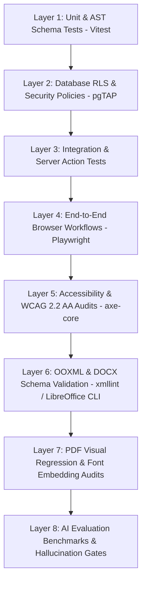
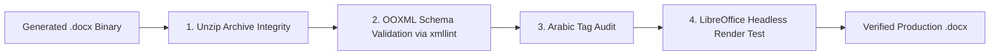

# 11 — Quality Assurance & Testing Strategy
## Project Codename: AI Document Studio
**Phase:** 00 — Discovery & Architecture  
**Document Status:** Complete Quality Assurance & Testing Strategy  

---

## 1. Quality Assurance Philosophy: Multi-Tiered Verification

Document software cannot rely solely on standard web unit tests. A green test suite that verifies React component rendering tells us nothing about whether an exported `.docx` file will crash Microsoft Word 2016 or whether Arabic ligatures will render as disconnected boxes on Windows.

AI Document Studio institutes an **8-Layer Verification Pyramid**:

---

## 2. Document Fixture Test Matrix

To guarantee robust cross-format fidelity, the test suite maintains an immutable corpus of **14 Gold-Standard Document Fixtures**:

| ID | Fixture Name | Primary Verification Objective | Key Edge Cases Tested |
|---|---|---|---|
| **FIX-01** | `short-report-en.json` | Baseline English text and typography | Standard H1–H3 hierarchy, bullet lists, simple paragraph styles |
| **FIX-02** | `long-report-en-50p.json` | Virtual canvas and export memory scaling | 50+ pages, 15,000 words, memory leak check, page numbering `Page X of Y` |
| **FIX-03** | `arabic-legal-report.json` | Pure Arabic RTL layout and shaping | Amiri font, `<w:bidi/>` paragraph tags, Arabic-Indic numerals, right alignment |
| **FIX-04** | `bilingual-bidi-memo.json` | Mixed RTL/LTR inline text stability | Latin terms and English abbreviations inside Arabic paragraphs; no punctuation inversion |
| **FIX-05** | `complex-financial-table.json` | Multi-column table layout and borders | Column spanning (`gridSpan`), row spanning (`vMerge`), currency formatting |
| **FIX-06** | `multi-page-table.json` | Table pagination across page breaks | Table header repeating on subsequent pages, zero cell row clipping |
| **FIX-07** | `nested-multilevel-lists.json` | Numbered and bulleted list hierarchy | 4 levels of indentation, Roman/Alpha/Numeric serialization to `<w:numPr>` |
| **FIX-08** | `embedded-media-document.json` | Image placement and captions | PNG/JPG image scaling, aspect ratio preservation, caption centering |
| **FIX-09** | `multi-section-orientation.json` | Mixed page layouts in one file | Section 1 (Portrait) -> Section 2 (Landscape Table) -> Section 3 (Portrait) |
| **FIX-10** | `academic-citations-paper.json` | Footnotes and bibliography mapping | Footnote reference numbers in body text linked to footer note text |
| **FIX-11** | `native-digital-pdf.pdf` | Digital text extraction pipeline | 20-page searchable PDF; 100% character recovery without OCR invocation |
| **FIX-12** | `scanned-receipt-invoice.png` | Multimodal table and OCR extraction | Skewed photograph; extraction of line items, totals, and tax percentages |
| **FIX-13** | `handwritten-notes.jpg` | Handwriting recognition benchmark | Legible doctor/student handwriting; semantic structuring into bullet points |
| **FIX-14** | `architectural-diagram.png` | Semantic visual interpretation | Flowchart image; generates accurate descriptive summary and Mermaid code |

---

## 3. Automated DOCX Validation Pipeline

A file being generated without throwing a Node.js exception does **not** prove it is a valid Word document. AI Document Studio executes a 4-step programmatic validation harness:

1. **ZIP Archive Integrity**: Confirms that the file is a valid Open Packaging Convention ZIP container containing `[Content_Types].xml`, `_rels/.rels`, `word/document.xml`, and `word/styles.xml`.
2. **OOXML Schema Validation**: Runs `xmllint --schema wml.xsd` against `word/document.xml` to verify strict compliance with ISO/IEC 29500 (Office Open XML format).
3. **Arabic & RTL Tag Audit**: Inspects the XML DOM to verify that every Arabic paragraph node contains `<w:bidi/>` and that text runs declare `<w:rtl/>` with valid complex script font declarations (`<w:rFonts w:cs="Amiri"/>`).
4. **Headless LibreOffice Smoke Test**: Executes:
   `libreoffice --headless --convert-to pdf test-output.docx`
   If LibreOffice returns a non-zero exit code or encounters an unhandled XML parse exception, the test suite immediately fails with a detailed stack trace.

---

## 4. Automated PDF Validation Pipeline

PDF output is audited for typographic precision, font embedding, and layout preservation:
- **Page Count Parity**: Verifies that the PDF page count matches expected pagination bounds (preventing runaway 100-page blank page bugs).
- **Text Extraction & Glyph Integrity**: Extracts text from the generated PDF using `pdf-parse`; asserts that Arabic characters are properly combined into cursive glyphs and not broken into isolated Unicode codepoints.
- **Font Embedding Verification**: Inspects the PDF dictionary using `pdf-lib` to assert that all required fonts (Inter, Amiri, Noto Sans Arabic) are embedded as subsets, preventing recipient fallback errors.
- **Visual Regression Testing**: Uses Playwright to render PDF pages via PDF.js, comparing pixel diffs against gold-standard baseline images with a strict `< 0.2%` mismatch tolerance.

---

## 5. AI Quality & Grounding Evaluation Framework

To prevent model drift, hallucinations, and regressions in structured output quality, the engineering pipeline runs an automated AI evaluation benchmark suite:

### 5.1 Grounding & Citation Precision Benchmark
- **Test Ingestion**: Evaluates 50 synthetic test queries against uploaded PDF sources with known ground truth facts.
- **Acceptance Criteria**:
  - **Factual Precision**: `>= 98%` (No invented metrics or hallucinated dates).
  - **Citation Bounding Box Accuracy**: `>= 95%` (Clicking the citation lands within 50px of the source sentence).
  - **Schema Compliance**: `100%` (Zero malformed JSON payloads allowed).

### 5.2 Scoped Editing Non-Interference Test
- **Test Workflow**: Selects a single target node (Paragraph #3) in a 10-page document fixture, commands a scoped rewrite, and compares the resulting document AST against the original.
- **Assertion**:
  - `targetNode.text` is updated.
  - All other node UUIDs, text strings, and table contents remain byte-for-byte identical (`diff.unmodifiedNodes.length === totalNodes - 1`).

---

## 6. End-to-End Testing with Playwright

Playwright is configured to test complete user journeys across Chromium, Firefox, and WebKit viewports:
- **Test Scenario 1: Natural Language Creation**:
  - User enters prompt -> reviews outline modal -> waits for section streaming -> verifies virtual canvas pagination -> clicks Export DOCX -> validates downloaded file size and integrity.
- **Test Scenario 2: Image to Editable Document**:
  - User uploads `FIX-12` -> verifies progress spinner -> reviews extracted side-by-side view -> edits table cell -> exports PDF.
- **Test Scenario 3: Bilingual Direction Switching**:
  - User toggles document direction from LTR to RTL -> verifies toolbar alignment shifts -> types mixed Arabic/English text -> asserts correct caret positioning.
- **Accessibility Suite**: Every Playwright test runs `axe-core` assertions on page changes, enforcing zero WCAG 2.2 Level AA violations.
