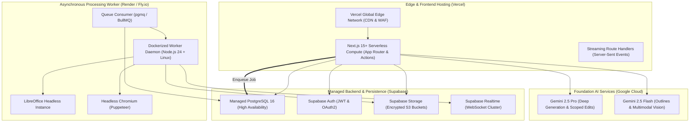

# 12 — Deployment Architecture & Cost Models
## Project Codename: AI Document Studio
**Phase:** 00 — Discovery & Architecture  
**Document Status:** Complete Infrastructure & Financial Model  

---

## 1. Multi-Cloud Infrastructure Topology

AI Document Studio avoids single-provider bottlenecks by assigning operational responsibilities to the cloud platforms best optimized for each workload:

### Infrastructure Responsibilities:
1. **Vercel (Edge & Frontend)**:
   - Hosts the Next.js web application, marketing landing pages, and server actions.
   - Enforces edge caching for static assets and handles global TLS termination.
   - Streams real-time AI responses to users via Server-Sent Events (SSE).
2. **Supabase (Data & Storage)**:
   - Dedicated PostgreSQL database cluster with automated daily backups and point-in-time recovery (PITR).
   - Encrypted S3 object storage for raw uploads, document images, and generated binary exports.
   - WebSocket infrastructure powering real-time job progress notifications.
3. **Render / Fly.io (Containerized Workers)**:
   - Dedicated Linux container instances running the conversion and extraction daemons.
   - Eliminates Vercel's serverless timeout restrictions (which cap executions at 15–60 seconds).
   - Pre-installed with Microsoft TrueType and Google Noto fonts to guarantee bit-for-bit typography match.
4. **Google Cloud (AI Foundation Models)**:
   - Google Gemini API enterprise endpoint with data privacy agreements (zero customer training).

---

## 2. Operational Constraints & Scaling Characteristics

| Operational Parameter | Platform Limit | Enforced Application Limit | Architectural Solution |
|---|---|---|---|
| **Serverless Request Timeout** | Vercel: 60s (Pro) | 25s maximum | Long tasks (>15s) are immediately offloaded to asynchronous background workers. |
| **Serverless Function Memory** | Vercel: 1024 MB | 1024 MB | Heavy memory tasks (LibreOffice conversion) never execute on Vercel. |
| **Worker Container Memory** | Render: 2048 MB | 1500 MB ceiling per container | Containers auto-restart if memory exceeds 1500MB, preventing OOM cascading. |
| **Maximum Upload File Size** | Supabase: 50 MB | 50 MB (PDF), 30 MB (DOCX), 20 MB (IMG) | Direct-to-S3 signed URL uploads bypass the Next.js serverless payload limit (4.5 MB). |
| **AI Rate Limits** | Gemini Tier 3: 1,000+ RPM | Client Token Bucket: 20 RPM/user | Exponential backoff retry loop with user queue position reporting. |
| **Database Connection Pooling** | Postgres: 100 direct | Supabase PgBouncer: 10,000 pool | All serverless functions connect via transaction-mode connection pooling (port 6543). |

---

## 3. Financial Cost Projections: Three Production Scenarios

### Pricing Baselines (Verified Published Rates)
- **Vercel**: Hobby ($0/mo), Pro ($20/seat/mo + $0.15/GB bandwidth + compute overages).
- **Supabase**: Free ($0/mo), Pro ($25/mo includes 8GB DB, 100GB storage, 250GB bandwidth).
- **Render Worker**: Starter ($7/mo - 512MB RAM), Standard ($25/mo - 2GB RAM / 1 CPU).
- **Google Gemini 2.5 Pricing (Standard Rates)**:
  - *Gemini 2.5 Flash*: $0.075 / 1M input tokens, $0.30 / 1M output tokens (text & multimodal).
  - *Gemini 2.5 Pro*: $1.25 / 1M input tokens, $5.00 / 1M output tokens.

---

### Scenario A: Development, Staging & Pre-Launch Testing
- **Workload**: 5 internal developers and QA testers; ~500 documents generated/month; ~10,000 AI test calls.
- **Infrastructure Breakdown**:
  - Vercel Pro (1 seat): **$20 / month**
  - Supabase Pro Plan: **$25 / month**
  - Render Worker (Starter 512MB): **$7 / month**
  - Google Gemini API (Flash/Pro blended test usage): **$15 / month**
  - Domain & SSL (Custom DNS): **$1.50 / month** (amortized)
- **Total Scenario A Cost**: **~$68.50 / month**

---

### Scenario B: Early Commercial Production (1,000 Monthly Active Users - MAU)
- **Assumptions**:
  - 1,000 active users; 15% paying Pro subscribers ($19/month = $2,850 MRR).
  - Average user creates/edits 6 documents/month = 6,000 documents generated.
  - 2,000 PDF intelligence queries & 1,500 file conversions.
  - Total Token Consumption: ~350 Million Flash tokens + ~80 Million Pro tokens.
- **Infrastructure Breakdown**:
  - Vercel Pro (2 developer seats + bandwidth): **$55 / month**
  - Supabase Pro Plan + Storage Overages (150GB stored): **$45 / month**
  - Render Worker (1 Dedicated Standard Instance: 2GB RAM / 1 CPU): **$25 / month**
  - Google Gemini API:
    - Flash (350M tokens blended): ~$70 / month
    - Pro (80M tokens blended): ~$280 / month
    - Subtotal AI: **$350 / month**
  - Observability & Monitoring (Sentry / Axiom): **$15 / month**
- **Total Scenario B Cost**: **~$490 / month**
- **Unit Economics**: **$0.49 infrastructure cost per active user**; Gross Margin on paying users: **~82%**.

---

### Scenario C: Scaling Production Workload (10,000 MAU)
- **Assumptions**:
  - 10,000 active users; 1,800 paying Pro subscribers ($19/mo = $34,200 MRR).
  - 70,000 documents generated/month; 25,000 file conversions.
  - Total Token Consumption: ~3.8 Billion Flash tokens + ~900 Million Pro tokens.
- **Infrastructure Breakdown**:
  - Vercel Enterprise / Pro (Team seats + compute scaling): **$320 / month**
  - Supabase Pro + Compute Add-on (4 CPU / 16GB RAM) + 1TB Storage: **$380 / month**
  - Render Worker Auto-Scaling Cluster (3 to 6 Standard Instances): **$125 / month**
  - Google Gemini API:
    - Flash (3.8B tokens): ~$760 / month
    - Pro (900M tokens): ~$3,150 / month
    - Subtotal AI: **$3,910 / month**
  - Monitoring, Security & WAF (Datadog / Cloudflare): **$180 / month**
- **Total Scenario C Cost**: **~$4,915 / month**
- **Unit Economics**: **$0.49 infrastructure cost per active user**; Monthly Net Gross Profit: **~$29,285 / month** (85.6% Gross Margin).
