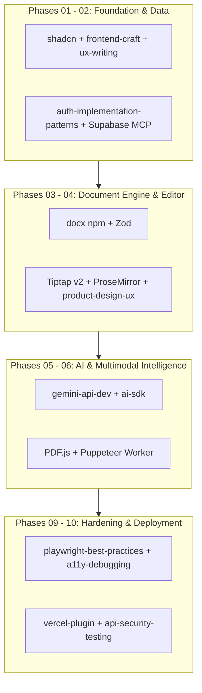

# 16 — Tools, Skills & MCP Inventory
## Project Codename: AI Document Studio
**Phase:** 00 — Discovery & Architecture  
**Document Status:** Complete Environmental Tooling Audit  

---

## 1. Environmental Discovery Audit

During Phase 00 pre-flight inspection, the local development host and Antigravity execution environment were thoroughly audited:
- **Host Operating System**: Windows 11 Enterprise (PowerShell runtime)
- **Node.js**: v24.22.1 (Active LTS track)
- **npm**: 11.19.1
- **pnpm**: Not detected on PATH (npm is present; pnpm can be installed in Phase 01 if desired)
- **Python**: 3.14.10
- **Git**: 2.56.0.windows.2
- **Current Workspace Path**: `c:\Users\abdal\Desktop\DOCORA` (Greenfield empty workspace; no legacy git repo)

---

## 2. Agent Skills, Plugins & MCP Matrix

The following table records the discovered agent skills, plugins, and MCP servers directly relevant to the engineering and delivery of AI Document Studio:

| Tool / Skill / Plugin | Source & Availability | Core Purpose | Project Subsystem Relevance | Recommended Usage in Later Phases | Restrictions & Permissions |
|---|---|---|---|---|---|
| **`product-design-ux`** | Installed Agent Skill | Interaction design, action scope, reversibility, reachable states | UI/UX & Studio Workspace | Guiding flow states, modal vs inline decisions, and undo mechanics | Read-only guidance |
| **`project-engineering-orchestrator`** | Installed Agent Skill | 8-stage universal engineering pipeline | Project Management & Delivery | Structuring execution phases, verification contracts, and DoD verdicts | Process governance |
| **`frontend-craft`** | Installed Agent Skill | Anti-AI-tell avoidance, visual design polish, mode classification | Web UI & Marketing Shell | Calibrating visual aesthetics (Mode B: Linear/Vercel grade SaaS) | Design standard |
| **`frontend-engineering`** | Installed Agent Skill | Production-quality frontend architecture & components | Next.js Studio Client | Implementing accessible, responsive UI components | Read-only guidance |
| **`shadcn`** | Installed Agent Skill | Radix-based UI component management | Component System | Generating and styling accessible dialogs, toolbars, and sheets in Phase 01 | Code generation |
| **`framer-motion-animator` / `ui-animation`** | Installed Agent Skill | Micro-interactions and spring animations | UI Motion & Polish | Fluid transitions for studio drawers, modals, and outline trees | Visual polish only |
| **`ux-writing`** | Installed Agent Skill | Microcopy, bilingual RTL/LTR copy, error states | Bilingual UX & Copy | Crafting clear English and formal Arabic labels and error messages | Copy standards |
| **`ai-sdk`** | Installed Plugin Skill (Vercel) | Vercel AI SDK integration, streaming, structured output | AI Orchestration (Phase 05) | Implementing Server-Sent Events (SSE) and model adapters | Core AI integration |
| **`gemini-api-dev`** | Installed Plugin Skill (Gemini) | Google Gemini SDK best practices, multimodal & structured schemas | AI Engine & Vision (Phase 05 & 06) | Generating CDM JSON via Gemini 2.5 Pro and Flash multimodal vision | Primary AI model |
| **`chrome-devtools` (MCP)** | Installed MCP Server | Live browser automation, DOM inspection, console/network auditing | E2E QA & Performance (Phase 09) | Testing live editor DOM, verifying zero console errors, network latency | Local sandbox only |
| **`vercel-plugin` (MCP)** | Installed Plugin / MCP | Vercel deployments, CI/CD, sandboxes, logs | Deployment (Phase 10) | Managing preview deployments, environment variables, and domains | Cloud credentials required |
| **`webapp-testing` / `playwright-best-practices`** | Installed Agent Skill | Playwright test suites, Page Object Models, component testing | Quality Assurance (Phase 09) | Authoring automated E2E tests for user journeys A through F | Test execution |
| **`web-accessibility` / `a11y-debugging`** | Installed Agent Skill | WCAG 2.2 AA audits, ARIA landmarks, keyboard nav | Accessibility (Phase 09) | Auditing virtual canvas and toolbar focus states | Compliance audit |
| **`api-security-testing` / `auth-implementation-patterns`** | Installed Agent Skill | OWASP API testing, JWT validation, RBAC, RLS | Security Hardening (Phase 02 & 09) | Auditing Supabase RLS policies and signed URL lifecycles | Security verification |
| **`mobbin`** | Plugin (Awaiting Sign-in) | UI/UX design pattern references | UI Benchmarking | Sign-in required if reference screenshots are needed | Needs user auth via `<plugin-card>` |
| **`notion`** | Plugin (Awaiting Sign-in) | Documentation export and knowledge sync | Optional export tool | Sign-in required | Needs user auth via `<plugin-card>` |

---

## 3. Subsystem-to-Tooling Mapping for Future Phases

### Strategic Recommendations:
- **Phase 01**: Leverage `shadcn` and `frontend-craft` to initialize the project shell and tokens without hand-rolling complex primitives.
- **Phase 02**: Use `auth-implementation-patterns` to audit Supabase JWT sessions and RLS policies.
- **Phase 05**: Implement the AI Gateway using `gemini-api-dev` and `@ai-sdk/google` for strict JSON Schema enforcement.
- **Phase 09**: Execute comprehensive test suites using `playwright-best-practices` with `chrome-devtools` for headless DOM verification.
