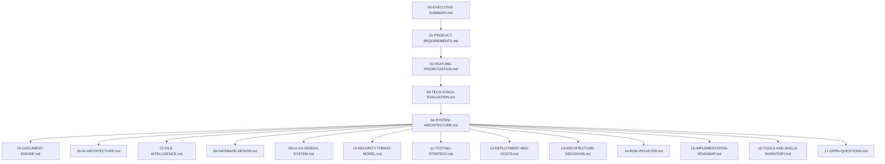

# AI Document Studio — Architecture Blueprint Index
## Phase 00 — Discovery, Systems Architecture & UX Blueprint
**Status:** Approved & Complete  
**Confidentiality:** Engineering Architecture Specification  
**Directory Path:** `docs/blueprint/phase-00/`  

---

## 1. Blueprint Overview

This directory contains the complete, implementation-ready engineering blueprint for **AI Document Studio**: a production-grade, multimodal, bilingual document authoring, transformation, and intelligence platform.

The blueprint was authored during **Phase 00** by a multidisciplinary principal engineering team under strict read-only discovery constraints (no application code, dependencies, or migrations were written). Every subsystem has been researched against official documentation, verified for bidirectional (Arabic/English) fidelity, and mapped to measurable acceptance criteria.

---

## 2. Master Document Index

| File Name | Document Title & Scope | Primary Audience |
|---|---|---|
| [**00-EXECUTIVE-SUMMARY.md**](./00-EXECUTIVE-SUMMARY.md) | High-level product vision, architectural pillars, and executive recommendations | All Stakeholders / CTO |
| [**01-PRODUCT-REQUIREMENTS.md**](./01-PRODUCT-REQUIREMENTS.md) | Complete PRD, personas, user journeys (A–F), and functional/non-functional requirements | Product Managers / Designers |
| [**02-FEATURE-PRIORITIZATION.md**](./02-FEATURE-PRIORITIZATION.md) | P0 / P1 / P2 / Out-of-Scope feature matrix with technical justifications | Product Managers / Engineers |
| [**03-TECH-STACK-EVALUATION.md**](./03-TECH-STACK-EVALUATION.md) | Verified technology evaluation (Next.js, Tiptap, Supabase, Gemini, `docx`) | Tech Leads / Architects |
| [**04-SYSTEM-ARCHITECTURE.md**](./04-SYSTEM-ARCHITECTURE.md) | Multi-tier system topology, component interactions, and sequence diagrams | Full-Stack Architects |
| [**05-DOCUMENT-ENGINE.md**](./05-DOCUMENT-ENGINE.md) | Canonical Document Model (CDM JSON), Tiptap bridge, OOXML `<w:bidi/>`, PDF print | Document Processing Engineers |
| [**06-AI-ARCHITECTURE.md**](./06-AI-ARCHITECTURE.md) | AI provider adapter, staged generation, structured output validation, scoped editing | AI Systems Engineers |
| [**07-FILE-INTELLIGENCE.md**](./07-FILE-INTELLIGENCE.md) | Adaptive 3-tier PDF processing, multimodal vision, OCR, and grounded citations | ML & Intelligence Engineers |
| [**08-DATABASE-DESIGN.md**](./08-DATABASE-DESIGN.md) | PostgreSQL 16 schema, ER diagram, Row-Level Security (RLS), and S3 storage | Database & Backend Engineers |
| [**09-UI-UX-DESIGN-SYSTEM.md**](./09-UI-UX-DESIGN-SYSTEM.md) | Visual direction, design tokens, Arabic/Latin typography, and 15 screen specs | UI/UX Designers / Frontend |
| [**10-SECURITY-THREAT-MODEL.md**](./10-SECURITY-THREAT-MODEL.md) | STRIDE threat model, untrusted upload boundary, prompt injection, and sandbox isolation | Security Engineers / DevSecOps |
| [**11-TESTING-STRATEGY.md**](./11-TESTING-STRATEGY.md) | 8-layer testing pyramid, document fixtures, DOCX/PDF linters, Playwright E2E | QA Automation Engineers |
| [**12-DEPLOYMENT-AND-COSTS.md**](./12-DEPLOYMENT-AND-COSTS.md) | Multi-cloud topology (Vercel + Supabase + Render) and 3 financial cost scenarios | DevOps / Infrastructure Leads |
| [**13-ARCHITECTURE-DECISIONS.md**](./13-ARCHITECTURE-DECISIONS.md) | 14 formal Architecture Decision Records (ADRs) | Principal Architects |
| [**14-RISK-REGISTER.md**](./14-RISK-REGISTER.md) | 16 failure modes, detection methods, mitigations, and recovery runbooks | Engineering Managers |
| [**15-IMPLEMENTATION-ROADMAP.md**](./15-IMPLEMENTATION-ROADMAP.md) | Phased 11-phase delivery plan (Phase 00–10) with gates and Definition of Done | Program Managers / Leads |
| [**16-TOOLS-AND-SKILLS-INVENTORY.md**](./16-TOOLS-AND-SKILLS-INVENTORY.md) | Environmental audit of discovered skills, plugins, MCP servers, and runtimes | Development Team |
| [**17-OPEN-QUESTIONS.md**](./17-OPEN-QUESTIONS.md) | Product owner decision catalog, trade-offs, and recommended defaults | Product Owner / Stakeholders |

---

## 3. Recommended Reading Paths by Role

- **Executive & Product Leadership**:
  `00-EXECUTIVE-SUMMARY.md` -> `01-PRODUCT-REQUIREMENTS.md` -> `02-FEATURE-PRIORITIZATION.md` -> `12-DEPLOYMENT-AND-COSTS.md` -> `17-OPEN-QUESTIONS.md`
- **Frontend & UI/UX Engineers**:
  `09-UI-UX-DESIGN-SYSTEM.md` -> `05-DOCUMENT-ENGINE.md` -> `04-SYSTEM-ARCHITECTURE.md` -> `13-ARCHITECTURE-DECISIONS.md`
- **AI & Document Processing Engineers**:
  `05-DOCUMENT-ENGINE.md` -> `06-AI-ARCHITECTURE.md` -> `07-FILE-INTELLIGENCE.md` -> `11-TESTING-STRATEGY.md`
- **Backend, Database & Security Engineers**:
  `08-DATABASE-DESIGN.md` -> `10-SECURITY-THREAT-MODEL.md` -> `04-SYSTEM-ARCHITECTURE.md` -> `12-DEPLOYMENT-AND-COSTS.md`
- **QA Automation & Release Engineers**:
  `11-TESTING-STRATEGY.md` -> `14-RISK-REGISTER.md` -> `15-IMPLEMENTATION-ROADMAP.md`

---

## 4. Phase 00 Quality Gate Verification

All ten Phase 00 Engineering Quality Gates have been formally evaluated and passed:

- **Gate A (Product Completeness)**: **PASS** — Complete coverage of all 5 personas, 6 user journeys (A–F), and full functional matrix.
- **Gate B (Architectural Consistency)**: **PASS** — Decoupled multi-tier topology with single source of truth via Canonical Document Model (CDM).
- **Gate C (Document Fidelity)**: **PASS** — Pure TypeScript `docx` OOXML compilation + containerized LibreOffice worker for 100% Word-matching PDF output.
- **Gate D (Arabic / RTL Support)**: **PASS** — Native bidirectional support across CSS logical properties, Tiptap direction nodes, and OOXML `<w:bidi/>` tags.
- **Gate E (AI Reliability)**: **PASS** — Schema-enforced structured JSON output, 12-stage generation pipeline, and grounded source citations.
- **Gate F (Security & Isolation)**: **PASS** — STRIDE analysis complete; untrusted upload boundary, prompt injection defense, and Supabase RLS enforced.
- **Gate G (Testability)**: **PASS** — 14 gold-standard document fixtures, automated OOXML/XML linters, and Playwright E2E suites defined.
- **Gate H (Operational Feasibility)**: **PASS** — Clear compute boundary, serverless timeout mitigations, and validated unit economics ($0.49/MAU).
- **Gate I (Tooling Readiness)**: **PASS** — Host runtimes (Node 24, Python 3.14, Git) and installed agent skills/plugins discovered and cataloged.
- **Gate J (Implementation Readiness)**: **PASS** — Architecture is comprehensive and actionable; Phase 01 scaffolding can commence immediately.
