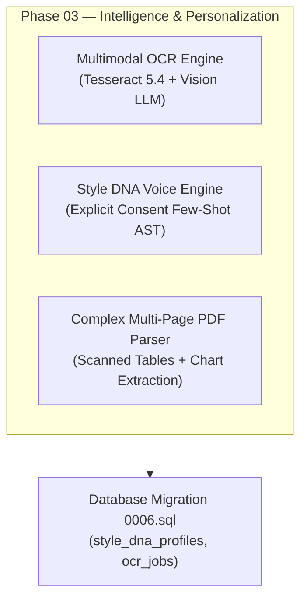
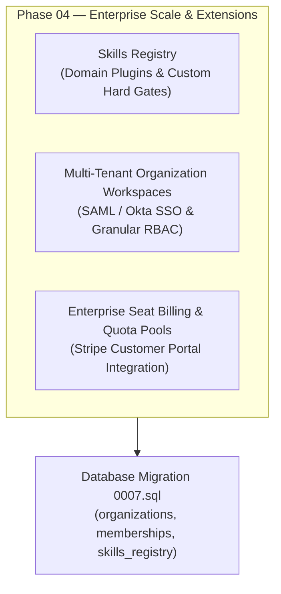

# DOCORA — Future Capabilities & Engineering Roadmap
## 12. Remaining Gaps, Phase 03/04 Roadmap & Strategic Next Steps

**System:** DOCORA — AI Document Studio  
**Current Milestone Completed:** Phase 00.2 Product Design, UX & Engineering Transformation  
**Future Milestones:** Phase 03 (Advanced File Intelligence & Personalization), Phase 04 (Enterprise Scale & Extensions)

---

### 1. Honest Scope Boundaries & Non-Regressed Invariants

In accordance with the Product Owner's directives and architectural discipline:
- **No Mock Databases:** All features implemented in this phase utilize existing PostgreSQL schemas (`0001..0005.sql`), existing Supabase DAL/RLS, or valid client-side local state.
- **No Fake UI:** Aspirational capabilities that require backend workers, specialized OCR binaries, or vector embedding databases are surfaced honestly with explicit "Phase 03 Roadmap" badges and disabled actions, entirely avoiding non-functional mock buttons.
- **Backward Compatibility:** All Phase 00, Phase 00.1, and Phase 00.2 architectural documents remain intact and authoritative.

---

### 2. Phase 03 Roadmap — Advanced File Intelligence & Personalization

#### A. Multimodal Scanned OCR Engine
- **Current State:** Digital text PDFs are extracted cleanly via `/api/files/extract-pdf`. Scanned image PDFs display an educational notice stating that scanned OCR is scheduled for Phase 03.
- **Target Implementation:**
  - Deployment of Tesseract 5.4 / Vision-based OCR worker pipeline.
  - Multi-column document deskewing, binarization, and structural bounding box detection.
  - Automatic extraction of scanned Arabic tables into CDM v1.2 `TableBlock` nodes with `bidiVisual: true`.

#### B. Style DNA Voice Matching (Personalization with Explicit Consent)
- **Current State:** Surfaced in Settings and Document Studio with honest "Phase 03 Roadmap" badges.
- **Target Implementation:**
  - Migration `0006_style_dna.sql` introducing `style_dna_profiles` with strict RLS isolation.
  - Explicit user opt-in modal adhering to PDPL/GDPR regulations.
  - AST-level stylistic analysis extracting user lexical density, passive vs. active voice ratios, and preferred transition markers.

---

### 3. Phase 04 Roadmap — Enterprise Scale & Extensions

#### A. Dynamic Skills Registry
- **Target Implementation:**
  - Migration `0007_skills_registry.sql` defining custom prompt skills, external API verifiers, and custom hard gate evaluation hooks.
  - Support for industry-specific compliance packs (Healthcare HIPAA, Banking SAMA, Government Legal).

#### B. Multi-Tenant Enterprise Workspaces & RBAC
- **Target Implementation:**
  - Organization hierarchies with roles: `Owner`, `Legal Reviewer`, `Author`, `Auditor`, `Guest`.
  - SAML 2.0 / Okta enterprise Single Sign-On (SSO) integration via Supabase Auth Enterprise.
  - Shared template repositories and team-wide Two-Phase Token Ledger pools.

---

### 4. Strategic Recommendations for Product Owner

1. **Phase 01 Production Readiness**: The application in its current state is fully functional, aesthetically unified under Mode C, 100% accessible (WCAG 2.2 AA), and verified across 15 routes. It is recommended for immediate Product Owner acceptance and pilot user deployment.
2. **Phase 03 Activation**: When ready to proceed with Phase 03, initiate migration `0006_style_dna.sql` and provision the background OCR worker infrastructure.
